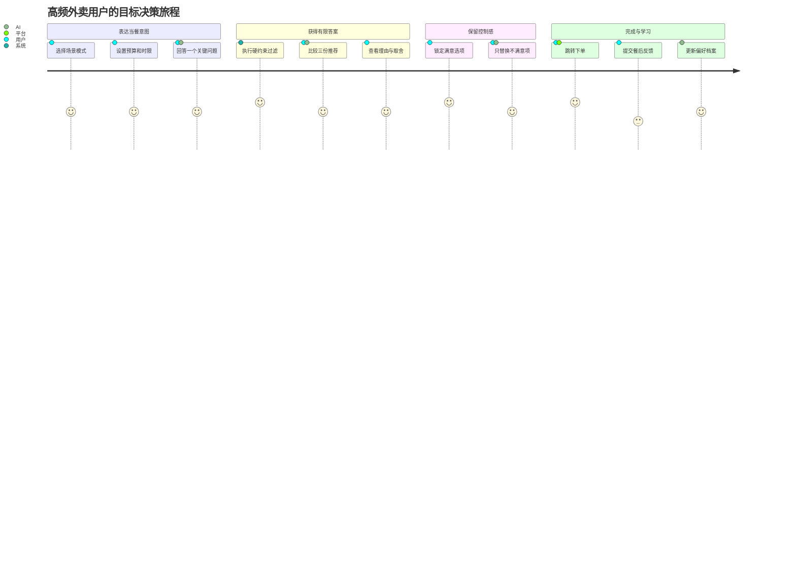
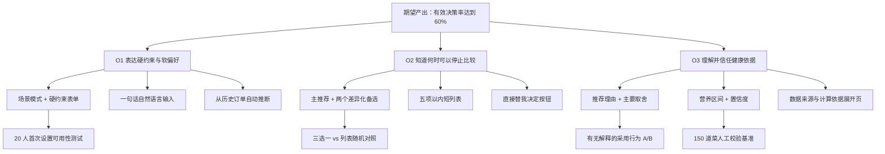

# 用户旅程与机会解决方案树

> 当前版本：研究前假设地图  
> 目标画像：高频外卖、当餐时间有限、同时受多项约束的年轻用户  
> 说明：情绪、重要性和满意度均为先验估计，不是调研结果

## 1. 当前旅程（AS-IS）

情绪使用 -2 到 +2：-2 表示强烈挫败，0 表示中性，+2 表示明显满意。

| 阶段 | 触点 | 用户行为 | 想法与疑问 | 情绪 | 主要痛点 | 机会 |
|---|---|---|---|---:|---|---|
| 饥饿触发 | 时间、课程、会议 | 判断是否点外卖 | “还有多久？今天能花多少钱？” | 0 | 约束存在脑中，尚未结构化 | 快速识别当餐情境 |
| 打开平台 | 外卖首页 | 看优惠、历史订单、推荐流 | “有什么既快又不太贵？” | 0 | 平台先展示供给，不先确认决策条件 | 把当餐目标前置 |
| 浏览搜索 | 搜索、类目、商家列表 | 滚动、筛选、切换关键词 | “这个看起来不错，还有没有更好的？” | -1 | 选项数量持续扩大，停不下来 | 主动压缩候选集 |
| 多项比较 | 商品页、购物车 | 在价格、时间、味道、健康间切换 | “健康的贵，好吃的又慢，怎么选？” | -2 | 信息散落、单位不同、需要工作记忆 | 统一表达硬约束与软偏好 |
| 结束选择 | 结算页 | 复购、随机选或放弃 | “算了，就这家吧。” | -1 | 选择常由疲劳结束，不代表满意 | 提供可解释的有限选择 |
| 下单履约 | 平台订单页 | 支付、等待、查看 ETA | “真的能按时到吗？” | 0 | 预计送达可能变化，跨应用会损失上下文 | 保持数据新鲜和跳转连续性 |
| 餐后评价 | 实际用餐、订单评价 | 判断味道、分量和后悔程度 | “下次还点吗？” | 0/+1 | 反馈很少反哺下一次多目标推荐 | 低成本学习真实偏好 |

## 2. 关键时刻

### 顿悟时刻

用户第一次看到三份推荐，并发现每份都满足预算和送达底线，同时清楚知道主推荐的理由和代价。

### 决定性时刻

用户是否愿意从三份中直接选择，而不是继续要求更多结果。这个行为比“觉得推荐不错”的口头评价更重要。

### 流失触发点

1. 首次设置条件比直接浏览平台更慢。
2. 推荐出现价格、配送或排除项错误。
3. 营养数字显得过度精确却没有来源。
4. 跳转平台后需要重新搜索同一道菜。
5. 推荐连续几次不符合口味且用户无法纠正。

## 3. 目标旅程（TO-BE）

目标不是让全程情绪都达到最高，而是消除比较阶段的明显低谷，并让用户在决定性时刻获得确定感。

## 4. 机会空间

### 4.1 机会陈述

| ID | 从用户视角描述的机会 | 重要性 I | 当前满意度 S | 先验机会分 I×(1-S) | 证据状态 |
|---|---|---:|---:|---:|---|
| O1 | 我很难同时表达哪些条件不能违反、哪些只是偏好 | 0.95 | 0.25 | 0.71 | [H] |
| O2 | 我很难知道什么时候已经看够，可以放心做决定 | 0.90 | 0.25 | 0.68 | [H] |
| O3 | 我希望理解健康推荐的依据，而不是只看到模糊标签 | 0.75 | 0.35 | 0.49 | [H] |
| O4 | 我想在熟悉与尝新之间找到风险可控的变化 | 0.65 | 0.45 | 0.36 | [H] |
| O5 | 我希望从推荐到下单不需要重复搜索和比较 | 0.80 | 0.40 | 0.48 | [H] |

说明：这些分数只用于展示研究前的排序逻辑。日记和访谈完成后，应使用用户重要度评分、现有方案满意度和行为频率重新计算。

### 4.2 优先机会

优先探索 O1、O2、O3。O1 决定推荐是否符合底线，O2 决定产品是否真正减少选择，O3 决定健康信息能否建立信任。O5 虽然重要，但依赖真实平台合作，应作为可行性验证并行推进。

## 5. 机会解决方案树（OST）

## 6. 每个优先机会的方案比较

### O1：表达硬约束与软偏好

| 方案 | 来源视角 | 价值 | 主要风险 | 当前决策 |
|---|---|---|---|---|
| 场景模式 + 硬约束表单 | 产品 | 输入结构清晰、易验证、可保证安全 | 输入仍可能显得麻烦 | V0.9 采用 |
| 一句话自然语言输入 | 设计 | 表达自然、首次体验短 | 解析错误可能违反底线 | 后续作为辅助入口 |
| 从历史订单自动推断 | 工程 | 长期输入最少 | 数据授权和错误推断风险高 | 数据合作后再做 |

**实验**：20 人完成首次设置，完成率≥85%、中位时长≤30 秒；要求参与者复述哪些是“不能违反”的条件，正确率≥90%。

### O2：知道何时可以停止比较

| 方案 | 来源视角 | 价值 | 主要风险 | 当前决策 |
|---|---|---|---|---|
| 主推荐 + 两个差异化备选 | 产品 | 同时提供决定和控制感 | 三个是否仍然过多或过少 | V0.9 采用 |
| 五项以内短列表 | 设计 | 保留更多探索空间 | 可能继续触发比较循环 | 对照组方案 |
| “直接替我决定”单选项 | 工程 | 决策最快、逻辑简单 | 自主感和容错过低 | 作为高时间压力模式实验 |

**实验**：40 人随机进入三选一或平台列表模拟，三选一组中位决策时长降低≥30%，完成率不下降超过 5 个百分点。

### O3：理解并信任健康依据

| 方案 | 来源视角 | 价值 | 主要风险 | 当前决策 |
|---|---|---|---|---|
| 推荐理由 + 主要取舍 | 产品 | 同时说明收益和代价 | 文字过多拖慢决策 | V0.9 采用 |
| 营养区间 + 置信度 | 设计 | 避免虚假精确，表达不确定性 | 用户可能不理解置信度 | V0.9 采用 |
| 数据来源与算法依据页 | 工程 | 对高关注用户提供审查能力 | 大多数用户不会打开 | P1 详情能力 |

**实验**：解释组相对无解释组的首选保留率提升≥15 个百分点；5 秒理解测试中≥80%参与者能指出推荐原因和主要取舍。

## 7. 优先改进项

### 立即验证

1. 首次输入是否比直接浏览更省力。
2. 三选一是否真的终止比较，而不是把比较移到新界面。
3. 理由和取舍是否能在 5 秒内被理解。

### 高投入、高回报

1. 授权实时菜单、价格、库存和配送数据。
2. 可审计的营养估算与置信度模型。
3. 推荐到平台下单的稳定深链与归因。

### 暂缓

- 周度饮食报告、社交分享、多人拼单和订阅付费。
- 在没有复访证据前，不用这些功能制造留存表象。
