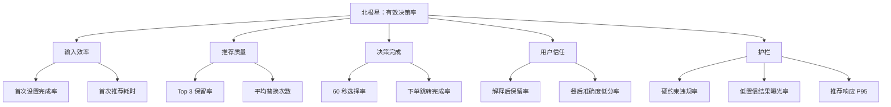

# 产品指标看板与实验方案

> 当前状态：指标规格已定义，尚无真实用户数据  
> 所有目标值均为 [T] 验证阈值，不是当前表现  
> 原则：只追踪能改变产品决策的指标，不把访问量等虚荣数据作为成功证明

## 1. 北极星指标

### 有效决策率（Effective Decision Rate, EDR）

```text
分子：展示推荐后 60 秒内选择其中一项并进入下单，且该项没有违反硬约束的有效会话数
分母：成功展示至少一项推荐的独立会话数
时间窗口：日 / 周
去重键：anonymous_user_id + session_id
目标：原型测试阶段 ≥60%
```

选择该指标的原因：它同时要求产品提供合适答案、用户完成决定、决策足够快并且没有突破底线，比点击率或推荐曝光量更接近产品核心价值。

### 不能单独作为北极星的指标

- 页面访问量：无法证明用户解决了点餐问题。
- 推荐点击率：可能来自好奇或误触，不代表完成决策。
- 平均停留时长：在本产品中停留更久可能意味着更纠结。
- 推荐数量：更多结果与“压缩选择”的价值方向相反。

## 2. 指标树



## 3. 看板指标规格

### 3.1 北极星与输入指标

| 指标 | 精确定义 | 数据来源 | 可视化 | 目标值 | 告警阈值 |
|---|---|---|---|---:|---:|
| 有效决策率 | 有效 `order_handoff` 会话 / `recommendations_shown` 会话 | 事件日志 | 周趋势折线 | ≥60% | 连续两周<50% |
| 首次设置完成率 | 首次进入后触发 `recommendation_requested` 用户 / `session_viewed` 用户 | 事件日志 | 漏斗 | ≥85% | <75% |
| 首次设置中位耗时 | 首次 `session_viewed` 到 `recommendation_requested` 的中位秒数 | 事件时间戳 | 分布/中位数 | ≤30 秒 | >45 秒 |
| Top 3 保留率 | 展示结果中至少一个未被替换并被选择的会话 / 推荐会话 | 展示、替换、跳转事件 | 周趋势折线 | ≥70% | <60% |
| 平均替换次数 | `recommendation_replaced` 数 / 推荐会话 | 事件日志 | 分布图 | ≤1.5 | >2.5 |
| 下单跳转完成率 | `order_handoff` 会话 / 打开下单弹窗会话 | 事件日志 | 漏斗 | ≥80% | <70% |
| D7 复访率 | 首次有效决策用户中，第 7 天再次请求推荐的比例 | 用户/会话事件 | 同期群 | ≥25% | <15% |

### 3.2 健康与安全护栏

| 指标 | 精确定义 | 数据来源 | 可视化 | 目标值 | 告警阈值 |
|---|---|---|---|---:|---:|
| 硬约束违规率 | 违反预算、时限或排除项的曝光结果 / 全部曝光结果 | 推荐日志与校验器 | 数字+趋势 | 0 | >0 立即阻断 |
| 低置信营养曝光率 | 低置信且展示营养数字的结果 / 全部营养结果 | 推荐输出 | 周趋势 | 0 | >0 立即检查 |
| 低准确度反馈率 | 推荐准确度评分≤2 的反馈 / 全部反馈 | 餐后反馈 | 周趋势 | <15% | >25% |
| 下单后悔率 | 餐后后悔评分≥4 的订单 / 有反馈订单 | 日记/反馈 | 周趋势 | <15% | >25% |
| 推荐响应 P95 | 请求到结果完成的第 95 百分位时长 | 性能日志 | 时序图 | ≤3 秒 | >5 秒 |
| 数据过期率 | 超过定义新鲜度仍参与排序的菜品 / 排序菜品 | 数据管道 | 数字+趋势 | <1% | >3% |

### 3.3 商业指标

| 指标 | 精确定义 | 数据来源 | 可视化 | 目标值 | 告警阈值 |
|---|---|---|---|---:|---:|
| 归因下单转化 | 可归因完成订单 / 有效跳转 | 平台回传 | 漏斗 | 待合作基线 | 连续下降20% |
| 单活跃用户贡献 | CPS收入 - 推理成本 - 可变数据成本 - 获客成本 | 财务/平台/模型 | 月趋势 | >0 | <0 |
| 单次推荐成本 | 数据查询+模型推理成本 / 推荐请求 | 服务日志 | 分布/趋势 | ≤0.05元 | >0.08元 |
| 渠道激活率 | 完成首次推荐用户 / 渠道落地访问用户 | 渠道与事件 | 渠道柱状图 | ≥20% | <10% |
| 商业推荐信任损失 | 商业标识组相对非商业组的保留率下降 | A/B实验 | 对比柱状图 | <10% | ≥15% |

## 4. 漏斗定义


每一层都使用独立会话计算，不将重复点击膨胀为转化。

## 5. 看板布局

```text
┌──────────────────────────────────────────────────┐
│ 北极星：有效决策率        当前：暂无真实数据      │
│ 目标：≥60%                趋势：验证后生成         │
├──────────────────────┬───────────────────────────┤
│ 输入效率             │ 推荐质量                  │
│ 设置完成率 / 中位耗时 │ Top 3保留 / 平均替换       │
├──────────────────────┼───────────────────────────┤
│ 决策完成             │ 用户信任                  │
│ 60秒选择 / 跳转完成   │ 解释采用 / 低准确度反馈     │
├──────────────────────┴───────────────────────────┤
│ 护栏：约束违规 | 低置信曝光 | P95 | 数据过期       │
├──────────────────────────────────────────────────┤
│ 商业：归因转化 | 单用户贡献 | 推荐成本 | 渠道激活    │
└──────────────────────────────────────────────────┘
```

原型阶段可使用导出的本地 JSON 加电子表格分析；进入受控 MVP 后建议使用 PostHog 或 Mixpanel，服务性能使用 Grafana 类工具。

## 6. 假设优先级

优先分沿用 `I × (1-C) × W`：影响力 × 不确定性 × 错误后暴露成本。分数是研究前先验，不是客观事实。

| 排名 | ID | 假设 | 分数 | 象限 |
|---:|---|---|---:|---|
| 1 | F1 | 能合法稳定获得实时外卖数据 | 22.5 | 高影响/高风险 |
| 2 | F2 | AI 能在不完整数据下准确过滤和排序 | 20.0 | 高影响/高风险 |
| 3 | B1 | CPS 能覆盖推理、数据与获客成本 | 18.0 | 高影响/高风险 |
| 4 | V1 | 选择困难足够频繁且严重 | 17.5 | 高影响/高风险 |
| 5 | V2 | 三选一显著加快决策 | 17.5 | 高影响/高风险 |
| 6 | U3 | 跨平台跳转不会中断决策 | 15.0 | 高影响/高风险 |
| 7 | B2 | 能低成本获客并形成复访 | 12.8 | 高影响/高风险 |
| 8 | V3 | 推荐解释会影响真实选择 | 12.0 | 高影响/高风险 |
| 9 | U1 | 用户能在 30 秒内完成设置 | 9.6 | 高影响/较低风险 |
| 10 | U2 | 用户能迅速理解理由和取舍 | 9.6 | 高影响/较低风险 |
| 11 | B3 | 商业推荐标识不会破坏信任 | 6.3 | 较低影响/较低风险 |
| 12 | F3 | 延迟和成本适合高频消费产品 | 5.4 | 较低影响/较低风险 |

## 7. 实验卡

### E1 数据可行性技术验证（F1）

- **假设**：存在至少一个合法、稳定的数据来源，可以支持菜单、价格、库存、ETA 和下单跳转。
- **方法**：仅评估官方或书面授权路径；用 100 家商户样本测试字段覆盖、新鲜度和深链。
- **行为/系统指标**：关键字段完整率、更新延迟、深链成功率。
- **成功阈值**：完整率≥90%，更新≤10分钟，深链成功≥95% [T]。
- **失败动作**：停止独立小程序方案，改为外卖平台内功能概念；不以抓取方式绕过授权。

### E2 7 天行为日记（V1）

- **假设**：目标用户每周至少 3 次出现明显选择困难。
- **方法**：20 人记录全部外卖决策，使用时间戳、截图和行为字段，而非只做态度问卷。
- **成功阈值**：≥60%参与者一周内至少 3 次决策超过 3 分钟或出现其他困难行为 [T]。
- **失败动作**：重新聚焦更具体场景，如工作日午餐或预算确定性；若仍低频则停止项目。

### E3 三选一随机对照（V2）

- **假设**：主推荐+两个备选比平台列表更快，且不会降低完成和满意度。
- **方法**：40 人随机进入三选一组或列表组，完成同一组点餐任务。
- **成功阈值**：中位决策时长下降≥30%，任务完成率下降≤5个百分点，满意度不下降 [T]。
- **失败动作**：测试单选项、五项短列表或按场景动态决定结果数量。

### E4 首次设置可用性（U1/U2）

- **假设**：用户能快速区分底线和偏好，并理解动态问题。
- **方法**：20 人首次使用，记录耗时、错误、回退和复述结果。
- **成功阈值**：完成率≥85%，中位≤30秒，硬/软条件复述正确率≥90% [T]。
- **失败动作**：减少模式数量，默认常用值，把高级权重移出主流程。

### E5 解释行为 A/B（V3）

- **假设**：同时展示理由和取舍会提高采用，而不是增加负担。
- **方法**：有解释与无解释两组比较首选保留、替换和决策时间。
- **成功阈值**：解释组首选保留率提升≥15个百分点，决策时间增加≤10秒 [T]。
- **失败动作**：缩短解释、仅保留取舍标签，或按需展开。

### E6 营养与排序基准（F2）

- **假设**：估算系统可在不完整菜单中保持安全和可用准确度。
- **方法**：150 道菜人工基准；覆盖预算、时限、排除项边界和营养区间。
- **成功阈值**：硬约束 0 违规；高置信营养区间覆盖≥80%；Top 3 命中≥70% [T]。
- **失败动作**：减少支持菜类、扩大区间、降低健康权重或只使用商家明确标注数据。

### E7 跳转漏斗测试（U3）

- **假设**：从小程序到外卖平台的跳转不会抵消节省的时间。
- **方法**：30 人完成从推荐到模拟下单的整条任务。
- **成功阈值**：跳转放弃≤20%，下单任务完成≥80% [T]。
- **失败动作**：验证平台内嵌形态，或通过授权深链直接定位商品。

### E8 渠道与单位经济（B1/B2）

- **假设**：校园、职场社群和内容渠道可低成本获得复访用户，CPS 可覆盖成本。
- **方法**：三个渠道各一次落地页烟雾测试，并用实测激活、跳转和保守佣金建模。
- **成功阈值**：访问到首次推荐≥20%，D7≥25%，单活跃用户贡献>0 [T]。
- **失败动作**：先验证 B2B2C 场景、平台合作或雇主健康福利，不用补贴制造虚假增长。

## 8. 评审节奏与告警

- **每日**：硬约束违规、数据过期、推荐失败和 P95 延迟；任何硬约束违规立即停止相关版本。
- **每周**：漏斗、替换、解释、低分反馈和实验分组；由产品、设计和工程共同回看会话。
- **每月**：北极星、D7、渠道、成本与商业假设；决定继续、调整或停止。
- **每季度**：重新评估北极星是否仍代表价值，并更新 OST 和假设分数。

告警必须关联行动人和时限：安全/约束问题 2 小时内响应，数据/性能问题 1 个工作日内，增长与留存问题进入周评审。
