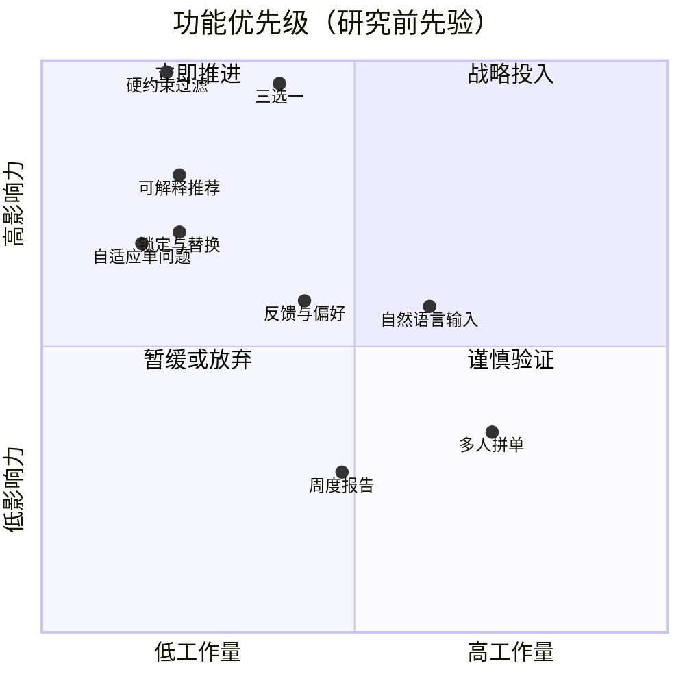
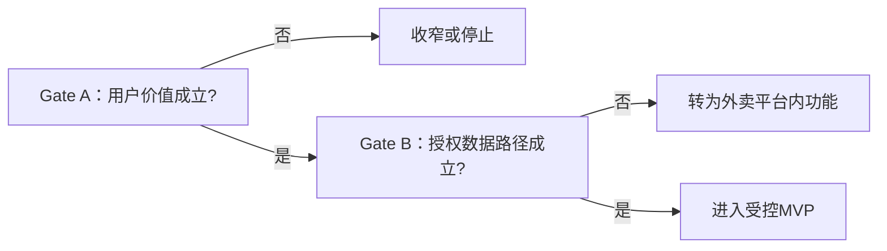

# 功能优先级｜ICE 为主，RICE 为校验

> 优先目标：提升“60秒内完成合规决策”的概率  
> 评分状态：研究前先验，用于解释取舍，不代表真实用户价值  
> 当前阶段判断：没有稳定流量和真实 Reach，因此 ICE 比 RICE 更适合作为主框架

## 1. 框架选择

### 为什么主用 ICE

早期原型最缺的是证据，而不是触达量预测。ICE 可以快速比较影响力、置信度和实现难度，适合当前的概念验证。

```text
ICE = Impact × Confidence × Ease
```

- Impact：对有效决策率的潜在影响，1–10。
- Confidence：当前证据置信度，1–10；没有用户数据时主动降低。
- Ease：在原型阶段实现和验证的容易度，1–10。

### 为什么不直接以 RICE 定案

RICE需要可靠的覆盖人数和人月估算。当前没有上线流量，直接填入用户数会制造精确幻觉。因此本文仅用“每100次目标会话的相对覆盖”和原型人周做敏感性校验。

## 2. ICE 功能排序

| 排名 | 功能/能力 | I | C | E | ICE | 决策 |
|---:|---|---:|---:|---:|---:|---|
| 1 | 预算、时限、排除项硬过滤 | 10 | 7 | 8 | 560 | P0，必须有 |
| 2 | 主推荐+两个差异化备选 | 10 | 5 | 7 | 350 | P0，核心价值 |
| 3 | 推荐理由、取舍与置信度 | 8 | 5 | 8 | 320 | P0，信任基础 |
| 4 | 锁定、单项替换与换一批 | 7 | 5 | 8 | 280 | P0，保留控制感 |
| 5 | 场景模式与自适应单问题 | 7 | 4 | 8 | 224 | P0，降低输入成本 |
| 6 | 餐后反馈与轻量偏好记忆 | 6 | 3 | 6 | 108 | P1，验证复访机制 |
| 7 | 一句话自然语言输入 | 6 | 2 | 4 | 48 | P2，先证明表单不足 |
| 8 | 周度饮食与预算报告 | 3 | 2 | 5 | 30 | 暂缓，尚无留存证据 |
| 9 | 多人拼单与共同决策 | 4 | 2 | 3 | 24 | 不在首批JTBD范围 |
| Gate | 实时平台数据与深链 | 10 | 1 | 1 | 10 | 生存门槛，不能按普通功能延后 |

## 3. RICE 敏感性校验

以下 Reach 以“每100次目标会话可能触达多少次”表示，不是实际流量；Effort 为原型相对人周。

```text
RICE = Reach × Impact × Confidence / Effort
```

| 功能 | Reach | Impact | Confidence | Effort | RICE |
|---|---:|---:|---:|---:|---:|
| 硬约束过滤 | 100 | 3.0 | 70% | 1.0 | 210.0 |
| 三选一 | 100 | 3.0 | 50% | 1.5 | 100.0 |
| 可解释推荐 | 100 | 2.0 | 50% | 1.0 | 100.0 |
| 自适应单问题 | 100 | 1.0 | 40% | 0.75 | 53.3 |
| 锁定与替换 | 75 | 1.0 | 50% | 1.0 | 37.5 |

RICE没有推翻前五项范围，只调整了“自适应问题”和“锁定替换”的相对顺序。由于锁定直接保护控制感，仍将两者都保留在首版，而不是对小分差做伪精确决策。

## 4. 影响力×工作量视图



## 5. 入选前五项的关键权衡

1. **硬约束过滤**：不具备它就无法兑现安全承诺，也无法计算有效决策率。
2. **三选一**：直接测试“决策压缩”是否成立，是首版最核心的可证伪功能。
3. **解释与置信度**：没有解释就难以判断用户拒绝的是结果还是不信任系统。
4. **锁定与替换**：防止三选一变成强迫选择，为错误推荐提供恢复路径。
5. **场景与单问题**：避免为了个性化要求用户填写长问卷。

## 6. 未入选内容

- **自然语言输入**：展示AI感更强，但会引入解析错误；先验证结构化输入是否已经足够。
- **周度报告**：只有出现稳定复访后才有意义，不能用报告制造伪留存。
- **多人拼单**：涉及新的决策主体与JTBD，会显著扩大范围。
- **订阅付费**：当前连核心价值都未验证，不应先优化付费墙。

## 7. Gate 0：为什么数据接入不能被低分延后

实时菜单和下单深链因为置信度低、工作量高，在ICE中得分很低，但它决定独立小程序是否能存在。因此它应作为与用户价值并行的生存门槛：



这也是本项目没有机械服从评分公式的原因：框架帮助讨论，但不能替代产品判断。
