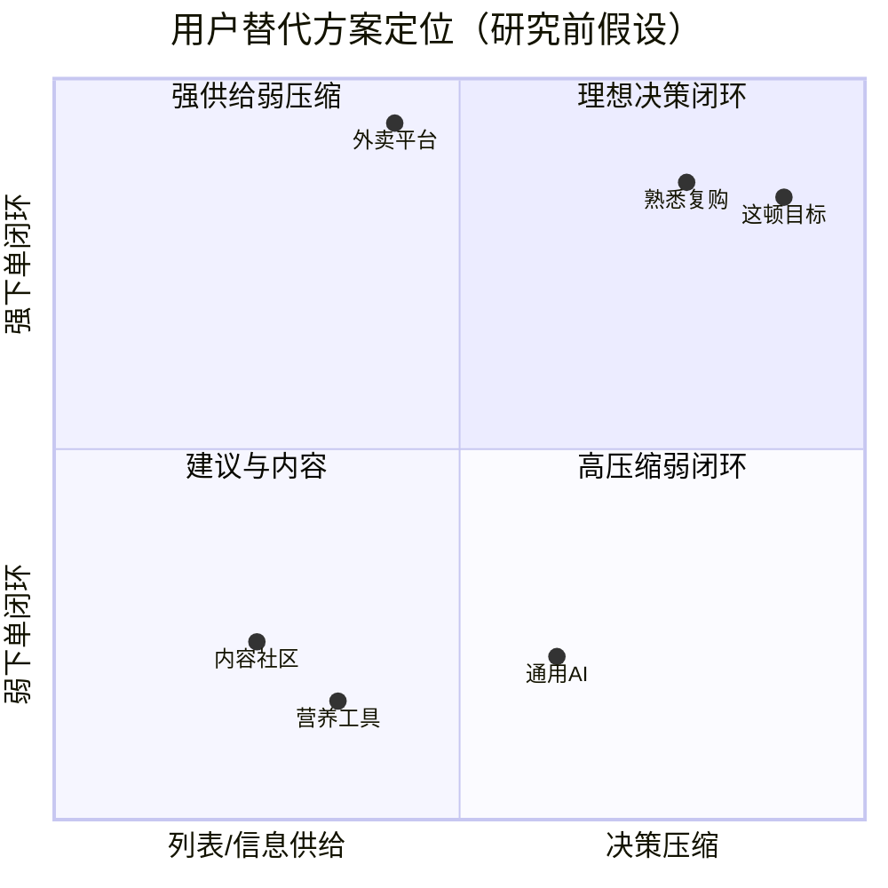

# 竞品与替代方案对比

> 分析范围：年轻用户完成“一次外卖决定”时采用的现有方案  
> 证据边界：本页是基于稳定核心能力的产品案头假设，不包含未经核验的市场份额、定价和最新版本功能  
> 面试前动作：对具体品牌页面补充截图、日期与来源

## 1. 为什么不只找“直接竞品”

目前没有证据证明“独立AI外卖三选一助手”已经形成稳定品类。对早期产品，更重要的问题是：**用户今天用什么办法完成这项工作，为什么愿意或不愿意切换？**

因此本文比较五类替代方案，而不是为了凑数量把相邻产品都称为直接竞品。

## 2. 竞争市场界定

- **需要完成的工作**：在预算、时间、口味和健康冲突时快速决定并完成外卖下单。
- **首要用户**：每周外卖≥3次，比较过程经常超过3分钟的年轻用户 [H]。
- **关键成功因素**：实时数据、约束正确性、决策压缩、用户信任和下单闭环。
- **竞争强度判断**：供给和订单闭环被大型平台掌握，独立工具的数据议价能力弱；平台复制风险高。

## 3. 五类替代方案

### A. 外卖平台列表（代表：美团外卖、饿了么）

**优势**：实时供给、价格优惠、配送和支付闭环是最强基础能力；用户习惯已经形成。  
**缺口假设**：主要交互仍围绕列表、搜索和筛选，跨多个目标的最终取舍由用户完成。  
**对「这顿」的威胁**：平台可以用现有数据和流量快速复制三选一功能。  
**策略**：不与平台争供给和履约，优先验证为平台内决策层的可能性。

### B. 熟悉复购与收藏

**优势**：几乎没有学习和比较成本，历史体验提供信任。  
**缺口假设**：变化少，不能适应当天预算、时间和健康目标的变化。  
**威胁**：如果多数用户认为重复点单已经足够，独立产品没有成立必要。  
**策略**：推荐不应强迫尝新，而应提供“熟悉附近的小变化”。

### C. 内容与口碑社区（代表：大众点评、小红书、短视频内容）

**优势**：真实体验、图片和社交证明有助于发现新选择。  
**缺口假设**：内容丰富但决策链路长，价格、配送和库存未必与当前时刻一致。  
**威胁**：内容信任高于算法解释。  
**策略**：不做内容社区；未来只考虑将可靠口碑作为排序特征。

### D. 通用 AI 助手（代表：主流对话式 AI）

**优势**：自然语言输入灵活，可以理解模糊意图并给出理由。  
**缺口假设**：若没有实时菜单、到手价和ETA，就不能稳定完成下单决策。  
**威胁**：一旦通用AI获得外卖插件或平台数据，独立入口价值会下降。  
**策略**：差异化不放在聊天界面，而放在可验证的决策协议、实时数据和反馈闭环。

### E. 营养与饮食记录工具（代表：薄荷健康、Keep类能力）

**优势**：健康知识、营养数据库和长期目标管理更专业。  
**缺口假设**：通常不负责当前外卖供给、配送时限和订单闭环。  
**威胁**：在健康准确度上明显强于个人原型。  
**策略**：不竞争医疗和专业营养；只提供当餐决策所需的区间、置信度和取舍。

## 4. 能力对比

“高/中/低”是当前产品定位假设，需在面试前用带日期截图复核具体品牌。

| 方案 | 实时供给/ETA | 决策压缩 | 多目标权衡 | 健康透明 | 下单闭环 | 认知负担 |
|---|---|---|---|---|---|---|
| 外卖平台列表 | 高 | 中 | 中 | 低/中 | 高 | 高 |
| 熟悉复购 | 中/高 | 高 | 低 | 低 | 高 | 低 |
| 内容与口碑社区 | 低 | 低 | 低 | 低 | 低/中 | 高 |
| 通用AI助手 | 低 | 中/高 | 中/高 | 不稳定 | 低 | 中 |
| 营养工具 | 低 | 低 | 中 | 高 | 低 | 中 |
| 「这顿」目标状态 | 高* | 高 | 高 | 中/高* | 高* | 低 |

`*` 依赖授权数据、营养基准和下单深链，当前原型尚未实现真实能力。

## 5. 定位图

## 6. 差异化机会

1. **把硬约束和软偏好分开**：不让生成模型覆盖用户底线。
2. **主动限制答案数量**：以终止比较为目标，而不是增加发现效率。
3. **展示取舍而非只说优点**：帮助用户理解为什么没有“完美选择”。
4. **用置信度管理健康信息**：承认数据不确定性，不制造精确幻觉。
5. **把反馈变成决策策略**：学习“何时愿意为健康、速度或味道妥协”。

## 7. 竞争风险

- **最高威胁**：外卖平台复制核心交互并使用更完整的数据。
- **结构性弱点**：独立小程序的数据和流量都依赖平台。
- **当前没有护城河**：三选一界面、多目标公式和解释文案都容易复制。
- **可能形成的能力**：真实行为数据形成的决策策略、可审计营养置信度体系和平台合作关系，但这些都尚未建立。

## 8. 推荐竞争定位

不把「这顿」定位为新的外卖平台，也不承诺比营养工具更专业。推荐定位是：

> 面向高频外卖场景的“决策压缩层”，连接用户当餐意图与平台真实供给；对用户提供有限答案，对平台提供更高效的决策入口。
