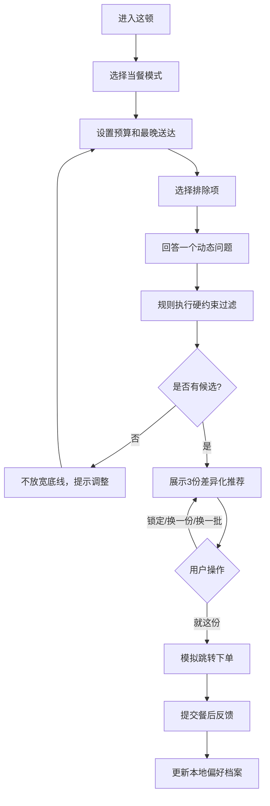

# 「这顿」Demo 演示说明

> 当前状态：本地可运行，不是公网链接  
> 入口文件：`../index.html`，可直接双击打开  
> 数据说明：30道模拟菜单，不连接真实外卖平台

## 1. 启动方式

直接双击 `index.html` 即可运行；页面使用本地浏览器兼容 bundle，不再依赖本地服务器。
如果浏览器禁止本地页面写入偏好或埋点，推荐、筛选和模拟下单仍会正常运行；这些数据只不会跨刷新保留。

开发时如果修改了 `src/menu-data.js`、`src/recommender.js` 或 `src/app.js`，先在项目目录 `01-ai-takeout-decider` 中执行：

```powershell
npm run build:local
```

如需通过本地服务器调试，也可以执行：

```powershell
npm run start
```

再在浏览器打开 <http://localhost:4173/>。如果 4173 端口被占用，可更换端口，并同步修改访问地址。

**不要把 localhost 地址放在公开简历中。** 它只能在当前电脑运行。简历需要公网链接时，应部署到 GitHub Pages、Cloudflare Pages 或其他静态托管服务，并完成手机与无痕窗口复测。

## 2. 核心用户流程



## 3. 两分钟面试演示脚本

### 0:00–0:20｜建立任务

> 假设我还有25分钟开会，午餐预算25元，而且今天不吃辣。我不是想查看更多推荐，而是想尽快完成一个不越界的决定。

### 0:20–0:45｜表达约束

1. 选择“赶时间”。
2. 将预算调整为25元。
3. 选择最晚25分钟送达。
4. 勾选“辣”。
5. 回答“速度和口味冲突时先保哪一个”。

说明：预算、时限和排除项是硬约束；模式与动态问题只改变软偏好。

### 0:45–1:15｜解释三选一

点击“让AI帮我定”，说明三个位置：

- 最合你意：综合得分最高。
- 时间更稳：在高分候选中提高速度权重。
- 营养更优：在剩余候选中提高健康权重。

展开其中一项，展示理由、主要取舍、四项分数、营养区间和置信度。

### 1:15–1:40｜展示控制和恢复

1. 锁定一份满意推荐。
2. 对另一份执行“只换这份”。
3. 点击“换一批”，说明锁定项不会被替换。

### 1:40–2:00｜完成与学习

点击“就这份”，明确这是模拟跳转，不会创建真实订单；提交味道、分量和推荐准确度反馈，再打开偏好档案查看本地指标。

## 4. 必演状态

| 状态 | 展示目的 | 对应能力 |
|---|---|---|
| 正常三选一 | 核心价值 | 多目标排序与结果压缩 |
| 推荐解释展开 | AI可信度 | 理由、取舍和置信度 |
| 锁定与单项替换 | 用户控制感 | 状态管理与错误恢复 |
| 无候选 | 安全边界 | 不自动突破硬约束 |
| 模拟下单与反馈 | 闭环 | 埋点、学习和指标设计 |

## 5. 当前Demo与产品文档一致性

| 文档要求 | 当前实现 |
|---|---|
| 5种当餐模式 | 已实现 [F] |
| 预算18–60元 | 已实现 [F] |
| 最晚25/40/55分钟 | 已实现 [F] |
| 6类排除项 | 已实现 [F] |
| 健康/味道/价格/速度权重 | 已实现 [F] |
| 三份差异化结果 | 已实现 [F] |
| 理由、取舍、营养区间、置信度 | 已实现 [F] |
| 锁定、换一份、换一批 | 已实现 [F] |
| 模拟下单和餐后反馈 | 已实现 [F] |
| 19类本地事件与JSON导出 | 已实现 [F] |
| 真实平台数据与真实订单 | 未实现，明确不在原型范围 |

## 6. 演示前检查

- 在手机宽度和桌面宽度各打开一次。
- 确认图片加载失败时仍能看到菜系降级块。
- 清除不需要展示的本地偏好，或提前说明历史数据来源。
- 准备一条正常流程和一条无候选流程。
- 关闭无关标签页、通知和浏览器扩展。
- 不把模拟数据说成实时平台数据。
- 准备离线备用：录制不超过90秒的视频或保存关键页面截图。

## 7. 公网发布缺口

当前Demo可用于在本人电脑现场演示，但还不能作为简历中的公开链接。正式投递前需要：

1. 选择静态托管服务并获得发布权限。
2. 使用稳定的公开URL，不带本机目录和临时端口。
3. 在无痕窗口验证首页、推荐、弹窗和反馈。
4. 在手机4G/5G环境测试图片降级和首次加载。
5. 在公开页面明显标注“作品集原型、模拟数据、不会真实下单”。
