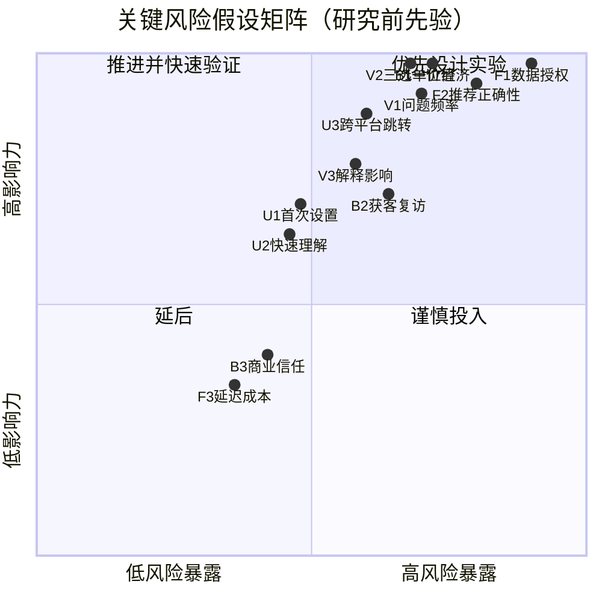

# 关键风险假设与影响力×风险矩阵

> 排序公式：`优先分 = 影响力 I × 风险暴露 ((1-C)×W)`  
> C 为当前置信度，W 为假设错误后的投入暴露  
> 所有分数为研究前先验，不是实验结果

## 1. 风险列表

| 排名 | ID | 类别 | 关键假设 | 影响力 | 风险暴露 | 优先分 |
|---:|---|---|---|---:|---:|---:|
| 1 | F1 | 可行性 | 能合法稳定获得实时菜单、价格、库存、ETA和跳转数据 | 5 | 4.5 | 22.5 |
| 2 | F2 | 可行性 | 系统能在不完整数据下正确过滤和排序 | 5 | 4.0 | 20.0 |
| 3 | B1 | 商业 | CPS收入能覆盖数据、推理和获客成本 | 5 | 3.6 | 18.0 |
| 4 | V1 | 价值 | 选择困难足够频繁、严重，值得独立解决 | 5 | 3.5 | 17.5 |
| 5 | V2 | 价值 | 三选一能加快决策且不降低满意度 | 5 | 3.5 | 17.5 |
| 6 | U3 | 可用性 | 小程序到外卖平台的跳转不会中断决策 | 5 | 3.0 | 15.0 |
| 7 | B2 | 商业 | 能低成本获得用户并形成复访 | 4 | 3.2 | 12.8 |
| 8 | V3 | 价值 | 理由、取舍和营养信息会影响真实选择 | 4 | 3.0 | 12.0 |
| 9 | U1 | 可用性 | 用户能在30秒内完成首次设置 | 4 | 2.4 | 9.6 |
| 10 | U2 | 可用性 | 用户能快速理解推荐原因与牺牲项 | 4 | 2.4 | 9.6 |
| 11 | B3 | 商业 | 商业推荐标识不会明显损害信任 | 3 | 2.1 | 6.3 |
| 12 | F3 | 可行性 | 延迟和成本适合高频消费产品 | 3 | 1.8 | 5.4 |

## 2. 2×2矩阵

Mermaid坐标已将影响力和风险暴露归一化到0–1。

## 3. 先验证什么

### 第一并行Gate

1. **V1 问题价值**：20人7天日记，≥60%参与者每周至少3次明显选择困难 [T]。
2. **F1 数据可行性**：授权来源覆盖100家店，关键字段≥90%、深链成功≥95% [T]。

任一失败都不进入完整MVP：V1失败则收窄或停止；F1失败则转平台内功能。

### 第二阶段

1. **V2**：40人三选一 vs 列表对照，中位决策时长下降≥30% [T]。
2. **U1/U2**：首次设置完成≥85%、中位≤30秒，理由与取舍理解≥80% [T]。

### 第三阶段

1. **F2**：150道菜基准，硬约束0违规，高置信营养区间覆盖≥80% [T]。
2. **V3/U3**：解释A/B与完整跳转任务。

### 最后验证

B1、B2和B3只有在核心价值与数据路径成立后才值得投入；否则商业实验只是在优化一个不存在的产品。

## 4. 面试表达

> 我没有把“模型能不能做”当作最高风险。对这个产品，最先可能失败的是用户根本没有高频痛点，以及独立小程序拿不到授权数据。因此我把价值和数据作为并行Gate，而不是继续堆AI功能。
