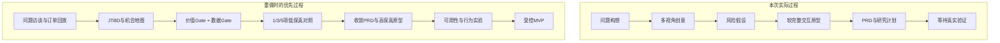

# 产品反思｜如果重做一次「这顿」

> 反思对象：从问题构想到可运行原型和完整产品文档的全过程  
> 当前事实：原型与文档已完成，真实研究、平台数据与商业验证尚未执行

## 1. 最强点

### 1.1 把问题从“推荐什么”改写为“如何结束取舍”

项目最有价值的部分不是三选一界面，而是重新定义了问题：用户已经拥有大量推荐，缺少的是在预算、时间、健康和味道冲突时结束比较的机制。

这个定义直接改变了产品方向：

- 不以增加菜单曝光或推荐数量为目标。
- 北极星指标使用有效决策率，而不是点击率或停留时长。
- 三个结果承担不同决策角色，而不是展示三个相似高分项。
- 无候选时不突破约束，因为“合规地完成决定”比“始终有答案”更重要。

### 1.2 AI边界清楚

预算、时限和排除项交给规则；软偏好交给可回放排序；语言模型只处理自然语言和忠实解释。这比“接一个大模型让它推荐”更可测试，也更符合用户风险。

### 1.3 没有把假设包装成结果

项目持续区分 `[F]事实`、`[H]假设`、`[T]目标` 和 `[D]设计决策`。对没有实习和真实业务资源的作品集，这种证据纪律比编造增长数字更重要。

## 2. 最大不足

### 2.1 没有真实用户证据

当前画像、旅程情绪和痛点频率都是研究前假设。没有访谈原话、操作录像、日记数据和前后对照，因此不能证明问题频率、三选一价值或解释效果。

### 2.2 先做了较完整原型，再补研究

实际过程容易形成方案承诺：已经投入较多界面和逻辑后，研究者会无意识寻找支持现有方案的证据。更好的顺序应先用纸面或低保真原型比较“一项、三项、五项”，再决定高保真实现范围。

### 2.3 产品入口确定得太早

微信小程序便于个人展示，但实时菜单和订单深链恰好是最大风险。产品形态应由数据合作和跳转测试决定，而不是在验证前固定。

### 2.4 目标人群仍然偏宽

大学生和职场新人共享部分行为，但预算、时间和复购模式可能差异很大。首轮研究后应选择一个更窄的桥头堡场景，例如“工作日午餐且30分钟内必须完成下单”。

### 2.5 指标阈值缺少历史基线

60%、30%、70%是用于提前约束实验解释的目标，不是行业基准。获得第一轮数据后需要用基线、分布和样本量重新校准。

## 3. 哪些决策会保留

| 决策 | 是否保留 | 理由 |
|---|---|---|
| 硬约束优先于模型 | 保留 | 直接关系正确性和用户信任 |
| 三个差异化位置 | 保留为实验版本 | 能测试效率与控制感的平衡，但数量仍待验证 |
| 理由+主要取舍 | 保留 | 比只展示优点更诚实，也便于理解拒绝原因 |
| 营养区间+置信度 | 保留 | 减少虚假精确，支持降级策略 |
| 锁定和单项替换 | 保留 | 为错误推荐提供恢复，不迫使用户重来 |
| 周报、社交和订阅 | 继续暂缓 | 没有复访和付费证据 |

## 4. 如果重做，优先优化什么

### 优先级 1：研究先于高保真

先完成5–8名目标用户的真实订单回放和低保真测试，再投入完整界面。重点比较一项、三项和五项结果，而不是询问“喜欢哪个版本”。

### 优先级 2：把数据可行性提前到第零天

在设计独立入口前，确认官方数据、联盟深链、商户合作和平台内能力的边界。若无合法路径，直接把概念定义为平台功能，而不是继续美化独立小程序。

### 优先级 3：收窄首个场景

优先测试“工作日午餐、预算明确、30分钟内完成”这类高压场景。若价值只在特定情境成立，产品应做情境触发功能，而不是全天候工具。

### 优先级 4：更早比较非AI方案

用固定模板推荐、规则短列表和人工礼宾服务作为对照。只有AI版本在输入效率、匹配或解释上明显更好，才增加模型复杂度。

### 优先级 5：从第一场测试开始保存证据

每条洞察保留参与者、原话、行为、反例和对应产品决策。作品集展示“证据如何改变方案”，而不只是展示最终页面。

## 5. 实际过程与重做过程

## 6. 如果关键假设失败

| 失败证据 | 不做什么 | 下一步 |
|---|---|---|
| 选择困难低频 | 不继续加功能说服用户 | 收窄到工作日午餐或停止项目 |
| 三选一不比列表快 | 不只调整视觉 | 测试单项、五项或自动复购 |
| 解释增加负担 | 不堆更多文字 | 改为短标签或按需展开 |
| 营养数据不可靠 | 不扩大菜品范围 | 只支持有商家标注的品类 |
| 无授权数据路径 | 不使用违规抓取 | 转为平台内功能或停止独立形态 |
| CPS无法覆盖成本 | 不靠补贴制造增长 | 探索平台合作或B2B2C场景 |

## 7. 对个人能力的真实评价

### 已展示

- 问题拆解、JTBD、OST、PRD和功能优先级。
- AI能力边界、数据契约、置信度和安全设计。
- 指标、埋点、实验、验收和失败策略。
- 把产品推理转成可运行原型与结构化材料。

### 仍需补强

- 真实访谈的追问、编码和洞察提炼。
- 与设计、工程、业务和法务的真实协作证据。
- 基于线上数据定位问题和迭代的经验。
- 真实平台合作、成本和商业谈判判断。

## 8. 面试收尾表达

> 这个项目目前最强的是问题定义和AI边界，最弱的是没有真实用户与平台数据。如果重做，我会先做订单回放和数据授权验证，再决定做独立小程序还是平台内功能。当前原型的价值不是证明方案已经成功，而是把所有关键假设变成了可以被快速推翻的实验。
