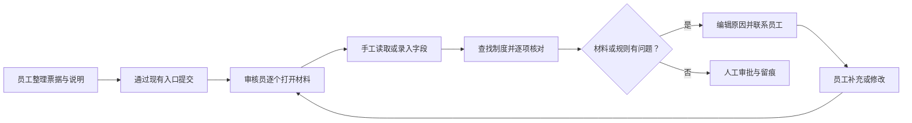
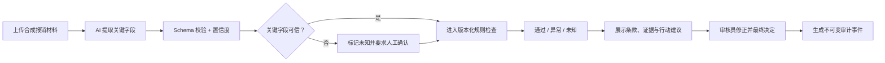
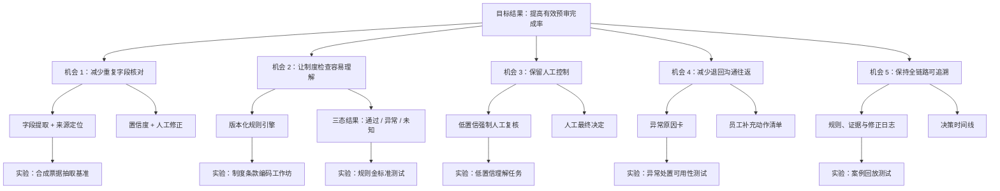
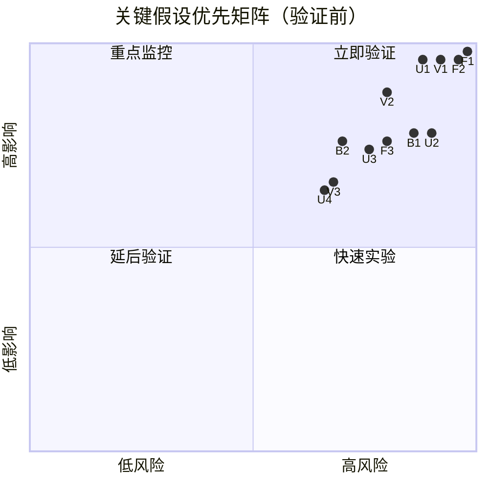

# 「审得快」业务流程、OST 与风险假设

> 阶段：03｜业务流程与机会定义  
> 文档状态：验证前产品推演  
> 证据限制：流程和机会来自业务拆解，尚未经过真实用户观察 [H]

## 1. 目标结果

### 1.1 产品结果

**有效预审完成率 [H/T]**

> 在进入预审的报销案例中，关键字段均已确认、每条适用规则均有状态和证据、审核员完成明确人工决定，且基准复核未发现关键抽取或规则错误的案例占比。

```text
有效预审完成率
= 有效完成预审的案例数 / 进入预审且材料格式受支持的案例数
```

“完成”不等于“自动通过”。异常或未知案例只要证据完整、正确转交人工并形成决定，也可以算有效完成。该定义避免用“通过率”激励系统忽略风险。

### 1.2 护栏结果

| 指标 | 口径 | 目标状态 |
|---|---|---|
| 关键规则漏报率 | 基准中应报异常但系统未报的规则数 / 应报异常规则数 | **[T]** 技术验证期为 0 |
| 低置信自动放行数 | 低于阈值的关键字段被系统视为已确认的次数 | **[T]** 0 |
| 无证据结论率 | 无规则版本或证据定位的预审结论数 / 结论总数 | **[T]** 0 |
| 人工决定覆盖率 | 有最终人工决定的案例数 / 已完成案例数 | **[T]** 100% |

## 2. AS-IS 假设流程



### 2.1 待验证摩擦点

| 环节 | 摩擦假设 [H] | 业务后果假设 [H] |
|---|---|---|
| 收集 | 材料入口和格式不统一 | 审核前先花时间整理 |
| 读取 | 同一字段在多份材料中重复出现 | 重复劳动、抄录错误 |
| 核对 | 条款分散，规则依赖个人记忆 | 执行不一致、培训成本高 |
| 退回 | 原因与补充动作需要重新组织 | 往返增加、员工不理解 |
| 留痕 | 证据、规则和沟通不在同一处 | 复核时难还原判断过程 |

## 3. TO-BE 目标流程



### 3.1 责任转移

| 原流程任务 | 目标流程承担者 [D] | 仍需人工的部分 [D] |
|---|---|---|
| 阅读票据 | AI 文档理解 | 低置信字段确认、模糊材料处理 |
| 核对明确条款 | 确定性规则 | 规则未覆盖和条款冲突 |
| 说明异常 | 模板 + 受约束生成 | 对员工的最终沟通语气与决定 |
| 审批 | 不交给 AI | 所有最终通过、退回、要求补充 |
| 留痕 | 系统自动记录 | 规则负责人审查与治理 |

## 4. 机会解决方案树（OST）



### 4.1 机会优先判断

| 顺序 | 机会 | 为什么优先 [D] | 关键证伪信号 |
|---:|---|---|---|
| 1 | 减少重复字段核对 | 是流程前置环节，也决定后续规则输入质量 | 人工修正成本不低于手工录入 |
| 2 | 让制度检查容易理解 | 决定产品是否超越普通 OCR | 高频制度无法稳定规则化 |
| 3 | 保留人工控制 | 直接影响信任、责任和安全 | 用户仍误把预审当最终审批 |
| 4 | 减少退回沟通往返 | 连接审核员和员工两端价值 | 行动清单没有减少理解成本 |
| 5 | 保持全链路可追溯 | 是进入真实业务的基础门槛 | 日志无法还原输入、规则和修正 |

## 5. 关键风险假设

### 5.1 风险分类

| ID | 类别 | 假设 | 影响 I | 风险 R | 分数 `I×R` | 最小验证 |
|---|---|---|---:|---:|---:|---|
| F1 | 可行性 | 高频费用制度可被稳定转换为可执行、可版本化规则 | 5.0 | 5.0 | **25.0** | 3 份模拟制度编码；双人独立编码一致率与规则覆盖复核 |
| F2 | 可行性 | AI 能从受支持票据中可靠提取关键字段与证据位置 | 5.0 | 5.0 | **25.0** | 30 组合成材料、字段级金标准、失败模式分析 |
| V1 | 价值 | 重复检查足够高频且痛苦，值得引入新工具 | 5.0 | 4.6 | **23.0** | 真实审核员任务回溯、观察与频率记录 |
| U1 | 可用性 | 用户不会把低置信或预审通过误解为最终审批 | 5.0 | 4.4 | **22.0** | 5 秒理解测试 + 决策任务；检查误读率 |
| U2 | 可用性 | 用户能从规则、证据和行动建议中快速理解异常 | 4.0 | 4.5 | **18.0** | 典型异常任务测试；复述原因和下一步 |
| V2 | 价值 | 预审能减少审核和退回成本，而非增加额外步骤 | 4.5 | 4.0 | **18.0** | 人工流程与原型流程对照任务 |
| B1 | 商业可行性 | 目标团队愿意投入试点时间并最终付费 | 4.0 | 4.3 | **17.2** | 决策者访谈、试点承诺、价格敏感度测试 |
| F3 | 可行性 | 未规则化例外可被可靠识别并转交人工 | 4.0 | 4.0 | **16.0** | 例外测试集；未知召回率与错误放行检查 |
| U3 | 可用性 | 字段确认和修正不会抵消自动提取带来的效率 | 4.0 | 3.8 | **15.2** | 字段修正率、操作数和完成时长对照 |
| B2 | 商业可行性 | 轻量预审可在低实施成本下接入现有流程 | 4.0 | 3.5 | **14.0** | 无集成 Wizard-of-Oz 与受控导入试验 |
| V3 | 价值 | 员工会使用提交前行动清单减少材料缺失 | 3.5 | 3.5 | **12.3** | 员工任务测试与再次提交正确率 |
| U4 | 可用性 | 审核员可以区分“修改抽取事实”和“覆盖规则结果” | 3.5 | 3.4 | **11.9** | 权限与操作理解测试 |

说明：影响与风险评分是 **[D] 产品先验排序**，并非调研统计。分数只用于决定先验证什么，不能证明哪项假设成立。

### 5.2 影响力 × 风险 2×2 矩阵



## 6. 验证 Gates

| Gate | 必须回答的问题 | 包含假设 | 通过后才能做什么 | 失败时的默认动作 |
|---|---|---|---|---|
| A 问题价值 | 真实审核流程是否存在高频、显著的重复成本？ | V1、V2 | 扩大交互原型测试 | 缩小到材料完整性检查，或更换场景 |
| B 数据与规则 | 字段和高频制度能否稳定结构化？ | F1、F2、F3 | 开发规则/抽取技术原型 | 限缩文档类型与规则范围，不做自动通过 |
| C 可用性与信任 | 用户能否理解证据、置信度、三态结果和人工责任？ | U1、U2、U3、U4 | 进入受控业务模拟 | 调整信息架构与措辞；仍误读则停止试点 |
| D 试点与商业 | 是否有人愿意投入真实资源采用？ | B1、B2 | 讨论受控真实试点 | 重估 ICP、产品入口与商业模式 |

Gates 优先于功能打分。即使某项功能 ICE 分高，只要 F1/F2 或 V1 未通过，也不应继续扩大开发投入。

## 7. 推荐验证顺序

1. **并行验证 Gate A 与 Gate B**：价值和制度规则化任一失败，都可能改变产品定义。
2. **用静态或低保真原型验证 Gate C**：先检查三态结果、证据和人工决定是否被正确理解。
3. **使用 Wizard-of-Oz 完整跑通任务**：AI 可由人工模拟，避免过早投入模型工程。
4. **最后验证 Gate D**：只有价值、数据和信任成立后，试点/付费讨论才有意义。

## 8. 本阶段结论

**[D] 产品机会不是“替财务自动审批”，而是把重复预审变成一条可证据化的人机协作链路。** 首先要证伪的是制度规则化、关键字段提取、问题价值和低置信误读四项高影响高风险假设。

上一份：[`01-用户研究与JTBD.md`](./01-用户研究与JTBD.md)  
下一份：[`03-产品策略-功能优先级-MVP.md`](./03-产品策略-功能优先级-MVP.md)
