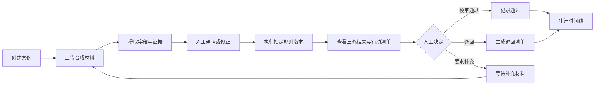
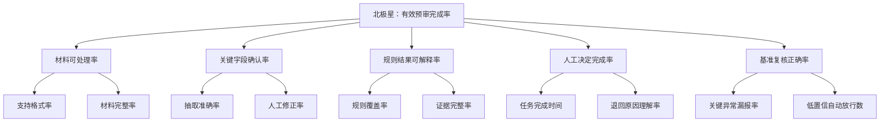

# 「审得快」产品策略、功能优先级与 MVP

> 阶段：04｜方案收敛与 MVP 定义  
> 优先级方法：Validation Gates + ICE  
> 文档状态：验证前设计决策，不代表已上线或已产生业务成果

## 1. 产品策略

### 1.1 战略问题

**[D]** 首版不追求覆盖完整报销流程，而是验证一个窄而关键的闭环：

> 合成材料进入 → 字段和证据结构化 → 版本化规则预审 → 异常与行动建议 → 人工决定 → 审计留痕

### 1.2 战略支柱

| 支柱 | 产品动作 [D] | 希望验证的假设 [H] |
|---|---|---|
| 证据优先 | 每个字段和结论都能回到原材料或规则 | 可解释证据能提高纠错和信任 |
| 规则确定性 | 明确制度交给版本化规则，不由模型自由判断 | 高频条款可稳定规则化 |
| 人类在环 | 低置信转人工，最终决定必须由审核员完成 | 控制感可以降低采用阻力 |
| 例外导向 | 不只显示“错了”，还说明原因和下一步 | 明确行动能减少退回沟通 |
| 最小数据 | 原型只使用合成/匿名化材料 | 可在不接触真实敏感数据时完成早期验证 |

## 2. 优先级方法

### 2.1 为什么使用 Gates + ICE

- **Validation Gates [D]**：先判断价值、规则化、信任等生死假设，避免功能总分掩盖致命风险。
- **ICE [D]**：在同一 Gate 内比较功能的影响力（Impact）、当前把握（Confidence）和实现便利度（Ease）。
- **依赖顺序 [D]**：上传、提取、规则、解释、人工决定存在前后依赖；交付顺序不完全等于 ICE 分数顺序。

```text
ICE = Impact × Confidence × Ease
```

每项 1–10 分。Confidence 表示对“该功能能帮助验证核心假设”的产品把握，不是用户证据置信度。

## 3. 功能优先级

### 3.1 P0：形成可验证闭环

| 功能组 | I | C | E | ICE | Gate | 入选原因 [D] |
|---|---:|---:|---:|---:|---|---|
| 上传材料与创建案例 | 8 | 9 | 9 | **648** | B | 所有任务的入口，且合成数据可低成本实现 |
| 人工决定与审计时间线 | 9 | 8 | 7 | **504** | C | 明确 AI 边界并保留责任链 |
| 异常证据与员工行动清单 | 9 | 6 | 7 | **378** | A/C | 直接验证是否减少理解和沟通成本 |
| 字段提取、证据、置信度与修正 | 10 | 6 | 6 | **360** | B/C | 决定后续规则输入质量和纠错能力 |
| 版本化规则与三态结果 | 10 | 6 | 5 | **300** | B/C | 是产品超越 OCR 的核心，但规则化风险最高 |

### 3.2 P1：核心闭环成立后增强

| 功能 | I | C | E | ICE | 延后原因 [D] |
|---|---:|---:|---:|---:|---|
| 政策版本管理界面 | 8 | 5 | 5 | **200** | P0 可先用预置规则版本验证 |
| 审核队列筛选 | 6 | 5 | 6 | **180** | 需先证明有足够案例量和使用频率 |
| 通知与补充材料提醒 | 5 | 5 | 6 | **150** | 不是验证预审价值的必要条件 |
| 效率与异常看板 | 5 | 4 | 7 | **140** | 没有真实使用数据时只会形成空看板 |
| 疑似重复报销检测 | 7 | 4 | 4 | **112** | 需要跨案例数据、较高误报治理成本 |

### 3.3 P2 / 明确不进入首版

| 能力 | 决策 | 原因 |
|---|---|---|
| 自动最终审批 | 不做 [D] | 责任、信任与误判风险超出当前验证范围 |
| 自动付款 | 不做 [D] | 涉及资金安全和真实系统集成 |
| 税务/法律结论 | 不做 [D] | 需要专业资质、外部数据与合规审查 |
| 发票真伪验真 | 不做 [D] | 需要官方数据源和授权；不能用图像猜测替代 |
| 预算控制与会计入账 | 不做 [D] | 会扩张成完整费控/财务系统 |
| 复杂多级审批流 | 不做 [D] | 偏离“预审助手”的核心问题 |
| 真实财务系统集成 | 不做 [D] | 在价值和工作流未验证前成本过高 |

## 4. MVP 范围

### 4.1 P0 功能清单

1. 上传一组受支持的合成 PDF/图片材料并创建案例。
2. 提取金额、日期、商户、发票号码、费用类别等关键字段。
3. 每个字段展示来源证据、置信度和确认状态。
4. 审核员可以修正字段，系统记录原值、新值和操作者。
5. 使用指定版本的模拟制度执行规则。
6. 规则输出“通过、异常、未知/需人工复核”三种状态。
7. 异常卡包含规则、证据、原因和员工行动清单。
8. 审核员做出“预审通过、退回、要求补充”人工决定。
9. 保存材料版本、提取版本、规则版本、修正与最终决定日志。

### 4.2 MVP 核心流程



### 4.3 关键边界条件

- 关键字段低于置信阈值时不得自动标记已确认。
- 缺少适用规则、条款冲突或材料无法读取时必须进入“未知/人工复核”。
- “规则通过”不能直接变为“最终审批通过”。
- 人工修改字段后必须重新运行受影响规则。
- 每个规则结果必须绑定规则版本和证据；否则结果无效。
- 原型中只允许使用合成或充分匿名化材料。

## 5. 成功指标设计

### 5.1 北极星指标假设

**有效预审完成率 [H/T]**：既衡量流程是否完成，也把正确性、证据和人工决定纳入“有效”定义。



### 5.2 指标口径与目标

| 层级 | 指标 | 定义 | 验证期目标 |
|---|---|---|---:|
| 北极星 | 有效预审完成率 | 有效完成案例 / 支持格式的进入预审案例 | ≥80% [T] |
| 激活 | 首个案例完成率 | 首次开始后完成一次人工决定的测试用户 / 首次开始用户 | ≥80% [T] |
| 效率 | 单案例预审时长 | 从开始处理到人工决定的中位时长 | 相对手工对照降低≥30% [T] |
| 质量 | 关键字段准确率 | 金标准中关键字段完全匹配数 / 关键字段总数 | ≥95% [T] |
| 质量 | 关键规则漏报率 | 应异常但未异常的关键规则数 / 应异常规则数 | 0 [T] |
| 可解释 | 异常理解率 | 能正确复述原因和下一步的任务数 / 异常任务数 | ≥85% [T] |
| 护栏 | 低置信自动放行数 | 未经人工确认的低置信关键字段进入通过状态次数 | 0 [T] |
| 护栏 | 人工决定覆盖率 | 有人工决定的已完成案例 / 已完成案例 | 100% [T] |

目标值用于指导验证，尚未实测。正式试点前需根据基线和风险容忍度重新校准。

## 6. 版本路线图

| 阶段 | 需要证明的结果 | 交付物 | 是否开始真实集成 |
|---|---|---|---|
| V0 概念 | 用户理解三态、证据和人工边界 | 流程图、交互原型、任务脚本 | 否 |
| V0.1 技术探针 | 字段与规则链路在合成基准上可用 | 文档抽取探针、规则测试集 | 否 |
| V0.2 Wizard-of-Oz | 端到端任务可能提高有效预审 | 可运行 Demo、对照测试 | 否 |
| V0.3 受控试点 | 真实工作流价值与采用成立 | 经授权的最小数据接入 | 经合规评审后决定 |
| V1 产品化 | 形成稳定使用与商业闭环 | 权限、监控、集成、服务保障 | 是 |

## 7. 本阶段决策

**[D] P0 只保留能完成“证据化预审 + 人工决定”的九项能力。** 功能优先级不能替代风险验证：在 Gate A（问题价值）和 Gate B（数据/规则可行性）未通过前，不投入真实系统集成、复杂模型或管理看板。

上一份：[`02-业务流程-OST-风险假设.md`](./02-业务流程-OST-风险假设.md)  
下一份：[`04-PRD-审得快.md`](./04-PRD-审得快.md)
