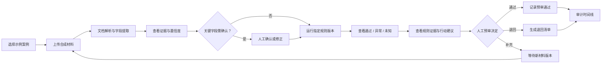
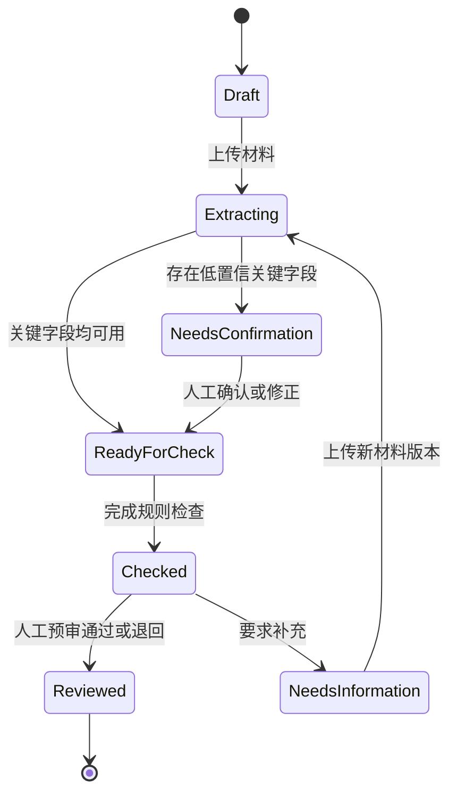

# PRD｜「审得快」AI 费用报销预审助手

> 版本：V0.1（原型开发前）  
> 日期：2026-08-17  
> 文档状态：用于原型评审、任务测试与技术探针  
> 产品形态：计划制作响应式 Web 交互 Demo [D]  
> 数据边界：只使用合成或充分匿名化材料 [D]  
> 证据状态：真实用户样本 `N=0` [F]；所有需求与目标仍待验证

## 0. 证据与需求标记

| 标记 | 含义 |
|---|---|
| **[F]** | 已知事实或已完成事项 |
| **[H]** | 待真实研究或实验验证的假设 |
| **[T]** | 预先设定的验证目标，不是已取得结果 |
| **[D]** | 当前产品设计决策及边界 |

## 1. 摘要

「审得快」面向 20–200 人团队中的财务/行政审核员，解决费用报销预审中重复读取材料、对照制度、解释异常和留存依据的问题假设。[H]

产品不让大模型直接决定报销是否合规，而是把任务拆为三层：AI 负责读取非结构化材料并生成受约束解释；确定性规则负责执行模拟公司制度；审核员确认事实并做出最终预审决定。[D]

V0.1 的目标不是上线完整费控系统，而是用合成材料验证三个关键问题：

1. 字段提取、证据和人工修正能否减少重复核对。[H]
2. 版本化规则与三态结果能否稳定表达高频费用制度。[H]
3. 审核员能否理解系统的不确定性，并保留最终控制。[H]

## 2. 联系人与职责

| 角色 | 负责人 | 职责 | 当前限制 |
|---|---|---|---|
| 产品负责人 | 作品集作者 | 问题定义、需求、优先级、原型、指标与实验 | 单人项目 [F] |
| 用户研究 | 作品集作者 | 研究计划、任务脚本、证据分级 | 暂无真实受访者 [F] |
| 交互设计 | 作品集作者模拟承担 | 信息架构、流程、状态与无障碍 | 尚未进入 UI 阶段 [F] |
| 工程角色 | 作品集作者模拟承担 | Demo、规则引擎、合成数据和日志 | 不接真实系统 [D] |
| 财务/合规顾问 | 待补充 | 审查制度表达、专业边界和真实试点条件 | 当前缺失 [F] |

本项目不虚构跨职能团队、客户合作或业务成果。

## 3. 背景与问题

### 3.1 问题陈述

**[H]** 中小团队的费用审核可能分散在聊天、邮件、表格和财务工具中。审核员收到票据后，需要手工读取字段、查找制度、检查附件和额度，并在发现问题时重新组织退回原因。这些机械步骤可能占用本应投入例外判断和风险控制的时间。

### 3.2 当前替代方案

1. 人工打开文件并在表格/系统中逐项录入和核对。
2. 使用 OCR 录入字段，再由人工继续查制度。
3. 使用通用大模型阅读材料，但人工承担事实核验与结论风险。
4. 采购完整费控系统，获得流程、预算和支付集成能力。
5. 依赖员工自查和审核员经验，接受一定的退回往返。

### 3.3 产品机会

**[D]** 先不替换现有审批和支付系统，而是在正式审批前增加一个轻量、可解释的预审层。其价值取决于能否降低总任务成本，而不是单纯提高 OCR 速度。[H]

## 4. 目标、指标与非目标

### 4.1 用户目标

- 审核员快速定位需要关注的字段和制度异常。[H]
- 审核员能回看原始证据、修正提取错误并保留最终决定权。[H]
- 员工获得明确的缺失材料和修改动作，而不是模糊退回原因。[H]
- 制度负责人能追踪某个结果使用的规则版本与证据。[H]

### 4.2 产品目标

**Objective [T]：在一个原型验证周期内，证明“证据化预审 + 人工决定”值得进入真实用户问题验证和受控技术试点。**

| KR | 口径 | 目标 |
|---|---|---:|
| KR1 有效预审完成率 | 有效完成案例 / 支持格式的进入预审案例 | ≥80% [T] |
| KR2 任务效率 | 原型组相对手工对照组的中位预审时长变化 | 降低≥30% [T] |
| KR3 关键字段质量 | 金标准中关键字段完全匹配数 / 关键字段总数 | ≥95% [T] |
| KR4 关键规则安全 | 应报异常但未报的关键规则数 | 0 [T] |
| KR5 异常理解 | 能正确复述原因和下一步的异常任务 / 异常任务 | ≥85% [T] |
| KR6 人工控制 | 已完成案例中带人工最终决定的比例 | 100% [T] |

上述数字是进入验证前的目标，不是当前产品结果。

### 4.3 非目标

- 不自动做出最终审批或触发付款。
- 不提供发票真伪、税务、法律、会计或审计专业结论。
- 不建设预算、入账、支付、报表和复杂多级审批能力。
- 不连接真实企业 ERP、财务系统、银行或税务数据源。
- 不声称替代财务人员或消除所有费用风险。
- 不用真实个人/企业财务数据训练或演示原型。

## 5. 用户、场景与 JTBD

### 5.1 首要用户

**[H]** 20–200 人团队内实际处理费用报销的财务或行政审核员，当前需要在多个材料和制度之间手工核对，并承担解释和留痕责任。

### 5.2 角色与权限

| 能力 | 报销员工 | 财务/行政审核员 | 制度负责人 |
|---|:---:|:---:|:---:|
| 上传/补充本人材料 | ✓ | ✓ | - |
| 查看本人预审问题 | ✓ | ✓ | - |
| 确认或修正抽取字段 | 仅本人提交前 [D] | ✓ | - |
| 运行已发布规则 | ✓ | ✓ | ✓ |
| 做出人工预审决定 | - | ✓ | - |
| 编辑规则草稿 | - | - | ✓ [P1] |
| 发布规则版本 | - | - | ✓ [P1] |
| 查看审计时间线 | 本人案例摘要 | ✓ | ✓ |

V0.1 Demo 重点实现审核员视角；其他角色通过流程和状态模拟，不建设完整账户权限系统。[D]

### 5.3 核心 JTBD

> 当我收到一组格式不一的报销材料并准备审核时，我想先看到结构化字段、对应证据和制度异常，以便把精力放在例外判断上，同时保留最终决定和可追溯记录。[H]

### 5.4 核心使用场景

| 场景 | 触发 | 用户期望 [H] | 系统目标 [D] |
|---|---|---|---|
| 正常费用 | 材料齐全且符合制度 | 快速确认无明显异常 | 所有关键字段确认、规则均通过，等待人工决定 |
| 明确异常 | 超额、缺附件或字段冲突 | 快速知道原因和处理动作 | 显示规则、证据、差值/缺失项和建议 |
| 信息不确定 | 图片模糊、字段冲突、规则不适用 | 不被错误结论误导 | 标记未知，阻止自动进入“全部通过” |
| 补充材料 | 审核员要求员工补充 | 知道具体缺什么 | 生成行动清单，补充后保留版本并重新预审 |

## 6. 价值主张

对需要处理高频、格式不一报销材料的中小团队审核员，「审得快」是一个可解释的费用预审工作台。它把票据信息、制度规则、异常证据和人工决定放在同一条可追溯链路中。相比只做录入的 OCR 或直接给出结论的通用 AI，它让机器承担重复整理，让规则负责明确制度，让人保留最终控制。[D/H]

### 6.1 价值交换假设

| 用户投入 | 预期回报 [H] | 产品必须守住的条件 [D] |
|---|---|---|
| 上传和确认材料 | 少做重复字段核对 | 修正成本不能抵消节省时间 |
| 学习三态结果和证据卡 | 更快定位异常 | 5 秒内能理解状态和责任边界 |
| 接受系统记录操作 | 获得可回放的证据链 | 数据最小化、权限清晰、可审计 |
| 配置/维护制度 | 获得一致规则执行 | 规则版本化、测试后发布、未知可转人工 |

## 7. 解决方案与需求

### 7.1 端到端流程



### 7.2 案例状态



案例预审结果和人工决定必须分开存储、分开展示。[D]

### 7.3 P0 / P1 范围

| ID | 优先级 | 功能 | 本版本要求 |
|---|---|---|---|
| FR-01 | P0 | 案例与材料上传 | 创建案例；上传合成 PDF/JPG/PNG；展示处理状态 |
| FR-02 | P0 | 字段提取 | 提取金额、日期、商户、发票号码、费用类别等关键字段 |
| FR-03 | P0 | 证据与置信度 | 展示字段来源、页码/区域、原始文本、置信度和确认状态 |
| FR-04 | P0 | 人工修正 | 审核员确认/修改字段；保存前后值、原因、时间和操作者 |
| FR-05 | P0 | 规则预审 | 对确认后的结构化字段执行指定版本的模拟费用规则 |
| FR-06 | P0 | 三态结果 | 每条规则输出通过、异常或未知/人工复核，不输出模糊二元结论 |
| FR-07 | P0 | 异常解释 | 显示适用条款、证据、判断过程、影响和员工行动清单 |
| FR-08 | P0 | 人工决定 | 支持预审通过、退回、要求补充；必须由用户主动确认 |
| FR-09 | P0 | 审计时间线 | 记录材料、抽取、修正、规则版本、规则结果和人工决定 |
| FR-10 | P1 | 规则版本管理 | 新建草稿、测试、发布和停用规则版本 |
| FR-11 | P1 | 疑似重复检测 | 跨案例提示相同票号/金额/日期组合，不能直接判定欺诈 |
| FR-12 | P1 | 审核队列 | 按状态、异常类型、金额和更新时间筛选案例 |
| FR-13 | P1 | 指标看板 | 展示时长、修正率、未知率、异常分布与护栏指标 |
| FR-14 | P1 | 通知 | 将已确认的补充清单发送到模拟通知入口 |

### 7.4 P0 规则范围

V0.1 使用虚构公司制度，不代表任何税务或法定要求。[D]

| 规则类型 | 示例 | 必需输入 | 不能判断时 |
|---|---|---|---|
| 必填字段 | 金额、日期、商户和票号不能为空 | 结构化字段 | `UNKNOWN` |
| 附件完整性 | 差旅类别需要发票和行程材料 | 费用类别、文档类型 | `EXCEPTION` 或 `UNKNOWN` |
| 类别额度 | 市内交通单笔不超过模拟额度 | 类别、金额、规则参数 | `EXCEPTION` |
| 日期范围 | 票据日期需在模拟提交窗口内 | 票据日期、提交日期、天数参数 | `EXCEPTION` 或 `UNKNOWN` |
| 金额一致性 | 申请金额与票据合计一致 | 申请金额、票据金额 | `EXCEPTION` |

“疑似重复”属于 P1；“票据真伪”和“税务合规”明确不做。

### 7.5 规则聚合逻辑

```text
若任一关键字段未确认 → 案例不得显示“全部通过”
若任一适用规则为 UNKNOWN → 案例预审状态 = 需人工复核
否则若任一规则为 EXCEPTION → 案例预审状态 = 存在异常
否则全部适用规则为 PASS → 案例预审状态 = 规则检查通过
```

“规则检查通过”仍需人工做出“预审通过”决定；系统不生成最终审批结果。[D]

### 7.6 WWA 需求与验收标准

#### WWA-01｜创建并上传案例

**Why**：审核员需要把一组相关材料作为同一个预审对象处理。[H]  
**What**：用户可创建案例并上传受支持的合成材料，系统显示文件类型、页数、处理进度和失败原因。[D]

**Acceptance**

- 给定受支持 PDF/JPG/PNG，系统成功创建唯一案例并保留原始材料引用。
- 不支持或损坏的文件不进入规则检查，并说明可执行的下一步。
- 重复上传同一文件时给出提示，但 P0 不自动判定重复报销。
- Demo 明确标注“仅使用合成/匿名化材料”。

#### WWA-02｜提取字段并查看证据

**Why**：仅显示字段值无法帮助审核员判断 AI 是否读对。[H]  
**What**：系统提取关键字段，并将值、来源文档、页码/区域、原始文本、置信度和状态放在同一字段卡中。[D]

**Acceptance**

- 每个提取字段都有唯一 ID、标准化值和至少一个证据引用；无证据时状态为未知。
- 点击字段可定位到对应文档证据，证据不可定位时不能标记高置信。
- 金额保留币种和小数精度，日期标准化但保留原始文本。
- 低置信关键字段默认进入“待确认”，不得被静默使用为已确认事实。

#### WWA-03｜确认或修正字段

**Why**：文档识别不可避免会失败，用户需要低成本纠错并留下依据。[H]  
**What**：审核员可确认、修改或标记无法判断；修改后重跑受影响规则。[D]

**Acceptance**

- 修改保存前必须显示原值、新值和受影响规则。
- 保存后生成审计事件，包含操作者、时间、原因和字段版本。
- 标记“无法判断”后，相关规则只能输出 `UNKNOWN`，不能输出 `PASS`。
- 仅重算依赖该字段的规则；旧结果保留在历史中但不作为当前结果。

#### WWA-04｜执行版本化规则

**Why**：用户需要知道系统依据哪一版制度、哪些输入得出结果。[H]  
**What**：系统对确认字段执行已发布的模拟规则版本，每条规则返回状态、输入快照和判断说明。[D]

**Acceptance**

- 每次运行固定保存 `rule_set_version`、运行时间和输入快照哈希。
- 同一输入和规则版本重复运行时，确定性规则结果一致。
- 输入缺失、条款冲突或规则不适用时返回 `UNKNOWN`，不得猜测。
- 每条结果只能是 `PASS`、`EXCEPTION`、`UNKNOWN` 三者之一。

#### WWA-05｜理解异常并采取行动

**Why**：只给错误代码仍会让审核员重新解释并联系员工。[H]  
**What**：异常卡显示规则名称、模拟条款、使用证据、实际值与阈值、影响和补充/修改动作。[D]

**Acceptance**

- 所有异常和未知结果都有规则 ID、规则版本和证据引用。
- 数值异常同时显示实际值、阈值和差值；缺失材料明确指出文档类型。
- 解释不得引入证据中不存在的事实，不使用税务/法律保证性措辞。
- 用户可编辑发送给员工的行动清单，但原始系统建议保留在审计日志中。

#### WWA-06｜人工做出预审决定

**Why**：预审需要支持工作，而不能模糊最终责任。[D]  
**What**：审核员主动选择预审通过、退回或要求补充，并填写必要备注。[D]

**Acceptance**

- 系统不得代替用户点击、默认勾选或自动提交决定。
- 存在 `UNKNOWN` 时，“预审通过”需要二次确认和人工理由；原型可进一步禁用该动作进行对照测试。
- 退回和要求补充必须至少关联一条异常、未知或人工备注。
- 决定保存后与 AI 建议分开展示，且可在时间线中回放。

#### WWA-07｜回放审计记录

**Why**：负责人需要还原某次预审使用的材料、规则、修正和人工决定。[H]  
**What**：系统按时间展示不可覆盖的案例事件，并支持查看各版本详情。[D]

**Acceptance**

- 时间线至少包含上传、提取、字段确认/修正、规则运行、解释生成和人工决定。
- 每条事件含事件 ID、案例 ID、主体、时间、对象版本和动作摘要。
- 修改不会覆盖旧记录；当前状态由最新有效事件派生。
- 导出数据不包含真实个人财务信息；Demo 使用匿名角色 ID。

### 7.7 空态、异常态与降级

| 情况 | 产品行为 [D] | 禁止行为 |
|---|---|---|
| 文件无法读取 | 标记失败，指出文件和重试/替换动作 | 猜测字段并继续通过 |
| 关键字段低置信 | 要求确认，关联证据 | 隐藏置信度或自动确认 |
| 证据互相冲突 | 并列展示来源，标记未知 | 私自选一个值当真相 |
| 找不到适用规则 | 转人工并说明无规则覆盖 | 让模型自由判断公司制度 |
| 解释生成失败 | 回退为确定性模板 | 展示未校验自然语言 |
| 规则服务失败 | 保留已确认字段，允许重试 | 显示上次结果为当前结果 |
| 新材料补充 | 创建材料新版本并重新计算 | 覆盖原材料和旧结果 |

### 7.8 非功能要求

| 类别 | 要求 |
|---|---|
| 性能 | 单文档解析 P95≤8 秒，单案例规则运行 P95≤2 秒 [T] |
| 稳定性 | 规则执行失败必须显式可见；同版本规则需确定性复现 [D] |
| 可访问性 | 键盘可操作；状态不只依赖颜色；主要文本对比度满足 WCAG AA [T] |
| 响应式 | 360px 手机与 1280px 桌面宽度下无关键内容遮挡或横向溢出 [T] |
| 隐私 | Demo 不收真实个人/企业财务数据；默认使用合成材料 [D] |
| 安全 | 文件类型、大小和解析流程需校验；文档内容不得作为系统指令执行 [D] |
| 可审计 | 当前结论可还原到材料、字段、规则版本和人工决定 [T] |
| 可观测 | 记录失败率、低置信率、修正率、未知率和规则耗时 [D] |

### 7.9 埋点与指标事件

| 事件 | 触发 | 关键属性 |
|---|---|---|
| `case_created` | 创建案例成功 | `case_id`, `source`, `actor_role` |
| `document_processed` | 文档处理完成/失败 | `document_type`, `status`, `duration_ms`, `error_code` |
| `field_reviewed` | 字段确认、修改或未知 | `field_name`, `confidence_band`, `action`, `had_evidence` |
| `rule_run_completed` | 规则运行结束 | `rule_set_version`, `pass_count`, `exception_count`, `unknown_count` |
| `finding_opened` | 展开规则结果证据 | `rule_id`, `result_status` |
| `action_list_edited` | 修改员工行动清单 | `finding_count`, `edit_type` |
| `human_decision_submitted` | 提交人工决定 | `decision`, `unknown_count`, `duration_ms` |
| `audit_exported` | 导出模拟审计记录 | `event_count`, `format` |

严禁在分析事件中记录票据原文、姓名、银行账户、税号、手机号或未脱敏备注。[D]

阶段 09 已将上述事件扩展为北极星、过程指标、AI 质量和 P0 安全护栏看板，见 [11-指标体系-埋点-实验看板.md](./11-指标体系-埋点-实验看板.md)；看板数字仅为合成演示，不代表线上结果。[D]

## 8. 发布与验证计划

| 阶段 | 范围 | 主要实验 | 退出条件 |
|---|---|---|---|
| 0 业务一致性 | 模拟制度、合成案例和字段/规则金标准 | 制度编码、案例走查 | 规则可表达，未知边界明确 [T] |
| 1 低保真可用性 | 字段卡、三态结果、异常卡、人工决定 | 5 秒理解与任务测试 | 状态/责任理解率达标 [T] |
| 2 可运行 Demo | P0 端到端流程、日志、合成数据 | 手工流程对照 + Wizard-of-Oz | 有效预审完成率和护栏达标 [T] |
| 3 技术探针 | 文档抽取、规则引擎和降级 | 30 组合成案例基准 | 关键字段和规则质量达标 [T] |
| 4 真实问题验证 | 经同意的财务/行政访谈 | 最近案例回溯、情境观察 | Gate A 获得真实证据 |
| 5 受控试点 | 经授权和合规评审的小范围真实流程 | 真实基线与对照 | 另行定义，不由原型数据替代 |

### 8.1 发布阻断条件

任一条件成立，均不得进入真实数据试点：

- 无法证明制度规则版本与测试方法。
- 关键字段低置信仍可能被系统自动视为通过。
- 用户在测试中持续把“预审通过”理解为最终审批。
- 审计记录无法还原证据、规则和人工修正。
- 未完成真实数据的授权、最小化、访问控制和删除机制评审。

### 8.2 依赖与开放问题

| 问题 | 当前状态 | 下一步 |
|---|---|---|
| 真实问题频率和基线 | 未知 [F] | 真实审核员访谈与任务观察 |
| 制度规则化边界 | 待验证 [H] | 模拟制度双人编码与冲突复核 |
| 文档识别方案 | 待选择 [D] | 先用 Wizard-of-Oz，再比较 OCR/多模态方案 |
| “预审通过”措辞 | 待测试 [H] | 与“未发现明确异常”等措辞做理解测试 |
| 真实数据合规要求 | 未评审 [F] | 在试点前由法律、隐私、安全与财务专业人员审查 |
| 付费与采购主体 | 未验证 [H] | 通过决策者访谈和试点承诺验证 |

## 9. PRD 完成定义

本 PRD 的“完成”是：P0 需求可被设计、工程和测试角色依据同一口径实现与验收；并不表示产品已验证成功。[D]

下一份：[`05-AI架构-数据契约-安全边界.md`](./05-AI架构-数据契约-安全边界.md)
