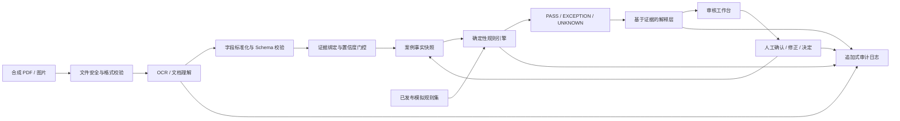
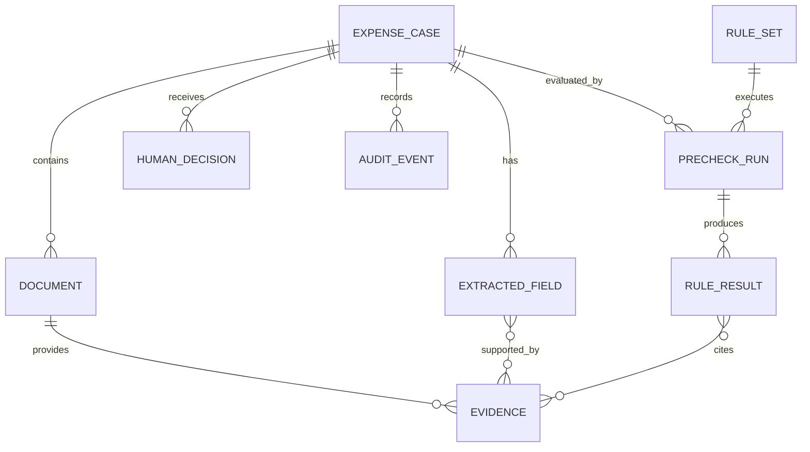
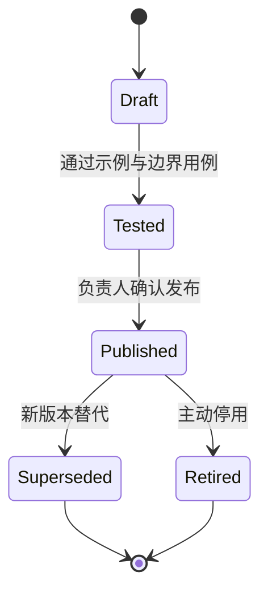

# 「审得快」AI 架构、数据契约与安全边界

> 阶段：05｜PRD、AI 方案与交付约束  
> 文档目的：明确 AI、规则和人工如何分工，以及系统如何表达证据与不确定性  
> 当前状态：架构设计与接口契约，尚未连接真实模型、真实制度或真实财务数据 [F]  
> 合规说明：隐私与安全部分是作品集中的产品设计参考，不构成法律、税务或安全认证意见

## 0. 核心原则

**[D] 系统可以自动整理事实和执行明确规则，但不能自动承担最终审批责任。**

```text
AI 建议 ≠ 规则结果 ≠ 人工决定 ≠ 最终财务审批
```

四者必须在界面、数据结构和日志中分开保存，不能用一个“AI 审核通过”字段混在一起。

## 1. AI、规则与人工职责

| 任务 | 负责机制 [D] | 原因 | 失败时的边界 |
|---|---|---|---|
| 文档分类与字段候选提取 | OCR/文档理解模型 | 输入非结构化、版式多样 | 输出候选值、证据和置信度，不直接判定通过 |
| 字段格式标准化 | 代码 + Schema 校验 | 金额、日期和枚举需稳定 | 解析失败即未知，不猜测 |
| 公司制度检查 | 确定性规则引擎 | 需要可复现、可测试、可版本化 | 无规则、缺输入或冲突时转 `UNKNOWN` |
| 异常解释 | 确定性模板优先；受约束生成可选 | 提高可读性但不能改变事实 | 生成失败回退模板；无证据内容禁止展示 |
| 事实修正 | 授权审核员 | 模型会误读，需要纠错 | 保留原值、新值、理由和操作者 |
| 最终预审决定 | 审核员 | 保留责任、业务语境和例外判断 | 系统不得默认选择或自动提交 |
| 最终财务审批/付款 | 现有正式流程 | 超出产品范围 | 「审得快」不触发 [D] |

## 2. 逻辑架构



### 2.1 数据链路

1. **输入门控**：验证文件类型、大小、可读性和模拟数据标识。
2. **文档理解**：输出字段候选，不输出“合规/不合规”。
3. **Schema 校验**：金额、日期、币种、枚举等不符合格式时标记未知。
4. **证据绑定**：每个候选值关联来源文档、页码/区域和原始文本。
5. **置信门控**：低置信关键字段进入人工确认，相关规则暂为未知。
6. **事实快照**：规则运行使用一个不可变输入版本，便于复现。
7. **规则执行**：固定规则版本对固定输入产生确定性三态结果。
8. **解释生成**：只引用规则结果与白名单证据，不能新增事实。
9. **人工决定**：用户确认或修正后提交预审决定。
10. **审计记录**：所有版本、修正、运行和决定以事件形式追加保存。

## 3. 为什么不让大模型直接审核

| 风险 | 直接让模型判断的后果 | 当前设计控制 [D] |
|---|---|---|
| 幻觉 | 引用不存在的制度、金额或附件 | 规则结果只由结构化输入和已发布规则产生 |
| 不稳定 | 同一材料多次运行结论不同 | 确定性规则对同一版本输入必须复现 |
| 黑箱 | 用户无法知道结论依据 | 字段证据、规则版本、输入与判断过程可回放 |
| 过度自动化 | 用户把建议当正式审批 | 三态预审与人工决定分层，最终审批不在产品内 |
| 提示注入 | 票据文本诱导模型忽略规则或泄露信息 | 文档内容视为不可信数据，模型无工具/规则修改权限 |
| 专业越界 | 输出税务或法律保证 | 禁止专业结论，使用模拟公司制度并明确边界 |

## 4. 数据契约

### 4.1 契约约定

- `schema_version` 使用语义化版本；破坏性字段调整提升主版本。[D]
- 金额使用整数最小货币单位，例如人民币分，避免浮点误差。[D]
- 时间使用 ISO 8601；日期不推断时区，事件时间使用带时区时间戳。[D]
- 原始值与标准化值同时保留，便于回看模型转换。[D]
- 所有模型输出先通过 JSON Schema 校验，失败则进入降级流程。[D]
- 所有引用必须使用内部 ID，禁止仅靠自然语言指代证据。[D]

### 4.2 核心对象关系



### 4.3 示例数据包

以下均为虚构数据，仅用于说明接口。

```json
{
  "schema_version": "1.0.0",
  "case": {
    "case_id": "case_demo_0007",
    "tenant_id": "tenant_demo",
    "subject_id": "employee_demo_12",
    "submission_date": "2026-08-17",
    "claimed_amount_minor": 26800,
    "currency": "CNY",
    "expense_category": "business_trip",
    "case_version": 3,
    "data_classification": "synthetic"
  },
  "documents": [
    {
      "document_id": "doc_invoice_01",
      "document_type": "invoice",
      "file_name": "demo-invoice-01.pdf",
      "content_sha256": "demo_hash_not_real",
      "page_count": 1,
      "processing_status": "processed"
    }
  ],
  "extracted_fields": [
    {
      "field_id": "field_amount_01",
      "field_name": "invoice_amount",
      "raw_value": "268.00",
      "normalized_value": 26800,
      "value_type": "money_minor",
      "currency": "CNY",
      "confidence": 0.97,
      "confidence_band": "high",
      "review_status": "machine_extracted",
      "evidence_ids": ["ev_01"],
      "extractor_version": "extractor_demo_v1"
    }
  ],
  "evidence": [
    {
      "evidence_id": "ev_01",
      "document_id": "doc_invoice_01",
      "page": 1,
      "bounding_box": [0.62, 0.70, 0.86, 0.77],
      "source_text": "价税合计 268.00",
      "source_type": "document_region"
    }
  ],
  "precheck_run": {
    "run_id": "run_0009",
    "input_case_version": 3,
    "rule_set_id": "policy_demo_travel",
    "rule_set_version": "1.2.0",
    "started_at": "2026-08-17T10:12:03+08:00",
    "completed_at": "2026-08-17T10:12:03+08:00",
    "aggregate_status": "exception",
    "rule_results": [
      {
        "rule_result_id": "result_01",
        "rule_id": "TRAVEL_LIMIT_001",
        "rule_version": "1.1.0",
        "status": "EXCEPTION",
        "severity": "blocking",
        "actual_value": 26800,
        "expected": {"operator": "lte", "value": 20000},
        "evidence_ids": ["ev_01"],
        "reason_code": "AMOUNT_OVER_LIMIT"
      }
    ]
  },
  "ai_explanation": {
    "explanation_id": "explain_01",
    "generator_type": "template",
    "generator_version": "explain_template_v1",
    "summary": "该笔模拟差旅费用比单笔额度高 68.00 元。",
    "basis_rule_result_ids": ["result_01"],
    "basis_evidence_ids": ["ev_01"],
    "action_items": ["补充超额说明并提交负责人确认"],
    "validation_status": "grounded"
  },
  "human_review": {
    "decision_id": "decision_004",
    "decision": "REQUEST_MORE_INFORMATION",
    "reviewer_id": "reviewer_demo_03",
    "reason": "需要补充超额说明",
    "based_on_run_id": "run_0009",
    "decided_at": "2026-08-17T10:14:28+08:00"
  }
}
```

### 4.4 关键字段字典

| 字段 | 类型 | 是否关键 | 来源 | 缺失/低置信处理 |
|---|---|:---:|---|---|
| `claimed_amount_minor` | integer | 是 | 员工申请/模拟表单 | 不能执行金额一致性与额度规则 |
| `invoice_amount` | integer | 是 | 发票证据 | 相关规则返回 `UNKNOWN` |
| `invoice_date` | date | 是 | 发票证据 | 日期窗口规则返回 `UNKNOWN` |
| `merchant_name` | string | 是 | 发票证据 | 要求人工确认，不推断商户身份 |
| `invoice_number` | string | 是 | 发票证据 | P1 重复检测不可用 |
| `expense_category` | enum | 是 | 用户选择 + 模型候选 | 决定规则适用范围，冲突时必须人工选择 |
| `document_type` | enum | 是 | 分类模型/人工 | 附件完整性规则返回 `UNKNOWN` |
| `submission_date` | date | 是 | 案例元数据 | 日期窗口规则不可执行 |

### 4.5 枚举与状态

| 对象 | 枚举 | 语义 |
|---|---|---|
| 字段复核 | `machine_extracted` | 机器候选值，尚未人工操作 |
| 字段复核 | `human_confirmed` | 人工确认候选值正确 |
| 字段复核 | `human_corrected` | 人工修改为新值 |
| 字段复核 | `unknown` | 人工或系统均无法确定 |
| 规则结果 | `PASS` | 已知输入满足该规则；不是最终审批 |
| 规则结果 | `EXCEPTION` | 已知输入触发明确异常 |
| 规则结果 | `UNKNOWN` | 输入、规则覆盖或证据不足，需人工处理 |
| 人工决定 | `PRECHECK_PASS` | 审核员认为可以进入后续正式流程 |
| 人工决定 | `RETURN` | 退回员工修改 |
| 人工决定 | `REQUEST_MORE_INFORMATION` | 等待补充材料或说明 |

## 5. 置信度与不确定性

### 5.1 原型阈值

| 区间 | 原型标签 [D] | 产品行为 [D] |
|---|---|---|
| `≥0.90` | 高 | 有有效证据时可进入规则；用户仍可复核 |
| `0.75–0.899` | 中 | 显示提醒；关键字段建议确认，风险规则可强制确认 |
| `<0.75` | 低 | 关键字段阻断依赖规则，必须人工确认或标记未知 |
| 无数值/无证据 | 不可用 | 一律未知，不进入自动通过链路 |

阈值是 **[D] 原型起点**，不是模型质量事实。真实使用前必须在代表性数据上做置信度校准；若模型分数与真实正确率不一致，需重新分箱或弃用该分数。

### 5.2 关键门控规则

1. 低置信关键字段从不自动成为通过依据。
2. 没有证据定位的字段最高只能标记中置信。[D]
3. 人工修正优先于机器候选，但必须留下版本和原因。
4. 修改输入后，所有受影响规则结果失效并重算。
5. 解释层的语言流畅度不能提高字段或规则置信度。
6. 模型意见与规则冲突时，以规则结果展示；规则覆盖不足则转未知，不让模型“裁决”。

## 6. 规则契约

### 6.1 规则定义示例

```json
{
  "rule_id": "TRAVEL_LIMIT_001",
  "rule_version": "1.1.0",
  "rule_set_id": "policy_demo_travel",
  "name": "模拟差旅单笔额度",
  "description": "仅用于作品集演示的虚构公司规则",
  "applies_when": {
    "field": "expense_category",
    "operator": "eq",
    "value": "business_trip"
  },
  "inputs": ["invoice_amount"],
  "logic": {
    "operator": "lte",
    "threshold_minor": 20000,
    "currency": "CNY"
  },
  "severity": "blocking",
  "source": {
    "policy_id": "DEMO_POLICY_01",
    "clause_id": "4.2",
    "effective_from": "2026-01-01"
  }
}
```

### 6.2 规则生命周期



- 只有 `Published` 规则集可以生成当前预审结果。[D]
- 已完成案例保留当时的规则版本，不能用新规则改写历史。[D]
- 规则变化必须附测试用例、变更原因和发布者。[D]
- 自然语言制度到规则的转换在 P0 由人工完成，不由 AI 自动发布。[D]

### 6.3 三态计算

```text
输入满足且证据可用 → 计算 PASS 或 EXCEPTION
关键输入缺失/未知 → UNKNOWN
规则不覆盖、条件冲突或运行失败 → UNKNOWN
```

规则引擎不得通过“默认通过”处理未知。

## 7. 解释生成契约

### 7.1 允许输入

- 已验证的标准化字段。
- 规则结果、实际值、阈值和 `reason_code`。
- 白名单证据片段 ID。
- 预先审核的行动模板。

### 7.2 禁止输入/能力

- 不向生成模型提供修改规则、调用付款或访问其他案例的工具。
- 不把文档中的指令当作系统指令执行。
- 不允许模型自行检索未审核的法律、税务或公司制度。
- 不允许模型新增商户、金额、日期、附件或条款事实。

### 7.3 输出 Schema

```json
{
  "summary": "string",
  "basis_rule_result_ids": ["string"],
  "basis_evidence_ids": ["string"],
  "action_items": ["string"],
  "uncertainty_note": "string|null"
}
```

展示前必须检查：引用 ID 存在、数值与规则结果一致、没有越界承诺、行动项来自允许集合。任一检查失败时回退到确定性模板。[D]

## 8. 人工决定与审计契约

### 8.1 决定分离

| 数据 | 生成者 | 可否被后续步骤覆盖 |
|---|---|---|
| 字段候选 | 模型 | 不覆盖；新版本追加 |
| 字段确认/修正 | 审核员 | 不覆盖；可产生更新版本 |
| 规则结果 | 规则引擎 | 固定输入/规则版本不可变；重跑生成新记录 |
| AI 解释 | 模板/模型 | 与对应规则结果绑定；新生成另存 |
| 人工决定 | 审核员 | 不覆盖；撤回或变更形成新事件 |

### 8.2 最小审计事件

```json
{
  "event_id": "evt_demo_021",
  "event_type": "FIELD_CORRECTED",
  "case_id": "case_demo_0007",
  "actor": {"actor_type": "human", "actor_id": "reviewer_demo_03"},
  "object": {"object_type": "extracted_field", "object_id": "field_amount_01"},
  "before": {"normalized_value": 28600},
  "after": {"normalized_value": 26800},
  "reason_code": "OCR_DIGIT_ERROR",
  "occurred_at": "2026-08-17T10:11:42+08:00",
  "schema_version": "1.0.0"
}
```

生产环境需要防篡改、访问控制、密钥管理和日志完整性设计；原型只能展示事件模型，不能声称已达到审计认证。[D]

## 9. 失败模式与降级

| 失败模式 | 检测 | 用户可见状态 | 降级策略 [D] |
|---|---|---|---|
| 文件损坏或格式不支持 | 解析器校验 | 处理失败 | 保留案例，要求替换文件 |
| OCR/模型无结果 | 空字段/异常码 | 字段未知 | 支持人工录入，不运行依赖规则 |
| 证据冲突 | 多来源值不一致 | 待确认 | 并列展示，不自动选择 |
| 低置信关键字段 | 置信门控 | 待确认 | 阻断相关规则通过 |
| 找不到适用规则 | 规则匹配为空 | `UNKNOWN` | 转人工，不调用模型自由判断 |
| 规则服务异常 | 超时/异常码 | 检查失败 | 允许重试；旧结果标记过期 |
| 解释引用错误 | Schema/grounding 校验 | 简化说明 | 回退确定性模板 |
| 文档提示注入 | 内容安全/指令模式检测 | 可疑内容提示 | 将内容保持为数据，模型无工具权限 |
| 人工覆盖异常 | 决定与规则状态冲突 | 二次确认 | 强制填写理由并记录 |
| 模型/供应商不可用 | 健康检查 | AI 服务暂不可用 | 进入人工录入 + 规则模式 |

## 10. 评估方案

### 10.1 离线评估

| 层 | 数据集 | 指标 | 目标 |
|---|---|---|---:|
| 文档分类 | 30 组合成材料 | 文档类型准确率 | ≥95% [T] |
| 字段提取 | 字段级金标准 | 关键字段标准化完全匹配率 | ≥95% [T] |
| 证据定位 | 人工标注区域 | 证据命中率 | ≥90% [T] |
| 置信校准 | 按置信分箱 | ECE / 分箱实际正确率 | 先建立基线，再定阈值 [D] |
| 规则引擎 | 正常、边界、缺失、冲突用例 | 确定性与预期结果一致率 | 100% [T] |
| 关键异常 | 金标准异常集 | 漏报数 | 0 [T] |
| 解释忠实度 | 规则结果与证据集 | 无依据陈述率 | 0 [T] |
| 审计回放 | 版本变更案例 | 可完整还原比例 | 100% [T] |

30 组合成材料只适合早期技术探针，不能代表真实世界模型效果。[D]

阶段 08 已将这 30 条案例固化为 [合成基准集](../data/benchmark-cases.json)，并在 [技术探针与评测方案](./10-技术探针-数据集与评测方案.md) 中定义开发集/留出集、指标、失败分类和停止规则。[F/D]

### 10.2 人因与在线任务指标

- 低置信和 `UNKNOWN` 的正确理解率。
- 异常原因、证据和下一步复述正确率。
- 字段修正率、每案修正操作数和修正时长。
- 规则结果展开率与人工覆盖原因分布。
- 人工决定完成率和单案预审中位时长。
- 用户将预审误认为最终审批的比例，目标为 0。[T]

### 10.3 测试集分层

1. 正常清晰材料。
2. 模糊、旋转、遮挡和多页材料。
3. 金额、日期和商户多处冲突。
4. 缺失附件、超额和跨期等明确异常。
5. 无适用规则和制度条款冲突。
6. 文档中包含“忽略规则”等提示注入文本。
7. 人工修正后需要部分重算的案例。
8. 新规则版本发布前后的历史回放。

## 11. 隐私与安全设计参考

### 11.1 原型数据政策

- 只使用虚构、合成或充分匿名化的票据和人员信息。[D]
- Demo 页面明确提示不要上传真实发票、身份证、银行账户或公司机密。[D]
- 优先把示例文件内置在本地；若提供上传，仅在浏览器会话内处理并明确状态。[D]
- 原型分析事件不记录文档原文、姓名、电话、税号、银行账户或自由文本备注。[D]
- 不使用原型材料训练外部模型。[D]

### 11.2 生产环境可能涉及的数据

| 数据类别 | 示例 | 敏感性判断 | 最小化原则 |
|---|---|---|---|
| 身份与组织 | 姓名、员工号、部门 | 个人/企业信息 | 仅保留完成流程所需标识 |
| 费用与交易 | 金额、日期、商户、用途 | 财务相关信息 | 分离原文与分析事件，限制访问 |
| 票据标识 | 发票号码、税号 | 可关联企业/交易 | 掩码展示，严格权限和留存 |
| 行程附件 | 出发地、目的地、时间 | 可能涉及位置和行为 | 非必要字段不抽取、不用于训练 |
| 审核记录 | 修正、备注、决定 | 决策与责任记录 | 目的限定，防止二次绩效画像 |
| 技术日志 | 设备、IP、错误码 | 可识别或可关联 | 去标识化，禁止写入票据正文 |

### 11.3 生产前必须完成的评审

1. 明确数据控制者/处理者、处理目的、合法依据和用户告知方式。
2. 按适用地区法律由专业人士审查隐私通知、授权、跨境和敏感信息要求。
3. 定义数据保存期限、删除流程、备份删除和法定留存之间的冲突处理。
4. 建立租户隔离、最小权限、单点登录、操作审计和离职撤权。
5. 审查 OCR/模型供应商的数据使用、保留、训练、区域和分包商条款。
6. 对真实数据开展威胁建模、渗透测试、事件响应与恢复演练。
7. 为用户提供访问、更正、删除、导出和申诉/人工复核渠道（以适用法律和业务要求为准）。

上述是产品上线前检查项，不表示当前原型已经满足任何特定法规或认证。[D]

### 11.4 威胁与控制

| 威胁 | 影响 | 原型控制 [D] | 生产要求 [D] |
|---|---|---|---|
| 恶意文件 | 解析器执行风险 | 限制为内置合成文件/受控类型 | 沙箱解析、恶意软件扫描、大小/页数限制 |
| 提示注入 | 模型越权或错误解释 | 文档仅作为数据，模型无工具权限 | 输入隔离、输出校验、红队测试 |
| 跨租户访问 | 企业数据泄露 | 单一虚构租户 | 强租户隔离、授权测试、审计告警 |
| 日志泄露 | 票据内容进入分析平台 | 事件属性白名单 | 敏感字段检测、脱敏、访问与保留控制 |
| 供应商留存 | 数据被外部模型保留/训练 | 原型不发送真实数据 | 零保留/不训练条款与供应商评估 |
| 过度依赖 | 用户忽略人工责任 | 明确预审标签和强制人工决定 | 培训、权限、护栏监控和申诉流程 |

## 12. Build / Buy / Wizard-of-Oz 决策

| 能力 | V0.1 选择 [D] | 后续决策依据 |
|---|---|---|
| 文档抽取 | 先用预置结果或 Wizard-of-Oz；再做小型技术探针 | 关键字段、证据定位、成本与数据条款 |
| 规则引擎 | 自建最小确定性规则 | 可测试、可版本化、复杂规则扩展成本 |
| 异常解释 | 模板优先，受约束生成作为对照 | 忠实度、理解率、延迟与成本 |
| 制度解析 | 人工编码 | 自动解析错误风险高，先验证规则化价值 |
| 案例数据 | 30 组合成案例 | 只用于早期基准，后续需授权代表性数据 |
| 审计日志 | 本地追加式事件模型 | 真实产品需专业存储和防篡改方案 |
| 财务集成 | 不做 | Gate A–D 通过后再评估 |

## 13. 上线门槛与开放风险

### 13.1 进入可运行 Demo 的条件

- 数据契约和枚举在界面、规则与测试中使用同一版本。
- 低置信关键字段、无规则覆盖和运行失败都能进入 `UNKNOWN`。
- AI 解释失败时有模板降级，且不能改变规则状态。
- 人工决定与系统建议分开展示并记录。
- 所有演示材料均为合成数据。

### 13.2 进入真实试点前的阻断项

- 真实用户问题价值仍未获得证据。[F]
- 制度规则化尚未经过财务专业人员评审。[F]
- 真实数据隐私、安全、保存与供应商条款尚未评审。[F]
- 模型仅在合成小样本上测试，无法推断真实可靠性。[F]
- 产品尚未证明能降低总任务成本。[F]

## 14. 第 5 阶段结论

本阶段把产品从“AI 帮财务看票据”的概念收敛为可交付契约：

1. **AI 只提供带证据的字段候选和受约束解释。**
2. **确定性规则只执行已发布的模拟公司制度。**
3. **未知不会被默认通过，低置信关键字段必须人工处理。**
4. **人工决定与 AI 建议、规则结果永久分离。**
5. **原型只使用合成数据，真实试点必须重新完成专业和合规评审。**

上一份：[`04-PRD-审得快.md`](./04-PRD-审得快.md)  
下一份：[`06-用户旅程-信息架构-核心任务流程.md`](./06-用户旅程-信息架构-核心任务流程.md)
