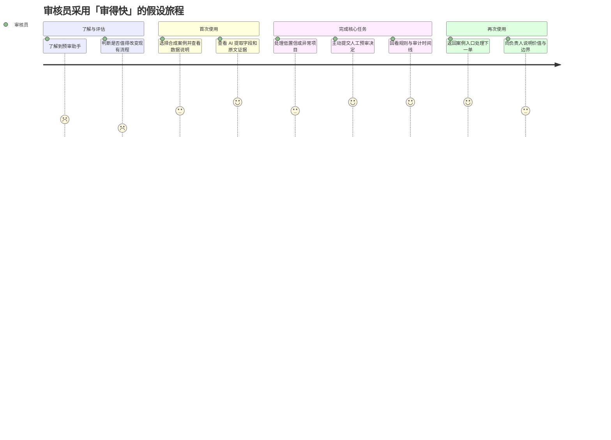
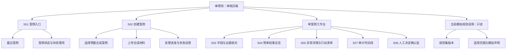
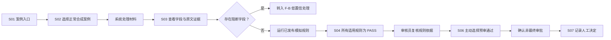
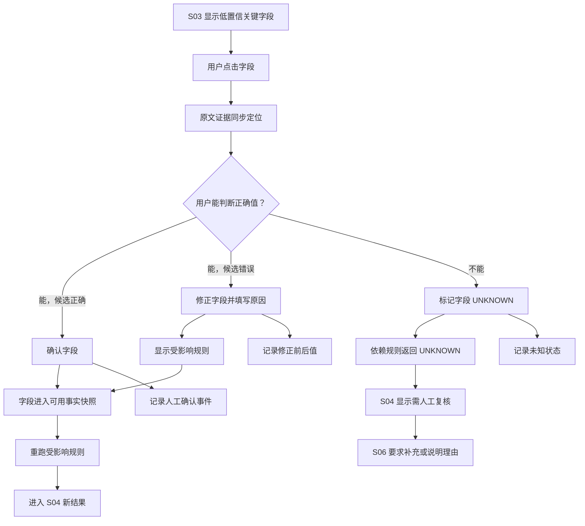
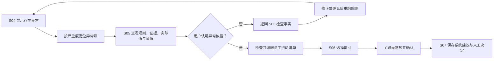
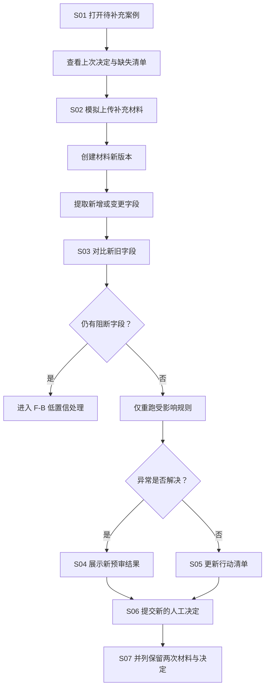
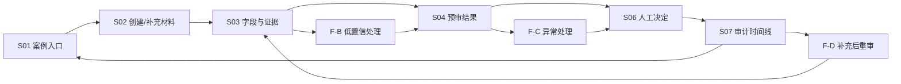

# 「审得快」用户旅程、信息架构与核心任务流程

> 阶段：06A｜体验结构设计  
> 文档状态：低保真原型前的结构基线  
> 核心角色：财务/行政审核员 [H]  
> 证据状态：真实用户样本 `N=0` [F]；旅程、情绪和行为均为待验证假设  
> 本阶段边界：确定旅程、页面范围与任务分支；不进行视觉设计和代码开发

## 0. 本阶段要解决什么

PRD 已经定义“系统需要具备哪些能力”，但还不能直接指导页面设计。本阶段把需求转成用户看得见的体验结构，提前回答四个问题：

1. 审核员从什么情境进入产品，在哪个时刻感受到价值？
2. 首版究竟需要哪些页面，哪些能力不应出现在导航中？
3. 正常、低置信、明确异常和补充材料四种任务如何走完？
4. 每个页面分别承接哪些 PRD 需求和风险假设？

## 1. 核心画像与任务

### 1.1 体验设计对象

| 维度 | 当前定义 |
|---|---|
| 核心画像 | 20–200 人团队中负责费用报销预审的财务/行政审核员 [H] |
| 触发情境 | 收到一组票据与说明，准备检查字段、附件和公司制度 [H] |
| 核心 JTBD | 先看到结构化字段、对应证据和制度异常，把精力放在例外判断上，同时保留最终决定和可追溯记录 [H] |
| 首版成功时刻 | 用户能依据字段证据和规则结果，主动完成一次人工预审决定 [T] |
| 最大信任风险 | 把低置信结果、规则通过或 AI 建议误认为最终审批结论 [H] |

### 1.2 体验原则

1. **先展示事实，再展示判断**：字段与原始证据先于规则结论。[D]
2. **异常优先于成功装饰**：页面首先帮助用户定位需要处理的项目。[D]
3. **未知必须可见**：未知不是失败提示，也不能被折叠进“通过”。[D]
4. **AI 与人工分层**：AI 提取、规则结果和人工决定使用不同标签与区域。[D]
5. **一案一工作台**：材料、字段、结果、决定和审计围绕同一个案例组织。[D]
6. **每次修改可追溯**：修改事实后明确受影响的规则并重新计算。[D]

## 2. 审核员端到端用户旅程

### 2.1 采用到复用旅程图

情绪分值为 1–5 的**假设评分 [H]**，仅用于决定原型先验证哪里，并非用户调研结果。



### 2.2 旅程地图

| 阶段 | 触点 | 用户行为 [H] | 想法与疑问 [H] | 情绪 [H] | 主要痛点 [H] | 产品机会 [D] | 待收集证据 |
|---|---|---|---|---:|---|---|---|
| 认知 | 同事推荐、内部试点说明、作品集演示 | 了解产品能做什么 | “它是帮我整理，还是要替我审批？” | 2/5 | 对 AI 审核的责任和安全存疑 | 首屏直接说明“预审辅助、人工决定、非正式审批” | 首次定位复述、主要顾虑 |
| 考量 | 产品说明、示例案例、安全说明 | 与人工表格、OCR 或现有费控比较 | “值得多打开一个工具吗？数据会去哪？” | 1/5 | 新工具成本、数据风险、价值不明确 | 用完整示例任务展示证据链；明确只用合成数据 | 替代方案、试用阻力、决策标准 |
| 获取与首次进入 | 案例入口、合成案例选择 | 选择预置案例或上传合成材料 | “我要先配置多少内容？” | 3/5 | 冷启动输入过多会立即流失 | 提供 3 个预置案例；默认加载已发布模拟规则 | 首次开始率、首次输入耗时、放弃点 |
| 字段核对 | 单案例工作台、文档证据区 | 浏览字段，定位原文，确认或修正低置信项 | “这个金额从哪里读出来？我改了会影响什么？” | 4/5 | 黑箱字段、修正成本可能抵消效率 | 字段与证据联动高亮；保存前显示受影响规则 | 证据定位理解率、修正率、操作数 |
| 结果与例外 | 预审结果、异常详情、行动清单 | 区分通过、异常、未知并检查依据 | “这是公司规则还是 AI 的意见？下一步怎么做？” | 3/5 | 状态容易混淆，异常解释可能过长 | 三态分组；显示规则版本、实际值、阈值和下一步 | 5 秒状态理解、原因与行动复述 |
| 人工决定 | 决定确认层 | 选择预审通过、退回或要求补充 | “这个决定由谁负责？未知项能否继续？” | 4/5 | 默认操作可能造成过度自动化 | 不默认选中；未知项触发二次确认/理由 | 决定完成率、误认最终审批率 |
| 留痕与复用 | 审计时间线、案例入口 | 回看材料、修正、规则运行和决定 | “之后能否还原我为什么这样处理？” | 4/5 | 记录分散、历史被新版本覆盖 | 追加式时间线；下一单回到基础案例入口 | 回放成功率、再次任务时间、复访意愿 |

### 2.3 关键时刻

| 类型 | 假设时刻 [H] | 设计响应 [D] | 验证方式 |
|---|---|---|---|
| 顿悟时刻 | 用户点击“金额”，原文同步定位，立即知道 AI 从哪里读取 | 字段和证据双向联动；无需打开新页面 | 观察是否无需提示完成证据定位 |
| 决定性时刻 | 用户首次看到 `UNKNOWN` 没有被包装成通过，并能继续人工处理 | 三态信息架构 + 明确人工决定区 | 5 秒理解与责任归属复述 |
| 流失触发点 | 上传后需要大量手工改字段，或不知道系统正在做什么 | 预置案例、处理进度、只阻断关键字段 | 修正操作数、等待退出和任务放弃 |
| 信任修复时刻 | 用户修改字段后，看见受影响规则重算且旧记录仍保留 | 变更摘要、重算提示、审计事件 | 让用户回放一次修正前后结果 |
| 复用时刻 | 用户完成一案后能直接回到入口处理下一单 | 完成页提供明确“返回案例”动作 | 第二次任务启动率与耗时 |

### 2.4 优先体验问题

1. **先验证证据联动，而不是先优化仪表盘。** 这是首次感知核心价值的时刻。[D]
2. **先验证三态结果和人工责任。** 若用户仍将预审理解为最终审批，不应进入真实试点。[D]
3. **控制字段修正成本。** 如果用户修正次数和耗时接近手工录入，AI 抽取价值不成立。[H]
4. **把安全说明放在实际触点。** 数据边界应出现在入口和上传区，而不是只写在帮助文档中。[D]

## 3. 首版信息架构

### 3.1 P0 信息架构图



### 3.2 页面层级决策

```text
一级：案例入口 / 创建案例 / 当前模拟规则说明
二级：单案例工作台
工作台内：字段与证据 / 预审结果 / 审计记录
上下文层：异常详情 / 人工决定确认
```

**[D] 不为七个功能分别建立七条主导航。** S03、S04、S05、S06、S07 是同一案例中的视图或状态，避免审核员在页面之间丢失材料上下文。

### 3.3 页面与视图清单

| ID | 页面/视图 | 形态 | 核心问题 | 主操作 | 离开条件 |
|---|---|---|---|---|---|
| S01 | 案例入口 | 一级页面 | 我现在要处理哪一单？ | 新建案例、继续处理 | 进入 S02 或已有案例 |
| S02 | 创建案例 | 一级页面 | 材料是否已进入且可处理？ | 选择示例/上传、开始预审 | 创建成功进入 S03；失败留在当前页 |
| S03 | 字段与证据核对 | 工作台主视图 | AI 读到了什么，依据在哪里？ | 确认、修正、标记未知 | 无阻断字段后进入 S04 |
| S04 | 预审结果总览 | 工作台主视图 | 哪些通过、异常或未知？ | 展开异常、发起人工决定 | 进入 S05/S06/S07 |
| S05 | 异常详情与行动清单 | 工作台上下文视图 | 为什么异常，下一步做什么？ | 编辑行动项、关联决定 | 返回 S04 或进入 S06 |
| S06 | 人工决定确认层 | 模态/侧层 | 我确认做出什么预审决定？ | 通过、退回、要求补充 | 提交后进入 S07 |
| S07 | 审计时间线 | 工作台主视图 | 这个案例如何走到当前状态？ | 查看版本、返回案例入口 | 返回 S01 或继续查看案例 |

### 3.4 导航约束

- S01 只提供基础最近案例和状态，不实现 P1 的复杂筛选、批量操作或效率看板。[D]
- 单案例工作台始终显示案例 ID、当前状态、材料版本和规则版本。[D]
- 字段与证据、规则结果、人工决定采用不同视觉分区，后续线框不得混为一个“AI 结论”面板。[D]
- S05 与 S06 保留案例上下文，不跳转到独立全屏流程。[D]
- P1 规则编辑、重复检测、通知和分析看板不进入首版主导航。[D]
- 员工补充材料在 Demo 中使用模拟入口，不建设完整员工端账户与通知系统。[D]

## 4. 核心任务流程

### 4.1 F-A｜正常案例快速预审

**目标**：验证清晰、材料齐全的案例能否让审核员快速完成一次有依据的人工决定。[H]



**完成标准 [T]**

- 用户能指出至少一个字段的证据来源。
- 用户能正确说明“规则通过”不等于“最终审批通过”。
- 系统没有默认选中或自动提交人工决定。
- 时间线能回放材料、提取、规则运行和人工决定。

### 4.2 F-B｜低置信字段人工处理

**目标**：验证模型不确定时，用户能低成本纠错，且系统不会错误放行。[H]



**完成标准 [T]**

- 低置信关键字段在处理前不能成为 `PASS` 的依据。
- 修改前展示原值、新值和受影响规则。
- 用户选择“无法判断”后，相关规则只能为 `UNKNOWN`。
- 所有确认、修正和未知操作进入审计时间线。

### 4.3 F-C｜明确异常并退回

**目标**：验证异常解释能否帮助审核员形成清楚、可执行的退回信息。[H]



**完成标准 [T]**

- 用户能复述异常规则、证据、实际值与下一步。
- 退回必须关联至少一条异常、未知或人工备注。
- 用户编辑后的行动清单与系统原始建议分别留存。
- 若用户不认可依据，流程允许回到字段层纠错，而不是直接覆盖规则。

### 4.4 F-D｜补充材料后重新预审

**目标**：验证补充材料不会覆盖历史，并能只更新受影响的事实和规则。[H]



**完成标准 [T]**

- 新材料形成版本，不覆盖旧文件、旧字段和旧规则结果。
- 页面明确显示哪些字段发生变化、哪些规则被重算。
- 新人工决定绑定新的预审运行版本。
- 时间线能解释从“要求补充”到新决定的完整过程。

## 5. 四条流程的汇合关系



这个结构决定后续只需设计一套共用工作台，通过状态变化覆盖四条任务，而不是为每种案例重新开发一套页面。[D]

## 6. 跨流程交互规则

| ID | 规则 [D] | 防止的返工/风险 |
|---|---|---|
| UX-01 | 所有字段值都能定位到原文证据；无证据必须说明 | 避免后期为“可解释”重构字段组件 |
| UX-02 | `PASS`、`EXCEPTION`、`UNKNOWN` 同级展示，不用颜色作为唯一编码 | 避免未知被误解为通过；兼顾无障碍 |
| UX-03 | AI 提取、规则结果、人工决定使用不同标题和来源标签 | 避免责任混淆 |
| UX-04 | 低置信关键字段必须在 S03 解决或转未知 | 防止不确定字段进入通过链路 |
| UX-05 | 字段改变后，相关规则结果先标记过期再重算 | 防止页面显示旧结论 |
| UX-06 | 人工决定没有默认选项，提交前显示当前异常与未知数量 | 防止误操作和过度自动化 |
| UX-07 | 补充材料和修改都创建新版本，历史不覆盖 | 保证审计回放能力 |
| UX-08 | 离开未保存的字段修正或行动清单时提示用户 | 避免操作丢失 |
| UX-09 | 生成解释失败时在原位置显示模板结果，不改变页面结构 | 避免降级状态导致布局重构 |
| UX-10 | 所有上传触点显示“仅限合成/匿名化材料” | 防止作品集演示误收真实数据 |

## 7. 页面—需求—风险追踪

| 页面/视图 | 对应 PRD | 主要风险假设 | 关键指标/测试 |
|---|---|---|---|
| S01 案例入口 | FR-01、FR-09 | V1、B2 | 首个任务开始率、返回下一单 |
| S02 创建案例 | FR-01 | U3、B2 | 创建完成率、处理失败理解率 |
| S03 字段与证据 | FR-02、FR-03、FR-04 | F2、U3、U4 | 字段准确率、证据命中、修正操作数 |
| S04 预审结果 | FR-05、FR-06 | F1、F3、U1 | 三态理解率、关键异常漏报数 |
| S05 异常与行动 | FR-07 | U2、V2、V3 | 原因/下一步复述、清单编辑率 |
| S06 人工决定 | FR-08 | U1、U4 | 决定完成率、误认最终审批率 |
| S07 审计时间线 | FR-09 | U4、B1 | 案例回放成功率、责任归属理解 |

P0 的 FR-01 至 FR-09 均已映射到至少一个页面；FR-10 至 FR-14 保持 P1，不进入本阶段线框范围。[D]

## 8. 线框前需要覆盖的页面状态

下一阶段必须为以下状态绘制线框或状态说明，避免只设计“理想成功路径”：

| 状态 | 至少出现位置 | 必须表达的信息 |
|---|---|---|
| 初始/空态 | S01、S02 | 可以做什么、数据边界、示例入口 |
| 处理中 | S02、S03 | 当前步骤、是否可离开、失败后的保留情况 |
| 处理失败 | S02 | 具体文件、原因、重试或替换动作 |
| 正常通过 | S04 | 规则检查通过但仍需人工决定 |
| 明确异常 | S04、S05 | 规则、证据、实际值、阈值、行动 |
| 未知 | S03、S04、S06 | 缺失原因、受影响规则、人工动作 |
| 低置信 | S03 | 置信标签、证据定位、确认/修正/未知 |
| 结果过期 | S03、S04 | 哪项输入改变、哪些规则等待重算 |
| 未保存变更 | S03、S05 | 保存、放弃或留在当前页面 |
| 决定确认 | S06 | 决定类型、异常/未知数量、责任边界 |
| 补充版本 | S02、S03、S07 | 新旧材料、字段变化、重算和历史 |
| 服务降级 | S03、S04 | 人工录入/模板解释/重试入口 |

## 9. 本阶段冻结与开放项

### 9.1 可进入低保真设计的冻结项 [D]

- 首版只设计审核员主视角。
- 使用 7 个页面/视图编号，实际控制为 3 个一级入口 + 1 个单案例工作台。
- P0 核心价值集中在 S03 字段证据、S04 三态结果和 S06 人工决定。
- 正常、低置信、明确异常和补充材料四条流程共用同一工作台。
- 基础案例入口属于 P0；复杂筛选、批量处理和效率看板仍为 P1。
- 规则版本只读说明进入 P0；规则编辑和发布仍为 P1。

### 9.2 需要用线框验证的开放项 [H]

1. S03 采用“左侧文档、右侧字段”还是“上方摘要、下方证据”更易核对？
2. S04 三态是按状态分组，还是按规则清单统一排序更易扫描？
3. S05 应使用侧栏还是工作台内展开，才能保留足够证据上下文？
4. 存在 `UNKNOWN` 时，S06 应禁用“预审通过”，还是允许二次确认并填写理由？
5. “预审通过”“规则检查通过”两种措辞是否仍会被误解为正式审批？

这些问题不在文档阶段武断决定，将通过两套低保真方案和任务测试比较。[D]

## 10. 第 6A 阶段完成标准

- 核心画像、JTBD、旅程触点、情绪、痛点和关键时刻已经对应。[F]
- P0 所有功能均映射到明确页面，P1 没有进入主流程。[F]
- 四条任务流程均有入口、分支、人工决定和审计终点。[F]
- AI 提取、规则结果与人工决定在结构上保持分离。[F]
- 仍待验证的行为、情绪和目标没有被描述为用户事实。[F]

上一份：[`05-AI架构-数据契约-安全边界.md`](./05-AI架构-数据契约-安全边界.md)  
下一份：[`07-服务蓝图-页面状态矩阵-低保真线框.md`](./07-服务蓝图-页面状态矩阵-低保真线框.md)
