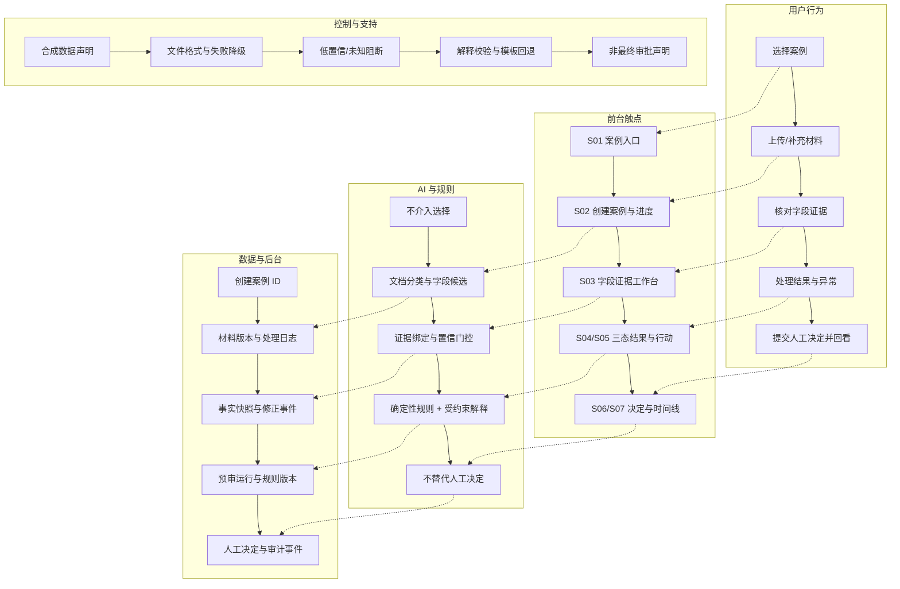
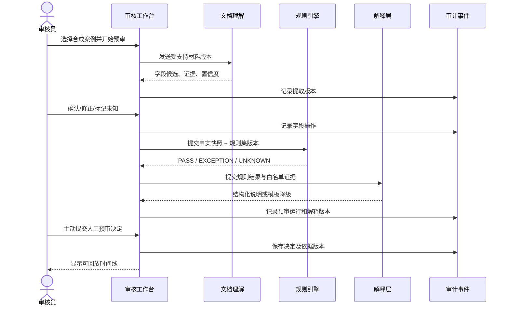
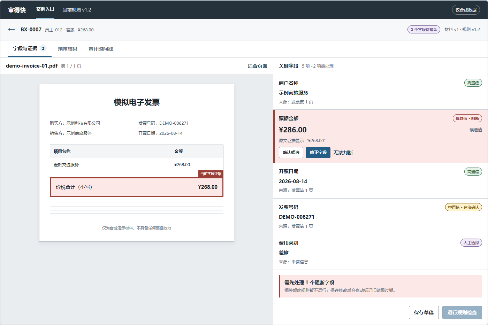
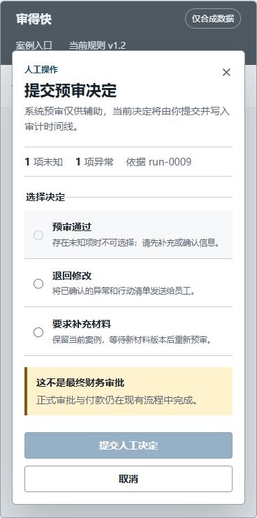

# 「审得快」服务蓝图、页面状态矩阵与低保真线框

> 阶段：06B｜体验结构落图  
> 文档状态：中保真交互原型前的低保真设计基线  
> 核心角色：财务/行政审核员 [H]  
> 证据状态：真实用户样本 `N=0` [F]；布局和交互选择均为待验证设计决策  
> 可视化线框：[`../wireframes/index.html`](../wireframes/index.html)

## 0. 本阶段结论

本阶段没有增加新功能，而是把 P0 需求落实为可评审的页面结构、后台协作关系和异常状态。[D]

首个低保真方案采用：

1. **桌面优先的单案例工作台**：材料、字段、规则结果和人工决定不离开案例上下文。
2. **字段—证据左右分栏**：点击字段时在原文中定位来源，移动端改为上下堆叠。
3. **三态优先列表**：先显示 `UNKNOWN`，再显示 `EXCEPTION`，最后显示 `PASS`。
4. **上下文侧栏展示异常**：保留当前规则列表和案例信息，不打开独立页面。
5. **存在 `UNKNOWN` 时暂时禁用“预审通过”**：首轮测试先验证最清晰、最保守的边界。
6. **人工决定独立确认**：没有默认选项，不与 AI 建议或规则结果合并。

这些均为 **[D] 原型决策**，不是用户已经认可的结论。

## 1. 服务蓝图

### 1.1 可视化蓝图

### 1.2 蓝图分层说明

| 阶段 | 用户目标 [H] | 前台可见 | 后台动作 [D] | 关键证据 | 失败/降级 [D] |
|---|---|---|---|---|---|
| 进入 | 找到待处理案例并理解产品边界 | 最近案例、状态、合成数据提示 | 创建/读取匿名案例索引 | 案例 ID、当前状态 | 加载失败时保留新建入口 |
| 材料 | 确认材料已进入并知道处理进度 | 文件、页数、处理步骤、失败原因 | 文件校验、分类、字段候选提取 | 材料版本、处理日志 | 单文件失败不伪装成功；允许替换 |
| 字段 | 判断 AI 读到什么、依据在哪里 | 字段值、置信度、原文定位、修正动作 | Schema 校验、证据绑定、事实快照 | 文档区域、原始文本、模型版本 | 无证据或低置信转人工/未知 |
| 结果 | 快速理解通过、异常和未知 | 三态数量、规则依据、实际值、阈值、行动项 | 版本化规则运行、解释校验 | 规则版本、输入快照、证据 ID | 规则失败转未知；解释失败用模板 |
| 决定 | 做出有责任边界的人工决定 | 决定选项、异常/未知摘要、二次确认 | 保存人工决定，冻结所依据的运行版本 | 审核员、理由、时间、运行 ID | 不自动提交；未知状态阻断首版通过 |
| 留痕 | 还原案例为何得到当前结果 | 材料、修正、运行、解释和决定时间线 | 追加式事件存储 | 事件 ID、对象版本、操作者 | 回放失败时不声称审计完整 |

### 1.3 关键系统时序

## 2. 页面布局基线

### 2.1 全局框架

| 区域 | 内容 | 固定约束 [D] |
|---|---|---|
| 顶部产品栏 | 产品名、案例入口、当前模拟规则、合成数据标识 | 不展示营销口号，不把状态做成装饰 |
| 案例上下文栏 | 返回入口、案例 ID、费用类型、金额、当前状态 | S03–S07 始终可见，防止上下文丢失 |
| 工作台页签 | 字段与证据、预审结果、审计时间线 | 只保留三个主视图 |
| 主工作区 | 当前任务内容 | 同一时间只有一个主任务 |
| 上下文层 | 异常详情或人工决定 | 侧栏/模态覆盖，不跳出案例 |

### 2.2 关键布局选择

| 问题 | 采用方案 [D] | 放弃方案 | 原因 |
|---|---|---|---|
| S03 字段核对 | 桌面左右分栏；窄屏上下堆叠 | 字段和证据分成两个页面 | 核对任务需要同时看到候选值和来源 |
| S04 三态结果 | 状态计数 + 按优先级排列的统一列表 | 三个独立页面/标签 | 规则数量少，统一列表更容易看见未知和异常 |
| S05 异常详情 | 桌面右侧上下文栏；窄屏内联展开 | 独立全屏详情页 | 保留案例和规则列表上下文 |
| S06 人工决定 | 居中确认层 | 页面底部固定按钮直接提交 | 强制用户停下来确认责任与当前风险 |
| `UNKNOWN` 处理 | 首版禁用预审通过 | 允许填写理由强制覆盖 | 先验证最清楚的安全边界，后续再对照测试 |
| 规则说明 | 只读入口 | 把规则编辑放入主导航 | 规则配置为 P1，避免首版范围膨胀 |

## 3. 页面状态矩阵

### 3.1 S01｜案例入口

| 状态 ID | 触发 | 用户看见 | 主操作 | 禁止行为/护栏 [D] |
|---|---|---|---|---|
| S01-E | 没有案例 | 空态、合成数据说明、示例入口 | 新建示例案例 | 不伪造历史数据和效率指标 |
| S01-R | 有案例 | 最近案例、金额、费用类型、状态、更新时间 | 继续处理/新建 | 不提供 P1 批量审批和复杂筛选 |
| S01-X | 列表加载失败 | 明确失败原因和重试 | 重试、新建示例 | 不显示过期列表为最新状态 |

### 3.2 S02｜创建案例与材料处理

| 状态 ID | 触发 | 用户看见 | 主操作 | 禁止行为/护栏 [D] |
|---|---|---|---|---|
| S02-D | 初始进入 | 三个预置合成案例、上传区域、数据边界 | 选择案例/上传 | 不允许默认为真实数据入口 |
| S02-V | 文件校验 | 文件类型、大小、页数检查进度 | 等待/取消 | 未校验文件不得进入提取 |
| S02-P | 正在处理 | 当前步骤：解析、提取、绑定证据 | 可离开后返回 | 不使用无限加载或虚假完成百分比 |
| S02-F | 单文件失败 | 失败文件、错误码、重试/替换动作 | 替换或重试 | 失败材料不能静默忽略 |
| S02-C | 处理完成 | 文档数、待确认字段数、下一步 | 进入字段核对 | 不直接跳到“审核通过” |

### 3.3 S03｜字段与证据核对

| 状态 ID | 触发 | 用户看见 | 主操作 | 禁止行为/护栏 [D] |
|---|---|---|---|---|
| S03-L | 字段加载中 | 文档骨架、字段骨架、当前步骤 | 等待/返回 | 不显示旧字段为当前结果 |
| S03-H | 高置信且有证据 | 候选值、原文区域、来源标签 | 查看/确认 | 高置信仍允许人工复核 |
| S03-M | 中置信关键字段 | 提醒、证据、建议确认 | 确认/修正/未知 | 不用模糊文案隐藏风险 |
| S03-LC | 低置信关键字段 | 强提醒、阻断说明、证据定位 | 确认/修正/未知 | 处理前不得成为 `PASS` 依据 |
| S03-U | 无证据或冲突 | 多来源并列/缺失原因 | 标记未知/补充材料 | 不替用户猜一个值 |
| S03-ED | 正在编辑 | 原值、新值、修改原因、受影响规则 | 保存并重算/取消 | 离开前提示未保存变更 |
| S03-ST | 修改后结果过期 | 哪些规则需要重算 | 重新检查 | 旧规则结果不得继续显示为有效 |
| S03-DG | AI 不可用 | 人工录入模式、服务状态 | 手工录入/稍后重试 | 不因模型失败阻断人工流程 |

### 3.4 S04｜预审结果总览

| 状态 ID | 触发 | 用户看见 | 主操作 | 禁止行为/护栏 [D] |
|---|---|---|---|---|
| S04-R | 规则运行中 | 当前规则集版本和运行状态 | 等待/返回字段 | 不展示上次结果为本次结果 |
| S04-P | 全部适用规则通过 | `PASS` 数量、规则依据、“仍需人工决定” | 发起人工决定 | 不写“AI 已审批通过” |
| S04-E | 至少一项异常、无未知 | 异常优先列表、实际值和阈值 | 查看异常/决定 | 不将异常折叠在通过项之后 |
| S04-U | 至少一项未知 | 未知优先、缺失原因、受影响规则 | 回字段/要求补充 | 不显示“全部通过” |
| S04-ST | 输入已改变 | 结果过期提示、影响范围 | 重新检查 | 禁止提交基于旧运行的决定 |
| S04-X | 规则服务失败 | 失败原因、规则版本、重试 | 重试/人工处理 | 不将服务失败当作未知业务结果或通过 |

### 3.5 S05｜异常详情与行动清单

| 状态 ID | 触发 | 用户看见 | 主操作 | 禁止行为/护栏 [D] |
|---|---|---|---|---|
| S05-E | 打开明确异常 | 规则、条款、证据、实际值、阈值、差值 | 接受依据/回到字段 | 不新增证据中没有的事实 |
| S05-U | 打开未知项 | 缺什么、为什么不能判断、受影响结果 | 要求补充/人工备注 | 不生成确定性合规结论 |
| S05-T | 解释生成失败 | 确定性模板和原始规则结果 | 继续处理 | 页面结构和规则状态不因降级改变 |
| S05-ED | 编辑行动清单 | 原始建议、人工编辑内容、未保存提示 | 保存/取消 | 原始系统建议不得被覆盖删除 |

### 3.6 S06｜人工决定确认

| 状态 ID | 触发 | 用户看见 | 主操作 | 禁止行为/护栏 [D] |
|---|---|---|---|---|
| S06-P | 全部规则通过 | 三个决定选项、0 异常/0 未知、责任说明 | 选择并提交 | 无默认选项，不自动点击 |
| S06-E | 存在异常、无未知 | 异常数量、关联行动清单 | 退回/要求补充；通过需说明 [P1 实验] | 首版不提供无理由覆盖 |
| S06-U | 存在未知 | 未知数量、缺失信息、“预审通过”禁用 | 要求补充/取消 | 首版不得提交预审通过 |
| S06-V | 决定信息不完整 | 缺少选择、关联项或理由 | 补全信息 | 不以通用错误提示替代具体字段反馈 |
| S06-S | 提交中 | 决定、依据运行版本、提交状态 | 等待 | 防止重复提交 |
| S06-X | 提交失败 | 决定未保存、失败原因 | 重试/取消 | 不显示已完成或写入假时间线 |

### 3.7 S07｜审计时间线

| 状态 ID | 触发 | 用户看见 | 主操作 | 禁止行为/护栏 [D] |
|---|---|---|---|---|
| S07-L | 加载中 | 时间线骨架和案例版本 | 等待 | 不混用其他案例事件 |
| S07-R | 正常回放 | 材料、提取、修正、规则运行、解释和决定 | 展开事件/返回入口 | 不覆盖旧版本或省略操作者 |
| S07-E | 事件缺失/回放失败 | 缺失范围和不可证明项 | 重试/报告问题 | 不声称审计完整 |
| S07-N | 尚无人工决定 | 已有处理事件、“等待决定”状态 | 返回 S03/S04 | 不把规则运行当作决定终点 |

## 4. 低保真线框说明

完整线框板可直接打开：[`../wireframes/index.html`](../wireframes/index.html)。

### 4.1 关键线框预览

桌面主工作台：字段候选、置信度与票据原文保持在同一视野。

窄屏人工决定：未知状态、责任说明和禁用操作均保持可见。

### 4.2 S01｜案例入口

- 使用紧凑表格而不是仪表盘卡片，符合高频审核任务的扫描习惯。[D]
- 只显示案例编号、人员匿名标识、类型、金额、状态和更新时间。
- 只保留“新建案例”和“继续处理”两个核心动作。

### 4.3 S02｜创建案例

- 首先展示合成数据边界，再提供三个预置任务：正常、低置信、明确异常。
- 上传只是次要入口，避免作品集演示时误用真实票据。
- 处理状态按真实步骤显示，不制造无法验证的百分比。

### 4.4 S03｜字段与证据

- 桌面左侧约 55% 显示文档，右侧约 45% 显示字段列表。[D]
- 当前字段在文档和列表中同时高亮；状态不只依赖颜色。
- 字段行直接提供确认、修正和未知入口，减少弹窗层级。

### 4.5 S04｜三态结果

- 顶部只显示 `UNKNOWN / EXCEPTION / PASS` 三个计数，不增加虚假效率 KPI。
- 下方按风险优先顺序排列规则，用户能在同一视图比较状态。
- “提交人工决定”与“规则检查通过”在措辞和区域上分开。

### 4.6 S05｜异常详情

- 桌面使用右侧上下文栏，保留左侧规则列表；窄屏改为当前规则后的内联区域。
- 规则、证据、实际值/阈值和行动清单按判断顺序排列。
- 系统建议与人工编辑分别保存。

### 4.7 S06｜人工决定

- 使用单独确认层，三个选项无默认选择。
- 当前线框演示存在未知项：预审通过不可选，并解释为什么。
- 提交前展示依据的预审运行版本，防止基于过期结果决定。

### 4.8 S07｜审计时间线

- 按时间顺序显示对象、动作、操作者和版本，不使用装饰性活动流。
- 人工决定使用独立事件，不能被规则结果替代。
- 结束动作是返回案例入口，不新增分析看板。

## 5. 响应式与无障碍要求

| 项目 | 桌面 ≥1024px | 窄屏 ≤720px |
|---|---|---|
| 导航 | 顶部水平导航 | 自动换行，保留当前案例信息 |
| 字段证据 | 左右分栏 | 文档在上、字段在下 |
| 异常详情 | 右侧上下文栏 | 当前规则下方内联展开 |
| 人工决定 | 居中确认层 | 近全宽确认区，按钮纵向排列 |
| 案例列表 | 完整表格 | 可横向查看必要列；核心状态优先 |
| 状态编码 | 文字 + 图形/边框 + 颜色 | 同样规则，不因宽度隐藏状态词 |

通用要求：[D/T]

- 键盘可访问所有链接、页签、字段和决定选项。
- 主要状态不只依靠颜色表达。
- 焦点顺序遵循页面阅读顺序，不创建自定义 `tabindex`。
- 错误信息紧邻发生位置，并提供下一步动作。
- 360px 宽度下按钮和最长状态文字不遮挡其他内容。[T]

## 6. 线框评审测试

在进入中保真交互前，使用合成任务完成以下走查：

| 测试 | 输入案例 | 观察问题 | 通过标准 [T] |
|---|---|---|---|
| T1 证据定位 | 低置信金额 | 用户能否找到金额原文并修正？ | 无提示完成；能指出修改影响 |
| T2 三态理解 | 1 未知 + 1 异常 + 3 通过 | 用户能否区分未知和异常？ | 5 秒内正确复述 |
| T3 责任理解 | 全部规则通过 | 用户是否认为系统已正式审批？ | 误认人数为 0 |
| T4 异常处置 | 金额超过模拟额度 | 用户能否说明原因和下一步？ | 原因、证据、阈值、动作全部正确 |
| T5 补充重审 | 缺附件后补充 | 用户能否理解新旧版本和重算范围？ | 能定位两次运行和新决定 |
| T6 降级处理 | AI 提取不可用 | 用户能否继续人工录入？ | 不被阻断，且不误以为 AI 已完成 |

这些测试可先由非财务背景参与者验证基础理解，但不能替代真实审核员的价值和专业可用性验证。[D]

## 7. 需求与线框一致性检查

| 检查项 | 结果 [F] |
|---|---|
| FR-01 至 FR-09 均有对应页面或状态 | 已覆盖 |
| 正常、低置信、异常、未知、补充和降级均有落点 | 已覆盖 |
| AI 提取、规则结果与人工决定分开展示 | 已覆盖 |
| P1 复杂筛选、规则编辑、通知和看板未进入线框 | 已控制 |
| 线框使用合成案例和匿名角色 | 已遵守 |
| 所有关键状态均有主操作和禁止行为 | 已定义 |

## 8. 第 6B 阶段完成定义

- 服务蓝图已连接用户行为、页面、AI/规则、数据和控制措施。[F]
- S01–S07 均有正常、异常或降级状态定义。[F]
- 七个核心视图已形成可直接查看的低保真线框。[F]
- 布局决策与 PRD、数据契约和风险假设保持一致。[F]
- 尚未声称线框已经过真实用户验证。[F]

上一份：[`06-用户旅程-信息架构-核心任务流程.md`](./06-用户旅程-信息架构-核心任务流程.md)  
下一阶段：07｜中保真可点击原型与可用性任务设计
