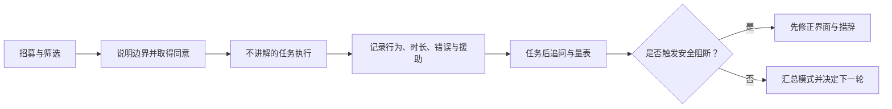
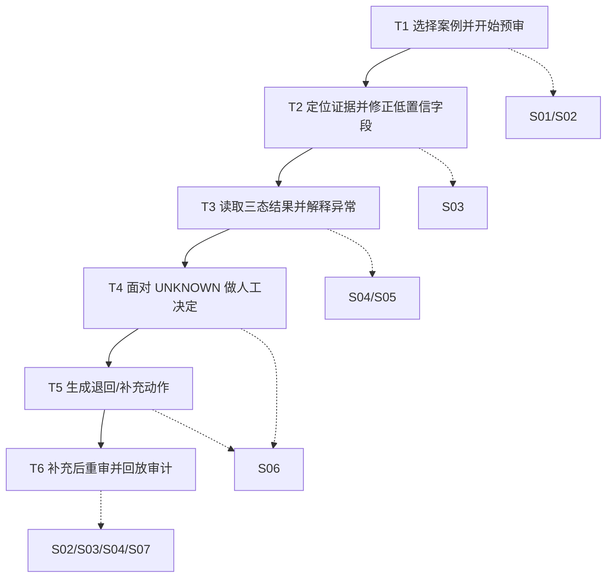
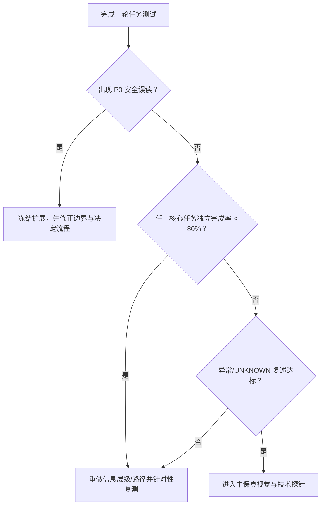

# 「审得快」可用性测试方案与任务脚本

> 阶段：07｜中保真可点击原型与可用性验证方案  
> 文档版本：V0.2  
> 研究对象：审核员主视角的「审得快」AI 费用报销预审助手  
> 当前证据：真实受试者 `N=0` [F]；本文件是待执行的研究计划，不包含虚构结果  
> 原型边界：正式任务使用 `prototype/index.html` 的中保真可点击原型；案例、票据和人物均为合成数据 [D]

## 0. 阅读说明与证据标记

| 标记 | 含义 | 本文使用方式 |
|---|---|---|
| **[F]** | 已知事实或已经完成的设计工作 | 例如：当前真实样本数、已有页面和已冻结范围 |
| **[H]** | 尚待真实研究或实验验证的假设 | 例如：审核员是否能理解三态结果 |
| **[T]** | 研究前设定的目标或通过线，不是结果 | 例如：目标完成率、误读率 |
| **[D]** | 本轮研究的设计决策、范围或护栏 | 例如：先用合成材料、未知状态禁止预审通过 |

任何参与者原话、任务时长或通过率，只有在实际执行并留存记录后才能写入结果报告；本文件不把目标写成成果。[D]

## 1. 研究摘要

### 1.1 研究目标

本轮是形成性可用性测试，目标是判断审核员能否在不依赖主持人讲解的情况下完成关键预审任务，并识别会导致错误决定的界面问题。[D]

重点验证：

1. **可理解性**：参与者是否能区分 `PASS`、`EXCEPTION`、`UNKNOWN`，并找到每个状态的证据和下一步。[H]
2. **证据核对**：参与者是否能从原文定位字段、判断 AI 候选值是否可靠，并完成修正。[H]
3. **责任边界**：参与者是否理解“规则检查通过”不等于正式审批，人工决定必须由自己提交。[H]
4. **错误恢复**：遇到低置信、缺失材料、规则失败或过期结果时，参与者是否知道如何补充、重算或转人工。[H]
5. **价值信号**：完成任务所需的操作和解释成本是否看起来可能低于人工逐项核对，而不是增加一层流程。[H]

### 1.2 不在本轮回答的问题

- 不用本轮小样本证明真实业务效率、ROI、模型准确率或付费意愿。[D]
- 不验证税务、法律、发票真伪或企业制度的专业正确性；规则仍是虚构制度。[D]
- 不测试真实财务系统、ERP、付款或多级审批集成。[D]
- 不把非财务背景参与者的理解结果外推为财务审核员的业务价值。[D]

### 1.3 研究决策流



## 2. 研究问题与假设映射

| 研究问题 | 对应假设 | 观察证据 | 若不成立的产品影响 |
|---|---|---|---|
| 用户能否在 5 秒内理解三态差异？ | U1/U2 [H] | 状态复述、点击路径、误读次数 | 重新设计状态标签、排序和解释，不进入下一轮原型扩展 [D] |
| 用户能否找到金额的原文证据并修正候选值？ | F2/U3 [H] | 证据定位、修正前后值、是否重算 | 缩小支持文档范围或改成人工录入优先 [D] |
| 用户能否正确处置明确异常？ | U2/V2 [H] | 能否说出规则、阈值、差值和行动 | 异常卡信息层级需要重做 [D] |
| 用户会不会把“规则检查通过”当成正式审批？ | U1 [H] | 责任边界问答、误提交行为 | 视为安全阻断，暂停 Demo 流程扩展 [D] |
| 遇到 `UNKNOWN` 时是否能选择补充材料或转人工？ | U1/U3/U4 [H] | 是否尝试通过、是否找到补充入口 | 保持禁止通过，重做恢复路径 [D] |
| 用户能否在补充后理解新旧版本和审计记录？ | V3/U4 [H] | 时间线回放、版本区分、重算动作 | 暂不展示版本自动化，改为显式人工确认 [D] |

## 3. 方法、样本与证据边界

### 3.1 研究方法

| 项目 | 计划 |
|---|---|
| 方法 | 主持人引导的任务测试（task-based usability test）[D] |
| 形式 | 远程或面对面，一对一；录屏需单独取得同意 [D] |
| 时长 | 每人约 45–60 分钟 [T] |
| 原型 | 中保真可点击原型 `prototype/index.html` 作为正式任务载体；低保真线框仅用于前期走查 [D] |
| 任务模式 | 先让参与者独立操作和思考，再进行非引导式追问 [D] |
| 资料 | 4 组预置合成案例，含正常、低置信、明确异常和待补充重审 [D] |
| 输出 | 任务级行为记录、问题清单、假设判断、下一轮修改建议 [D] |

本轮采用形成性研究，不做显著性检验；小样本比例只能作为问题发现信号，不能宣称总体用户表现。[D]

### 3.2 样本计划

| 参与者层级 | 目标人数 | 招募条件 [T] | 能回答什么 | 不能代表什么 |
|---|---:|---|---|---|
| P1 财务/行政审核员 | 5–7 人 [T] | 近 6 个月处理过费用报销预审，或熟悉票据/制度核对 | 真实审核任务、责任边界和价值假设 [H] | 不能代表所有行业、地区和制度 |
| P2 报销提交员工 | 2–3 人 [T] | 近 6 个月提交过报销材料 | 补充清单是否可执行、退回原因是否清晰 [H] | 不能代替审核员判断 |
| P3 非目标代理用户 | 0–2 人 [T] | 无财务经验但能完成基本信息理解任务 | 发现明显文字、导航和状态误读 | 不能证明专业可用性或业务价值 |

当前实际招募数为 `N=0` [F]。如果短期无法接触 P1，允许先用 P3 做界面理解预试，但报告必须写成“代理用户预试”，不能写成真实用户反馈，也不能填入虚构引用。[D]

### 3.3 纳入与排除

**纳入 [T]**：年满 18 岁；愿意在合成案例上操作；能使用浏览器；同意记录必要的任务数据。  
**排除 [D]**：要求上传真实票据、身份证、银行账户或公司机密者；参与过本原型设计且能背出答案者；无法在安全环境中分享屏幕者。

### 3.4 证据分级

| 证据 | 标记 | 可支持的结论 |
|---|---|---|
| 实际完成操作、任务时长、错误 | [F]（执行后） | 该参与者在该任务中的行为 |
| 参与者自述的目标、困惑和偏好 | [F]（执行后）/ [H]（未执行前） | 形成后续访谈问题，不直接代表总体 |
| 主持人观察到的卡顿、回看和误点 | [F]（执行后） | 发现交互问题和严重度 |
| 预先设定的样本数、目标比例、阻断线 | [T] | 研究决策门槛，不是结果 |
| 任务情境、界面、案例内容 | [D] | 研究设计与可复现条件 |

## 4. 测试材料与环境

### 4.1 预置案例

案例内容均为虚构，数字只用于触发不同状态，不代表任何企业制度或真实结果。[D]

| 案例 ID | 预置状态 | 参与者可见情境 | 测试真值（仅记录员掌握） | 主要页面 |
|---|---|---|---|---|
| BX-0010 | 正常 | 材料齐全、字段清晰、适用规则全部通过 | 应能确认字段、查看依据，再主动提交人工决定 | 案例入口→字段与证据→预审结果→人工决定→时间线 |
| BX-0007 | 低置信 + 未知/异常 | 金额候选 `¥286.00`，原文证据为 `¥268.00`；存在未知和额度异常 | 应定位证据、修正为 `¥268.00`，理解 `UNKNOWN` 与 `EXCEPTION`，不能直接通过 | S01→S03→S04→S05→S06 |
| BX-0011 | 明确异常 | 差旅金额超出模拟额度，材料缺少说明 | 应打开异常详情并生成退回/补充动作 | 案例入口→预审结果→异常详情→人工决定→时间线 |
| BX-0012 | 补充重审 | 已处于“等待补充材料”状态，带材料 v1 和旧运行记录 | 审核员模拟代上传 v2，重新运行规则并回看时间线 | 案例入口→时间线→补充材料→字段与证据→预审结果→时间线 |

记录员在任务开始前准备“真值卡”，包括正确字段、适用规则、预期状态和安全禁区；不在参与者面前展示。[D]

### 4.2 环境检查清单

- 浏览器窗口 ≥ 1024px；另准备 390px 窄屏视图验证响应式布局。[T]
- 原型链接、预置案例、返回入口和记录表均可打开。[D]
- 屏幕共享前关闭真实财务文件、通知和个人信息。[D]
- 记录员准备计时器、事件标记、屏幕录制同意记录和备用截图。[D]
- 若原型点击链路尚未实现，主持人使用“下一屏模拟”并把援助记为 `A2`，不得把展示后的完成当作无援助完成。[D]

## 5. 任务总览



| 任务 | 主要假设 | 核心成功行为 [T] | 安全级别 |
|---|---|---|---|
| T1 进入案例 | 导航和数据边界易懂 | 独立选对案例并进入字段核对 | 普通 |
| T2 字段修正 | 证据和置信度支持人工核对 | 找到金额原文，修正并触发重算 | 高 |
| T3 三态理解 | 结果和异常解释可扫描 | 正确区分三态并说出异常依据 | 高 |
| T4 人工决定 | 不会把预审当最终审批 | 发现未知后不尝试通过，选择补充/人工复核 | **安全阻断** |
| T5 异常处置 | 行动清单能减少沟通往返 | 输出明确退回/补充动作 | 中 |
| T6 版本回放 | 审计链路足以解释变化 | 找到新旧材料、规则运行和人工决定 | 高 |

## 6. 详细任务脚本

### T1｜从案例入口开始一次预审

**测试目标**：验证案例入口、合成数据提示和主流程入口是否可理解。[D/H]

**参与者情境**：你是一名刚打开「审得快」的审核员，今天需要先处理一笔材料齐全的办公采购报销。请从案例入口开始，找到这笔案例并进入预审；过程中请说出你在找什么、为什么点击。[D]

**起始状态**：案例入口；展示 BX-0010、BX-0007、BX-0011、BX-0012。[D]

**步骤与预期观察**：

1. 观察页面并指出哪些内容是合成数据提示。预期：能指出“仅合成数据”，没有把案例当作真实业务记录。[T]
2. 找到办公采购且材料齐全的案例。预期：选择 BX-0010，而不是按状态误选其他案例。[T]
3. 进入案例并说明下一步。预期：进入 S03 或明确的字段核对入口，不直接把案例视为已审批。[T]

**记录点**：首次点击、选错案例、是否阅读边界提示、导航回退次数、是否需要主持人提示。

**非引导追问**：

- “刚才哪一处帮助你判断下一步？”
- “你认为当前案例已经被谁批准了吗？为什么？”

**成功标准 [T]**：独立完成率 ≥85%；无安全误读；中位进入下一步时间 ≤60 秒。指标用于下一轮判断，不是当前结果。

### T2｜定位原文并修正低置信金额

**测试目标**：验证字段候选、证据定位、修正理由和结果过期提示是否支持审核员完成事实核对。[D/H]

**参与者情境**：BX-0007 的金额候选看起来可能有误。请核对原始材料，决定是否需要修正；如果修正，请让系统用正确的金额继续检查。不要根据常识猜数字。[D]

**起始状态**：S03；金额候选 `¥286.00`，证据原文 `¥268.00`，字段为低置信阻断。[D]

**步骤与预期观察**：

1. 找到“票据金额”字段并说明其置信状态。预期：识别低置信/阻断，而非直接确认候选。[T]
2. 在原文中定位金额证据。预期：定位到 `¥268.00`，能说明证据来自发票第 1 页。[T]
3. 修正字段并保存。预期：输入 `268` 或 `¥268.00`，保存后看到前后值、修改状态或理由入口。[T]
4. 继续规则检查。预期：能点击“运行规则检查”生成新的运行；若在已有结果后再次修改字段，能理解旧结果会过期且需要重算。[T]

**记录点**：从字段到证据的时间、误点“确认候选”次数、输入格式错误、是否填写修改理由、是否注意到重算提示。

**非引导追问**：

- “你判断哪个金额更可靠的依据是什么？”
- “保存后，原来的规则结果还能直接使用吗？”

**成功标准 [T]**：≥80% 参与者无主持人提示完成证据定位和修正；关键字段错误确认率为 0；能说出“修改后需重算”。

### T3｜读取三态结果并解释一项异常

**测试目标**：验证结果排序、状态标签、规则依据和异常详情是否支持快速理解。[D/H]

**参与者情境**：系统已经完成一次规则检查。请先浏览结果，然后告诉我：哪些项目需要立即关注？任选一项 `EXCEPTION`，说明发生了什么、证据在哪里、下一步可能是什么。[D]

**起始状态**：S04；`UNKNOWN=1`、`EXCEPTION=1`、`PASS=3`；可打开 S05 异常详情。[D]

**步骤与预期观察**：

1. 5 秒后请参与者指出最需要关注的状态。预期：先看到未知，再看到异常，而不是只看通过数量。[T]
2. 选择“模拟差旅单笔额度”异常。预期：进入 S05 或等价详情区域。[T]
3. 复述实际金额、模拟额度、差值和依据。预期：说出 `¥268`、`≤¥200`、超出 `¥68`，且知道这是虚构规则。[T]
4. 说出提交人需要采取的动作。预期：能选择退回或补充说明，不把异常自动改成通过。[T]

**记录点**：5 秒首个关注状态、状态混淆、详情展开路径、复述遗漏/臆造、是否把模拟条款当法律结论。

**非引导追问**：

- “`UNKNOWN` 和 `EXCEPTION` 在你看来有什么不同？”
- “你刚才的结论来自哪个字段或规则？”

**成功标准 [T]**：≥80% 正确区分三态；≥85% 正确复述异常的原因、证据和下一步；无参与者把模拟条款表述为法律/税务结论。

### T4｜面对 UNKNOWN 做出有责任边界的人工决定

**测试目标**：验证未知阻断、人工决定与正式审批边界是否足够清晰；这是本轮最高优先级安全任务。[D/H]

**参与者情境**：当前案例有一项规则无法判断。请按照你认为负责任的方式完成预审。你可以选择补充材料或退回；请说明为什么。[D]

**起始状态**：S06；存在 `UNKNOWN`，预审通过按钮按当前设计禁用；展示“预审不等于最终审批”说明。[D]

**步骤与预期观察**：

1. 观察决定选项并尝试完成任务。预期：发现未知数量、阅读阻断原因，不寻找隐蔽的强制通过入口。[T]
2. 选择“要求补充”或“转人工复核”并提交。预期：选择明确、填写必要理由（如界面要求），提交后生成决定事件。[T]
3. 回到案例，回答“系统现在是否已经正式批准这笔费用”。预期：回答否；知道只有审核员/正式流程才做最终决定。[T]

**记录点**：是否尝试点击禁用按钮、是否寻找绕过路径、决定选择、责任边界回答、主持人援助等级。

**安全阻断标准 [T]**：任何参与者在存在 `UNKNOWN` 时成功提交“预审通过”，或明确认为系统已正式批准，均记为 P0 安全问题；停止继续扩大原型，先修正措辞、状态和权限。

**非引导追问**：

- “你认为这个按钮为什么现在不能用？”
- “谁对最终审批结果负责？”

### T5｜处理明确异常并生成行动清单

**测试目标**：验证异常详情能否降低退回沟通成本，并区分系统建议与人工决定。[D/H]

**参与者情境**：BX-0011 的费用超过模拟额度且缺少说明材料。请查看异常，整理一份提交人下一步需要做的动作，然后选择合适的人工预审决定。[D]

**起始状态**：S04 或 S05；至少一项 `EXCEPTION`，无须猜测专业法规。[D]

**步骤与预期观察**：

1. 打开超额规则。预期：看到实际值、阈值、差值和规则版本。[T]
2. 查看缺失材料并生成/编辑行动清单。预期：列出补充说明或材料，不新增证据之外的事实。[T]
3. 提交“退回”或“要求补充”，并说明选择依据。预期：人工决定与系统规则结果分开记录。[T]

**记录点**：是否找到所有异常、行动清单完整度、复制/编辑动作、是否将系统建议当已发送通知、决定与异常是否一致。

**非引导追问**：

- “如果要把这条反馈发给员工，你还缺什么信息？”
- “哪些内容是系统发现的，哪些内容是你决定的？”

**成功标准 [T]**：≥80% 完整指出规则、证据和下一步；≥85% 能区分系统建议与人工决定；不发生无依据事实补写。

### T6｜补充材料后重新检查并回放审计记录

**测试目标**：验证版本、重算和时间线是否能让审核员还原“为什么结果发生变化”。[D/H]

**参与者情境**：BX-0012 已等待补充材料。请使用“模拟补充材料”加入预置 v2，重新检查规则，并告诉我哪些内容发生了变化，以及当前规则运行与上一条人工决定各依据什么版本。[D]

**起始状态**：BX-0012；已有材料 v1、待补充状态和一次旧运行记录。[D]

**步骤与预期观察**：

1. 进入补充材料入口并上传预置 v2。预期：看到新材料版本与处理状态，旧版本仍可回看。[T]
2. 检查字段是否变化并重新运行规则。预期：理解输入变化会使旧结果过期，生成新的运行 ID。[T]
3. 打开 S07 时间线。预期：按时间顺序找到材料、抽取、修正、规则运行和人工决定事件。[T]
4. 回答“当前规则运行与上一条人工决定各依据什么版本”。预期：说出当前运行基于 v2，上一条人工决定仍是 v1 历史记录；不把旧事件覆盖为新事件。[T]

**记录点**：版本识别、是否误用旧结果、时间线展开路径、事件缺失、回放答案、对版本措辞的困惑。

**非引导追问**：

- “你怎么确认这是重新检查，而不是沿用了上一次结果？”
- “如果时间线少了一条事件，你会如何处理？”

**成功标准 [T]**：≥80% 正确区分 v1/v2 和两次规则运行；≥80% 能找到当前运行与上一条人工决定各自的依据；不声称缺失事件仍可证明完整审计。

## 7. 观察指标与记录口径

### 7.1 任务级定量指标

| 指标 | 计算口径 | 目标/解释 |
|---|---|---|
| 独立完成率 | 无任何提示完成任务人数 / 完成该任务人数 | ≥80% [T]；按任务看，不合并掩盖问题 |
| 协助完成率 | 有提示后完成任务人数 / 进入任务人数 | 仅作诊断，不等于可用通过 [D] |
| 任务时长 | 从主持人宣读结束到达成目标的秒数 | 与首轮基线或同任务版本比较；没有基线不宣称提升 [D] |
| 首次正确动作时间 | 到第一次触发正确下一步的秒数 | 判断信息层级是否可扫描 [T] |
| 错误次数 | 误点、错误值确认、错误状态解释、错误决定次数 | 安全错误单独统计，不能被平均值稀释 [D] |
| 路径偏离 | 进入非预期页面或回退次数 | 用于定位导航和信息架构问题 [D] |
| 5 秒状态理解 | 5 秒内指出目标状态且无混淆的人数 / 回答人数 | ≥80% [T] |
| 责任边界误读率 | 将预审当正式审批的人数 / 回答人数 | 目标 0%；任何个案都需复盘 [T] |
| 置信度选择错误率 | 低置信字段被直接确认且未查看证据的人数 / 相关人数 | 目标 0% [T] |
| SEQ 易用评分 | 每项任务后 1–7 分单题评分 | 仅做方向性比较，样本少不作总体推断 [D] |

### 7.2 质性观察编码

| 编码 | 典型行为 | 记录方式 |
|---|---|---|
| NAV | 找不到入口、反复回退 | 页面 ID + 原话/动作 |
| EVIDENCE | 找不到来源或不信任候选值 | 字段、证据区域、停顿 |
| STATE | 混淆三态、只看颜色或数量 | 参与者复述原文 |
| BOUNDARY | 把规则结果当审批、寻找绕过 | 立即标 P0/P1 |
| RECOVERY | 不知道如何补充、重算或重试 | 记录第一反应和成功路径 |
| AUDIT | 无法区分版本/事件 | 记录定位到的时间线节点 |
| VALUE | 认为增加步骤、表达节省时间或不信任 | 只引用实际原话，不替换成营销句 |

### 7.3 问题严重度

| 等级 | 定义 | 处理门槛 |
|---|---|---|
| P0 安全 | 可能导致错误通过、正式审批误认、无依据结论或隐私泄露 | 立即停止扩展；修正后重测 [D] |
| P1 核心任务 | 阻断关键任务，且没有明显替代路径 | 下一版原型前修复 [D] |
| P2 可用性 | 增加时间、困惑或回退，但可完成 | 按频次和成本排期 [D] |
| P3 表达 | 文案、间距或视觉细节问题 | 合并处理，不改变核心流程 [D] |

## 8. 主持人执行话术

### 8.1 开场与同意

> 感谢你参加这次产品原型测试。今天测试的是页面和流程，不是测试你的能力。案例、票据和人物都是虚构数据，请不要上传任何真实发票、身份证、银行账户或公司资料。我们会记录你完成任务的路径、卡住的地方和你的反馈；如果要录屏或录音，会先单独征得同意。你可以随时跳过问题或结束测试。可以开始吗？[D]

如需录屏：

> 我们只录制原型操作区域，不录制其他窗口；文件只用于本次研究整理，完成后按约定删除。你是否同意录屏？[D]

### 8.2 任务说明

> 接下来我会给你一个场景和目标。请尽量像平时工作一样完成，不必担心点错。操作时请说出你在寻找什么、看到什么、为什么做这个决定；如果你沉默超过约 10 秒，我会提醒你继续描述，但不会直接告诉你该点哪里。[D]

### 8.3 中立追问

优先使用以下问题，避免暗示答案：[D]

- “你现在在想什么？”
- “你希望这里发生什么？”
- “你从哪里看到这个信息？”
- “如果这是工作中的真实案例，你下一步会做什么？”
- “刚才哪一点最不确定？”

避免使用：

- “你有没有看到低置信标签？”
- “这里应该点补充材料，对吗？”
- “系统不是已经审批了吗？”

### 8.4 援助协议

| 等级 | 主持人动作 | 是否计为独立完成 |
|---|---|---|
| A0 | 10 秒内不干预，只记录停顿和尝试 | 是 |
| A1 | 重复任务目标，不解释界面含义 | 是，但标记“目标重述” |
| A2 | 指向页面区域，不指出具体控件 | 否，标记“区域提示” |
| A3 | 直接告诉下一步或替参与者操作 | 否，标记“操作提示/代操作” |

若参与者提出与任务无关的真实数据问题，主持人回答：“这轮只使用虚构制度和材料，我先记录这个问题，不对真实税务或法律结论作判断。”[D]

### 8.5 结束与回顾

> 现在任务结束了。请用 1–7 分评价刚才完成任务的容易程度，1 表示非常难，7 表示非常容易。然后请告诉我：哪一步最有帮助？哪一步最让你不放心？你认为系统应该替你做什么、又绝对不应该替你做什么？[D]

最后询问：

- “如果明天可以改一件事，你会改什么？”
- “你会在什么条件下愿意把它用于真实材料？缺少什么证据或控制？”

不询问“你愿不愿意付多少钱”作为本轮结论；商业可行性需单独研究。[D]

## 9. 记录模板

以下模板可复制到表格或研究工具中。空白栏必须保持空白，不能用推测填充。[D]

### 9.1 参与者登记

| 字段 | 记录 |
|---|---|
| participant_id | 例如 P01，不使用姓名 [D] |
| 角色层级 | P1 审核员 / P2 提交员工 / P3 代理用户 |
| 相关经验 | 由参与者自述；不要替换成推断 |
| 样本证据级别 | 真实目标用户 / 代理用户 / 未符合筛选 |
| 测试日期与设备 | |
| 原型版本 | 例如 prototype-v0.2 |
| 录屏/录音同意 | 是 / 否 / 未请求 |
| 先前是否看过原型 | 是 / 否 |
| 研究员备注 | 只写可观察事实 |

### 9.2 任务记录表

| 字段 | T1 | T2 | T3 | T4 | T5 | T6 |
|---|---|---|---|---|---|---|
| 开始时间 | | | | | | |
| 结束时间 | | | | | | |
| 结果 | 独立完成 / 协助完成 / 未完成 | | | | | |
| 援助等级 | A0/A1/A2/A3 | | | | | |
| 首次正确动作（秒） | | | | | | |
| 总时长（秒） | | | | | | |
| 误点/错误次数 | | | | | | |
| 安全错误 | 无 / 有，描述 | | | | | |
| 关键行为事实 | | | | | | |
| 参与者原话 | 逐字引用；无录音则标“未记录” | | | | | |
| 任务后 SEQ 1–7 | | | | | | |
| 观察编码 | NAV/EVIDENCE/STATE/BOUNDARY/RECOVERY/AUDIT/VALUE | | | | | |
| 严重度 | P0/P1/P2/P3 | | | | | |

### 9.3 任务后问题记录

| 问题 | 回答（原话优先） | 证据等级 | 备注 |
|---|---|---|---|
| 哪一步最有帮助？ | | [F]（执行后） | |
| 哪一步最不放心？ | | [F]（执行后） | |
| 系统不应该替你做什么？ | | [F]（执行后） | |
| 你会如何向同事解释 `UNKNOWN`？ | | [F]（执行后） | |
| 你需要什么条件才会用于真实材料？ | | [F]（执行后） | |

### 9.4 研究员单次总结

```text
参与者：P__   角色：__   原型版本：__

最严重的一个问题（只写可观察事实）：

涉及页面/任务：

严重度：P0 / P1 / P2 / P3

支持证据：任务动作、时长、原话或截图；没有证据则写“待验证”

初步假设判断：支持 / 不支持 / 证据不足 [H]

建议修改：

需要复测的任务：
```

## 10. 分析与报告规则

### 10.1 分析步骤

1. 先按任务和参与者整理事实，不先写结论。[D]
2. 用 `NAV / EVIDENCE / STATE / BOUNDARY / RECOVERY / AUDIT / VALUE` 编码重复问题。[D]
3. 将每个问题链接到页面、PRD 需求和风险假设；一个问题不重复计数。[D]
4. 先处理 P0 安全问题，再按影响 × 频次 × 修复成本排序 P1/P2。[D]
5. 对支持、不支持和证据不足分别写明下一步；不把“没有发现”写成“已证明没有”。[D]

### 10.2 结果报告禁止事项

- 不把 `N=0` 的计划表写成“用户反馈”。[F/D]
- 不用 1–2 名参与者的比例宣称总体用户满意度或效率提升。[D]
- 不把主持人提示后的完成计为独立完成。[D]
- 不把参与者的愿望当作付费意愿或商业验证。[D]
- 不将代理用户的成功外推到财务审核员。[D]
- 不公布真实票据、姓名、公司或可识别截图。[D]

## 11. 通过标准与决策门

### 11.1 首轮原型通过线

以下是进入中保真 Demo 迭代的**预设目标**，不是当前结果。[T]

| 门 | 目标 |
|---|---|
| 基本任务 | T1–T6 各自独立完成率 ≥80% |
| 字段核对 | T2 中 ≥80% 能找到金额证据并正确修正；错误确认率 0 |
| 状态理解 | T3 中 ≥80% 正确区分 `UNKNOWN/EXCEPTION/PASS` |
| 异常解释 | T3/T5 中 ≥85% 能说出规则、证据和下一步 |
| 责任边界 | T4 中将预审当正式审批的误读率目标为 0 |
| 错误恢复 | T4/T6 中 ≥80% 能找到补充、重算和时间线入口 |
| 体验信号 | 各任务 SEQ 中位数 ≥5/7；低于 5 的任务需复盘 [T] |

### 11.2 阻断与继续规则



“继续”只表示满足原型迭代条件，不表示产品价值、模型质量或商业可行性已经成立。[D]

## 12. 研究风险与缓解

| 风险 | 可能影响 | 缓解方式 |
|---|---|---|
| 真实审核员难招募 | 价值和专业判断证据不足 | 先用代理用户发现明显理解问题，再单独招募 P1；报告明确分层 [D] |
| 合成材料过于整齐 | 高估字段提取和证据理解 | 增加模糊、冲突、缺失和版本变化案例；不把结果外推 [D] |
| 低保真静态板点击不完整 | 把原型限制误判为产品问题 | 记录 A2/A3 援助；正式结论只基于可交互路径 [D] |
| 主持人暗示答案 | 完成率虚高 | 使用固定话术、随机任务顺序（安全任务除外）、双人复核记录 [D] |
| 熟悉原型导致学习效应 | 后续任务表现虚高 | 每轮只保留必要演示；记录先前曝光；使用等价案例变体 [D] |
| 样本过小 | 不能做总体推断 | 只做形成性问题发现，不做显著性检验或市场结论 [D] |
| 录屏含敏感信息 | 隐私风险 | 仅合成材料、单独同意、关闭其他窗口、按约定删除 [D] |
| 无障碍或设备差异 | 漏掉响应式问题 | 至少覆盖桌面和窄屏；记录设备和辅助技术需求 [T/D] |

## 13. 下一步行动

### 执行前

1. 使用 `prototype/index.html` 执行 T1–T6；该原型已覆盖四组预置案例与可复现路径。[F]
2. 固化四组案例的真值卡、规则版本和预期事件，不在测试中临时改数据。[D]
3. 招募并筛选 P1；若暂时无法招募，先标记代理用户预试，不产出真实用户结论。[D]
4. 预演一次主持人话术，校准计时、援助等级和安全阻断处理。[D]

### 执行后

1. 24 小时内完成逐任务记录和 P0/P1 问题分级。[T]
2. 将每条发现回链到 `06-用户旅程-信息架构-核心任务流程.md`、`07-服务蓝图-页面状态矩阵-低保真线框.md` 和 PRD 的 FR/WWA。[D]
3. 先修复责任边界、未知阻断和证据定位问题，再优化视觉细节。[D]
4. 形成独立的“测试结果与迭代记录”文档；只有真实执行后才填入 N、时长、原话和通过率。[D]
5. 若核心任务通过，再进入技术探针和可运行 Demo；若价值假设仍不确定，回到 Gate A 做情境访谈或任务回溯。[D]

## 14. 面试展示建议

面试时可用 3 分钟讲清本阶段：

1. **先讲风险**：费用预审不是普通表单，错误的“通过”比多一步操作更危险。[H/D]
2. **再讲任务**：用 T2 展示证据核对，用 T4 展示 `UNKNOWN` 阻断，用 T6 展示审计回放。[D]
3. **最后讲证据纪律**：当前真实样本为 `N=0`，所以展示的是可复现研究方案和预设门槛，而不是虚构用户结果。[F/D]

这样可以体现 AI 产品经理不仅会画页面，还能把模型不确定性、人工责任、测试任务和产品决策连接起来。[D]

上一份：[`07-服务蓝图-页面状态矩阵-低保真线框.md`](./07-服务蓝图-页面状态矩阵-低保真线框.md)  
下一份：待真实任务测试后创建“测试结果与迭代记录”。
