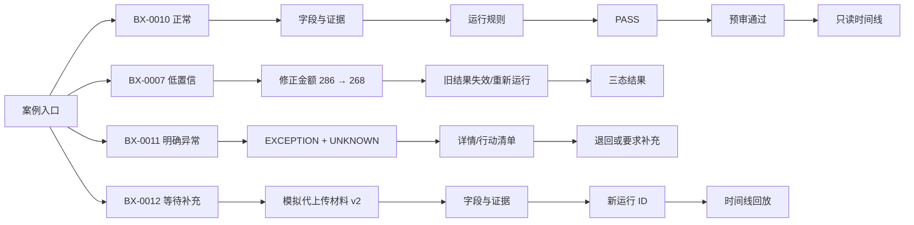

# 阶段 07｜中保真原型与交互验证记录

> 产品：审得快｜AI 费用报销预审助手  
> 原型版本：prototype-v0.2  
> 日期：2026-08-18  
> 数据边界：仅合成材料；不接入真实财务系统  
> 证据边界：真实用户样本 `N=0`；本文件记录的是原型实现和自动化冒烟验证，不是用户研究结果

## 1. 本阶段目标

把阶段 06 的页面状态和关键流程变成可点击原型，验证以下高风险交互是否有闭环：

- 低置信字段能否查看证据、确认/修正/标记 `UNKNOWN`，并使旧规则结果失效。
- `PASS / EXCEPTION / UNKNOWN` 三态能否进入不同的人工处理路径。
- 存在未知或异常时，首版是否阻止“预审通过”，并要求人工决定、理由和关联问题。
- 补充材料能否形成新版本，重新运行规则，并在时间线保留旧事件。
- 人工行动清单、人工决定和 AI/规则结果是否分开记录。

## 2. 原型入口

直接打开 [prototype/index.html](../prototype/index.html)，无需启动服务或上传真实文件。

| 入口 | 用途 |
|---|---|
| [prototype/index.html](../prototype/index.html) | 面试展示和手工走查 |
| [prototype/prototype.js](../prototype/prototype.js) | 单页状态机、合成案例和交互逻辑 |
| [prototype/prototype.css](../prototype/prototype.css) | 中保真视觉、抽屉、弹层和响应式样式 |
| [prototype/capture-prototype.cjs](../prototype/capture-prototype.cjs) | Playwright 桌面/移动端冒烟验证脚本 |

页面顶部持续展示“仅合成数据”；规则说明页和决定弹层均声明：预审不是最终财务审批，系统不自动付款、不发送真实通知。

## 3. 案例状态与可点击路径



### 3.1 已冻结的 V0 行为决策

| 场景 | 原型行为 | 设计理由 |
|---|---|---|
| 存在 `UNKNOWN` | 禁用“预审通过”；只允许退回或要求补充 | 把不确定性显式转交人工，避免错误通过 |
| 存在 `EXCEPTION` | 首版同样不提供覆盖通过 | 先验证安全边界，覆盖审批作为后续实验，不在 Demo 中混用 |
| 字段被修正 | 当前结果标记过期，需重新运行；旧运行留在时间线 | 不能把旧输入的结果伪装成当前结果 |
| 要求补充材料 | 进入 `needs_info`；补充入口写明“审核员模拟代上传” | 员工端、通知和真实文件上传属于 P1，不伪造已实现能力 |
| 退回修改 | 首版作为终态，生成行动清单和人工决定记录 | 不暗示未建设的员工端重新提交链路 |
| 人工决定提交后 | 成功态和只读详情；决定绑定案例、运行 ID、理由和关联问题 | 保留人工责任和审计回放 |

## 4. 原型交互验收矩阵

| 交互 | 验收条件 | 自动化冒烟状态 |
|---|---|---|
| 案例选择 | 四个预置案例均能进入对应状态 | 通过 [F] |
| 字段修正 | 金额可从 `286` 修正为 `268`；保存原因进入时间线 | 通过 [F] |
| 结果过期 | 已有运行后修改字段，出现“旧结果已过期”和重算入口 | 通过 [F] |
| 三态详情 | `UNKNOWN` 显示无法判断原因；`EXCEPTION` 显示实际值、阈值、差值 | 通过 [F] |
| 行动清单 | 系统建议与人工补充项分开显示，人工补充项写入时间线 | 通过 [F] |
| 决定校验 | 退回/补充必须有理由且至少关联一条异常或未知 | 通过 [F] |
| 安全阻断 | 混合异常案例的“预审通过”按钮为禁用态 | 通过 [F] |
| 成功与只读 | 提交后显示成功态，时间线可打开只读决定详情 | 通过 [F] |
| 补充重审 | v2 进入案例，旧事件保留，规则运行生成新 ID | 通过 [F] |
| 规则说明 | 规则集、单条规则版本和“不提供”边界可在只读页查看 | 通过 [F] |

## 5. 自动化冒烟验证

执行命令：

```text
node prototype/capture-prototype.cjs
```

脚本使用本机 Chrome 和 Playwright，验证四条完整路径：

1. **正常路径**：`BX-0010` → 运行规则 → 主动提交“预审通过” → 成功态 → 只读时间线。
2. **低置信路径**：`BX-0007` → 修正金额 → 运行规则 → 再改字段 → 旧结果过期。
3. **异常路径**：`BX-0011` → 查看 `UNKNOWN` 与 `EXCEPTION` 详情 → 编辑行动清单 → 验证禁用通过 → 退回。
4. **补充路径**：`BX-0012` → 模拟代上传 v2 → 重新运行 → 查看材料版本和时间线。

### 5.1 本次运行结果

| 环境 | 横向溢出 | 控制台错误 | 路径结果 |
|---|---:|---:|---|
| Chrome，1440 × 1000 | 否 [F] | 0 [F] | 四条路径通过 [F] |
| Chrome，390 × 844 | 否 [F] | 0 [F] | 四条路径通过 [F] |

这只是代码和页面状态的冒烟证据，不等于 `T1–T6` 的独立完成率，也不等于价值、模型质量或商业可行性已经成立。

## 6. 与可用性任务的映射

详细主持人话术、记录表、援助等级和通过线见 [08-可用性测试方案-任务脚本.md](./08-可用性测试方案-任务脚本.md)。

| 任务 | 原型可复现路径 | 当前可测内容 | 仍需真实参与者验证 |
|---|---|---|---|
| T1 案例入口 | 首页 → BX-0010 | 合成数据提示、入口和下一步 | 5 秒理解、进入时间、安全边界复述 |
| T2 字段核对 | BX-0007 → 金额修正 → 重算 | 证据、修正、过期提示 | 误确认率、理由理解、任务时长 |
| T3 三态理解 | BX-0011 → 结果/详情 | 三态排序、规则与证据解释 | 三态复述准确率 |
| T4 UNKNOWN 决定 | BX-0011 → UNKNOWN → 人工决定 | 禁用通过、理由/关联项、只读记录 | 是否尝试绕过、责任边界误读率 |
| T5 异常行动 | BX-0011 → 异常详情 → 行动清单 | 系统建议/人工补充分层 | 是否能整理完整行动清单 |
| T6 补充回放 | BX-0012 → v2 → 新运行 → 时间线 | 版本、运行 ID、历史不覆盖 | 版本回放和错误恢复理解 |

## 7. 还没有验证的部分

这些内容没有被当前 Demo 包装成已完成能力：

- 真实 PDF/JPG 上传、OCR/多模态抽取、文件解析失败率和模型基准集。
- 真实公司制度、真实财务系统、账号权限、通知、员工端重新提交和付款。
- 规则版本发布后台、生产级日志、数据保留/删除和安全评审。
- 真实审核员样本、任务时长、满意度、付费意愿和商业单位经济。
- “规则检查通过”与“预审通过”两种措辞的真实责任边界理解结果。

因此文档中的目标值仍使用 `[T]`，待研究的假设使用 `[H]`；不填入虚构用户比例、原话或成功率。

## 8. 面试展示顺序（约 3 分钟）

1. **先展示风险**：费用预审的核心不是让 AI 替人审批，而是把事实、规则和不确定性放到同一条证据链。
2. **现场走 T2**：打开 `BX-0007`，指出候选金额与原文不一致，修正后展示“旧结果过期”。
3. **现场走 T4/T5**：打开 `UNKNOWN` 和 `EXCEPTION`，展示详情、行动清单、禁用的“预审通过”和人工理由校验。
4. **现场走 T6**：打开 `BX-0012`，模拟补充 v2，再看时间线如何保留 v1、旧运行和新运行。
5. **最后说证据纪律**：当前真实样本为 `N=0`；已验证的是原型交互和安全状态，下一步才是招募审核员执行任务测试。

## 9. 下一阶段决策门

只有完成真实或明确分层的任务测试，并且没有 P0 安全误读，才进入技术探针。技术探针要单独验证字段基准集、规则一致性、未知率、响应时间和成本；本原型的自动化冒烟通过不能替代这些证据。

上一份：[07-服务蓝图-页面状态矩阵-低保真线框.md](./07-服务蓝图-页面状态矩阵-低保真线框.md)  
任务脚本：[08-可用性测试方案-任务脚本.md](./08-可用性测试方案-任务脚本.md)
