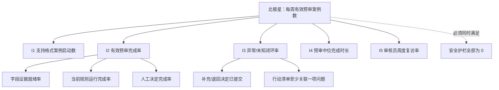
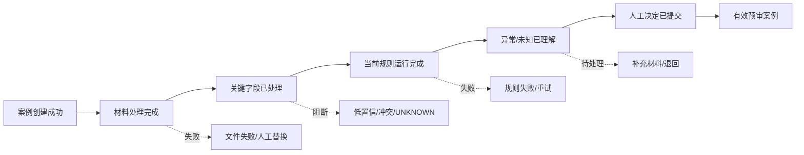
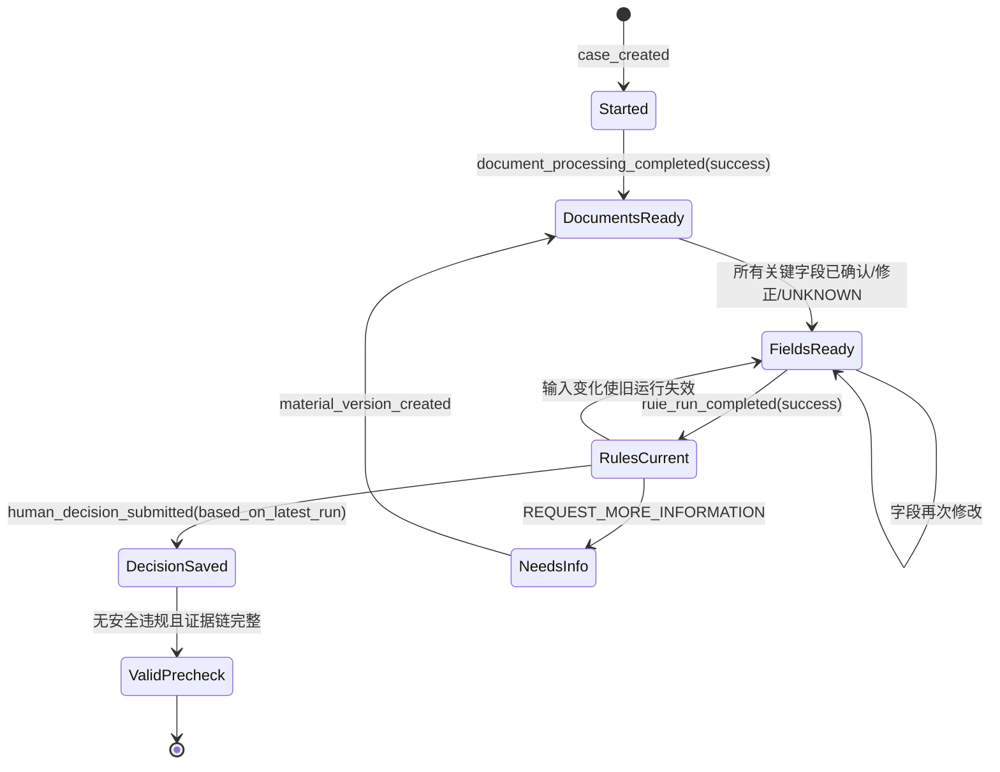

# 阶段 09｜北极星指标、埋点体系与产品看板

> 产品：审得快｜AI 费用报销预审助手  
> 文档版本：V0.1  
> 状态：指标与看板设计完成，尚未接入真实分析系统  
> 证据边界：真实业务事件 `N=0`；目标值均为 `[T]`，看板数字均为合成演示数据 `[D]`

## 1. 指标设计原则

「审得快」属于**生产力型产品（Productivity Game）**：价值不在用户停留多久，也不在系统自动通过多少案例，而在审核员能否更可靠、更高效地完成预审任务。[D]

指标必须同时满足三条约束：

1. **价值可观察**：事件能证明一笔预审真正完成，而不是只打开页面或运行一次模型。
2. **安全不可被平均**：关键异常漏报、低置信放行等 P0 问题单独告警，不能被总体完成率掩盖。
3. **证据不越界**：真实数据接入前不填“当前准确率”“节省时间”等业务成果，只展示定义、目标和合成示例。

## 2. 北极星指标

### 2.1 定义

**每周有效预审案例数（Weekly Valid Prechecks，WVP）**

> 一周内，完成当前版本规则运行、关键字段有可追溯处理状态、审核员主动提交人工决定，且没有触发安全违规的唯一案例数。[D]

```text
WVP = COUNT_DISTINCT(case_id)
WHERE supported_format = true
  AND latest_field_snapshot_is_resolved = true
  AND latest_rule_run_is_current = true
  AND every_rule_has_status_and_basis = true
  AND human_decision_submitted = true
  AND decision_based_on_latest_run = true
  AND critical_safety_violation = false
```

同一案例在一周内多次重跑只计算一次；补充材料产生新版本时，只有基于最新有效运行的人工决定才算有效完成。`RETURN`、`REQUEST_MORE_INFORMATION` 和 `PRECHECK_PASS` 都可能算完成，因为完成不等于通过。[D]

### 2.2 为什么不是其他指标

| 候选指标 | 不采用为北极星的原因 |
|---|---|
| AI 自动通过数 | 鼓励过度自动化，与人工责任边界冲突 |
| 规则通过率 | 由费用分布决定，不能代表产品价值，且可能诱发漏报 |
| 页面访问量/停留时长 | 属于虚荣或反向指标；生产力工具应减少无效停留 |
| 模型字段准确率 | 是关键健康指标，但不能证明用户完成了工作 |
| 有效预审完成率 | 适合作为核心输入指标，但单独使用会忽略实际使用规模 |
| 节省总时长 | 需要可靠基线和真实对照，当前不可持续在线计算 |

### 2.3 七项标准检查

| 北极星标准 | 判断 |
|---|---|
| 易理解 | 能解释为“一周有多少案例被可靠地完成预审” |
| 以客户为中心 | 反映审核员完成任务，而不是产品内部调用量 |
| 可持续价值 | 重复周度使用才会持续增长，不靠一次性访问 |
| 愿景契合 | 对齐“证据化预审 + 人工决定” |
| 可量化 | 可由案例、字段、规则运行和决定事件计算 |
| 可干预 | 可通过证据定位、规则覆盖、交互和错误恢复改善 |
| 领先指标 | 预示工作流采用、复访和后续试点价值 |

## 3. 北极星指标树



### 3.1 五个输入指标

| ID | 输入指标 | 精确定义 | 产品可采取的动作 |
|---|---|---|---|
| I1 | 支持格式案例启动数 | 周内成功创建且材料格式受支持的唯一案例数 | 改善入口、格式提示和处理失败恢复 |
| I2 | 有效预审完成率 | WVP / 支持格式案例启动数 | 改善字段核对、规则运行、决定校验和恢复路径 |
| I3 | 异常/未知闭环率 | 24 小时内提交退回或补充决定的异常/未知案例数 / 异常或未知案例数 | 优化异常解释、行动清单和决定入口 |
| I4 | 预审中位完成时长 | 从案例进入可处理状态到提交人工决定的中位分钟数 | 减少无价值操作；按正常/异常/未知分层 |
| I5 | 审核员周度复访率 | 本周完成有效预审且下周再次完成的审核员数 / 本周完成有效预审审核员数 | 提升可靠性、融入现有流程和持续价值 |

I4 越低通常越好，但不能脱离安全指标优化；发生错误放行时，即使时长下降也不视为成功。

## 4. 指标分层与看板规格

### 4.1 产品价值与过程指标

| 指标 | 定义 | 数据来源 | 可视化 | 目标值 | 告警阈值 |
|---|---|---|---|---:|---|
| 每周有效预审案例数 | 见北极星定义 | 案例快照 + 运行 + 人工决定 | 周趋势折线 + 数字 | 试点后设基线；演示目标 40 [T] | 连续两周下降 ≥20% |
| 有效预审完成率 | WVP / 支持格式启动案例 | 案例漏斗 | 漏斗 + 周趋势 | ≥80% [T] | <70% 连续 2 天 |
| 字段证据就绪率 | 有可用值或明确 `UNKNOWN` 且有证据/原因的关键字段 / 关键字段 | `field_reviewed` + 字段快照 | 分层条形图 | ≥95% [T] | <90% |
| 人工决定完成率 | 基于当前运行提交人工决定的案例 / 当前规则运行完成案例 | 运行 + 决定事件 | 漏斗 | 100% [T] | <95% |
| 异常/未知闭环率 | 24 小时内有退回/补充决定 / 异常或未知案例 | 结果 + 决定事件 | 周趋势 | ≥85% [T] | <75% |
| 预审中位完成时长 | `human_decision_submitted_at - case_ready_at` | 事件时间戳 | 箱线/分位数趋势 | 相对手工基线下降 ≥30% [T] | P50 连续两周上升 ≥20% |
| 审核员周度复访率 | 本周到下周再次完成有效预审的审核员比例 | 匿名审核员 + 案例完成 | 同期群 | 首轮先建基线 [D] | 仅趋势观察，不提前设硬门槛 |

### 4.2 AI 与规则健康指标

| 指标 | 定义 | 数据来源 | 可视化 | 目标值 | 告警阈值 |
|---|---|---|---|---:|---|
| 关键字段完全匹配率 | 与金标准完全一致的关键字段 / 基准关键字段 | 离线评测运行 | 场景分层柱状图 | ≥95% [T] | 任一留出集版本 <95% |
| 证据命中率 | 文档、页码和片段均命中 / 有证据字段 | 离线评测 | 场景分层柱状图 | ≥90% [T] | <90% |
| 字段人工修正率 | `human_corrected` 关键字段 / 已展示机器候选字段 | 线上字段事件 | 周趋势 + 字段分布 | 先建基线 [D] | 单字段较四周基线上升 ≥10pp |
| `UNKNOWN` 率 | 输出未知规则数 / 总规则结果数 | 规则运行 | 周趋势 + 规则分层 | 不设越低越好目标 | 单规则偏离四周基线 ≥2 倍 |
| 规则一致率 | 实际三态与金标准一致 / 基准规则结果 | 离线评测 | 版本对比 | 100% [T] | 任一错误即阻断 |
| 解释无依据陈述率 | 无法回链规则/证据的陈述 / 总陈述 | 解释评测 | 数字 + 错误列表 | 0 [T] | >0 立即阻断 |
| 文档处理 P95 | 文档处理完成耗时第 95 百分位 | 处理事件 | 分位数趋势 | ≤8 秒 [T] | >10 秒持续 15 分钟 |
| 规则运行 P95 | 规则运行耗时第 95 百分位 | 运行事件 | 分位数趋势 | ≤2 秒 [T] | >3 秒持续 15 分钟 |

`UNKNOWN` 不是越低越好。过低可能意味着系统在猜测，过高可能意味着规则覆盖或抽取质量不足，因此只做分层趋势和异常变化告警。[D]

### 4.3 P0 安全护栏

| 护栏 | 计算口径 | 目标 | 处理 |
|---|---|---:|---|
| 关键规则漏报数 | 金标准为异常但未输出 `EXCEPTION` | 0 [T] | 冻结相关版本，停止扩大测试 |
| 低置信自动放行数 | 低置信/无证据关键字段成为 `PASS` 依据 | 0 [T] | P0，检查门控和输入快照 |
| 错误预审通过数 | 存在 `UNKNOWN/EXCEPTION` 却提交 `PRECHECK_PASS` | 0 [T] | P0，禁用提交并审计事件 |
| 无依据决定数 | 决定未绑定当前 `run_id` 或关联证据 | 0 [T] | P0，阻止保存 |
| 提示注入越权数 | 文档内容改变规则、调用工具或访问其他案例 | 0 [T] | P0，停用模型版本并安全复盘 |
| 责任边界误读数 | 测试参与者认为预审已触发正式审批 | 0 [T] | 停止扩展，修改措辞和权限后复测 |

P0 护栏使用绝对数量，不使用平均率；任一事件都必须单独复盘。[D]

### 4.4 商业与成本指标

当前不以收入作为北极星，但为 Gate D 预留以下指标：

| 指标 | 定义 | 当前处理 |
|---|---|---|
| 单个有效预审变动成本 | OCR、模型、存储和重试成本 / WVP | 先用技术探针估算 [H] |
| 试点激活团队数 | 7 天内完成首个 WVP 的试点团队数 | 真实试点后统计 [H] |
| 团队周留存 | 本周与下周都有 WVP 的团队 / 本周有 WVP 的团队 | 样本足够后按同期群观察 [H] |
| 试点承诺率 | 明确投入时间/数据评审资源的决策者 / 合格决策者访谈 | 不能由问卷意愿替代 [H] |

## 5. 核心漏斗



漏斗必须按正常、异常、未知、文件失败和补充重审分层；不能只看总体转化，否则正常案例占比变化会掩盖复杂路径问题。

## 6. 事件字典

### 6.1 公共属性

所有事件使用以下白名单公共属性：

| 属性 | 说明 |
|---|---|
| `event_id` | 唯一事件 ID，支持去重 |
| `event_name` | 受控事件名 |
| `occurred_at` | ISO 8601 时间戳 |
| `schema_version` | 事件 Schema 版本 |
| `product_version` | 原型/产品版本 |
| `tenant_key` | 不可逆或受控的租户标识，不用公司名 |
| `actor_key` | 匿名化用户标识，不用姓名/员工号 |
| `actor_role` | `reviewer / submitter / policy_owner` |
| `case_key` | 内部案例标识，不包含姓名或票号 |
| `case_version` | 当前材料/事实版本 |
| `data_classification` | `synthetic / anonymized / authorized_real` |

### 6.2 业务与交互事件

| 事件 | 触发时机 | 必要属性 | 主要指标 |
|---|---|---|---|
| `case_created` | 案例创建成功 | `source`, `supported_format` | I1、漏斗 |
| `document_processing_completed` | 文档处理成功/失败 | `status`, `document_type`, `duration_ms`, `error_code` | 处理成功率、P95 |
| `field_reviewed` | 确认、修正或标记未知 | `field_name`, `action`, `confidence_band`, `had_evidence`, `duration_ms` | 证据就绪率、修正率 |
| `rule_run_completed` | 规则运行完成/失败 | `run_id`, `rule_set_version`, `status`, `pass_count`, `exception_count`, `unknown_count`, `duration_ms` | 三态分布、运行 P95 |
| `finding_opened` | 查看异常或未知详情 | `rule_id`, `rule_version`, `result_status` | 异常理解路径 |
| `action_list_edited` | 人工增加/删除行动项 | `rule_id`, `edit_type`, `item_count` | 行动清单使用 |
| `decision_form_opened` | 打开人工决定弹层 | `run_id`, `unknown_count`, `exception_count` | 决定漏斗 |
| `human_decision_submitted` | 决定保存成功 | `decision_id`, `decision`, `based_on_run_id`, `linked_finding_count`, `duration_ms` | WVP、I2、I3 |
| `supplement_requested` | 提交要求补充决定 | `decision_id`, `linked_finding_count` | 补充路径 |
| `material_version_created` | 新材料版本保存 | `from_version`, `to_version`, `source_role` | 补充重审 |
| `audit_timeline_viewed` | 打开时间线 | `latest_run_id`, `event_count` | 回放使用 |
| `fallback_triggered` | 进入人工录入/模板/重试 | `stage`, `reason_code`, `previous_version` | 错误恢复 |
| `safety_violation_detected` | 触发 P0 护栏 | `violation_type`, `model_version`, `rule_set_version` | 安全告警 |

### 6.3 禁止采集

分析事件不得包含票据原文、姓名、手机号、税号、银行账户、自由文本决定理由、文档图片、具体行程或公司制度全文。自由文本只保存在受控业务对象中，并与分析系统隔离。[D]

## 7. 指标计算状态机



## 8. 看板信息架构

可直接展示的静态看板：[analytics/index.html](../analytics/index.html)。页面所有数字均带“合成演示数据”标记。[D]

```text
01 产品价值
  北极星周趋势
  五个输入指标
  核心漏斗与按状态分层

02 AI 质量与护栏
  字段/证据/规则质量
  UNKNOWN 与修正分布
  P0 安全事件
  延迟与成本

03 事件口径
  事件字典
  指标计算说明
  数据禁采边界
```

## 9. 告警与评审节奏

| 频率 | 内容 | 负责人 | 产出 |
|---|---|---|---|
| 实时/P0 | 错误通过、关键漏报、无依据决定、提示注入越权 | 产品负责人 + 技术/安全角色 | 冻结版本、事件复盘、回归测试 |
| 每日 | 处理失败、P95、规则失败和重试 | 产品 + 工程角色 | 故障清单和恢复状态 |
| 每周 | WVP、完成率、时长、闭环率、修正率和 UNKNOWN 分布 | 产品 + 设计 + 业务代表 | 优先问题和实验决策 |
| 每月 | 复访、团队留存、成本和假设证据 | 产品负责人 + 决策者 | Gate 状态和路线图调整 |
| 每季度 | 北极星是否仍代表客户价值 | 跨职能评审 | 指标口径与战略复核 |

## 10. 首轮指标实验

| 假设 | 实验 | 指标 | 判定 |
|---|---|---|---|
| 证据化预审比手工核对更高效 | 同一组合成任务的手工流程 vs 原型流程 | 中位时长、错误数、援助等级 | 时长下降 ≥30%，安全错误不增加 [T] |
| 解释能帮助异常处置 | 有/无规则证据详情的任务对照 | 原因复述、下一步完整率 | 完整复述 ≥85% [T] |
| UNKNOWN 阻断不会让用户失去方向 | 执行 T4/T6 | 恢复路径完成率、责任边界误读 | 恢复 ≥80%，误读 0 [T] |
| 行动清单减少退回沟通成本 | 有/无行动清单的退回任务 | 补充材料一次正确率、再次往返数 | 真实员工任务后设门槛 [H] |

样本不足时只报告参与者级事实、任务时长和错误，不做统计显著性结论。[D]

## 11. 阶段结论

阶段 09 将原有“有效预审完成率”扩展为可持续的北极星体系：

1. 北极星用**每周有效预审案例数**同时表达使用规模和可靠完成。
2. 五个输入指标对应入口、完成、异常闭环、效率和复访。
3. AI 质量指标和 P0 安全护栏独立展示，不能被平均表现掩盖。
4. 埋点只采受控结构化属性，不把财务原文送入分析系统。
5. 当前没有真实数据，因此看板只展示结构和合成示例，不声称业务增长。

上一份：[10-技术探针-数据集与评测方案.md](./10-技术探针-数据集与评测方案.md)  
PRD 埋点来源：[04-PRD-审得快.md](./04-PRD-审得快.md)
