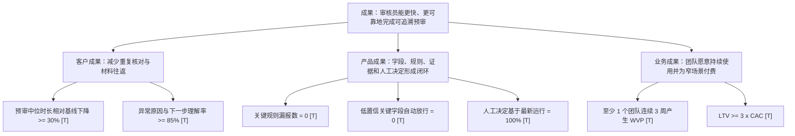
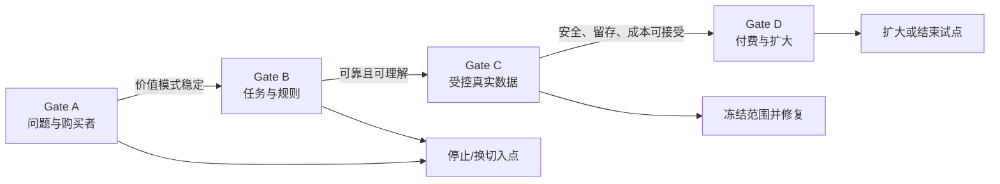
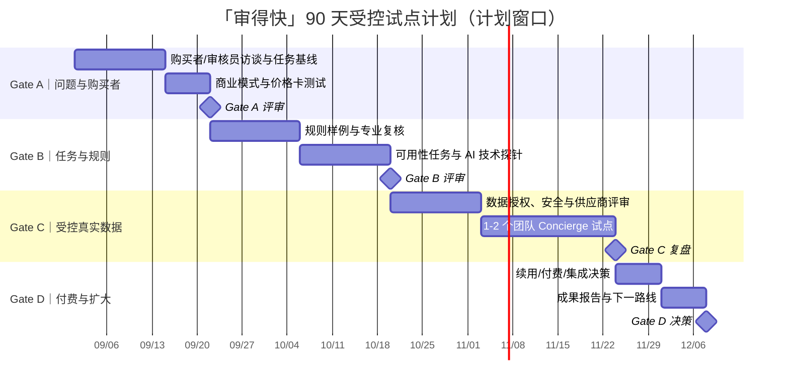

# 阶段 10｜受控试点路线图与成果导向规划

> 产品：「审得快」AI 费用报销预审助手  
> 文档版本：V0.1  
> 路线图类型：Outcome Roadmap + 90 天受控试点  
> 当前状态：尚无真实试点；所有团队数量、时间和指标均为计划或门槛，不是已发生结果。

## 1. 路线图原则

- 以“客户和业务发生什么变化”描述阶段，而不是以“开发了哪些页面”描述阶段。[D]
- 每个 Gate 都有进入条件、验证动作、退出标准和阻断项。[D]
- 先验证问题价值、规则可靠性和责任边界，再谈真实数据、系统集成和收费。[D]
- 任何 P0 安全问题都可以冻结路线图，不能被总体完成率抵消。[D]

## 2. 战略成果树

## 3. 产出到成果的转换

| 传统产出写法 | 需要实现的成果 | 关键指标/证据 | 依赖 |
|---|---|---|---|
| 做字段抽取页面 | 审核员能够快速确认关键事实，不必在文件间反复找金额和日期 | 关键字段证据就绪率、修正时长、字段准确率 | 受控文档样本与金标准 |
| 做规则结果卡片 | 审核员能区分通过、异常和未知，并知道下一步如何处理 | 异常理解率、规则一致率、UNKNOWN 正确处理率 | 已发布规则与证据绑定 |
| 做人工决定弹窗 | 每个预审结果都有明确责任人和可回放依据 | 人工决定完成率、无依据决定数 = 0 | 当前运行 ID、关联异常/未知 |
| 做补充材料重审 | 材料变化后可以重新处理，不沿用过期结论 | 新版本重审完成率、过期运行误用数 = 0 | 版本化案例与审计事件 |
| 做指标看板 | 团队能持续发现价值、质量和安全问题，而不是只看自动通过率 | WVP、完成率、P0 护栏、成本 | 事件字典和权限边界 |
| 做系统集成 | 产品嵌入现有工作流且不增加总任务成本 | 试点使用率、支持成本、导出/集成成功率 | Gate C 通过、数据授权 |

## 4. Gate 总览

## 5. 90 天成果路线图

### 5.1 时间线

日期是示例窗口，用于展示排期逻辑；真正启动时应根据招募、数据授权和专业评审的可用性调整。[T]

### 5.2 Gate A｜证明“问题值得解决，且有人拥有预算”

**目标成果**：让产品团队知道应该服务谁、解决哪一种高频返工，以及谁能决定试点预算。[D]

| 内容 | 设计 |
|---|---|
| 目标对象 | 8–10 名审核员 + 8–10 名财务/行政负责人（目标，不是已完成样本） |
| 任务 | 回放最近一次报销预审，记录读、找、核、问的实际步骤和时间 |
| 商业动作 | 用同一 Demo 展示“免费诊断、付费试点、订阅/按案”三种下一步 |
| 退出标准 [T] | ≥60% 受访审核员报告每周至少 3 次重复核对；≥3 名负责人愿意进入材料评估；至少 2 个团队愿意讨论真实授权 |
| 阻断条件 | 只有泛泛的“觉得有用”，但没人提供最近案例、预算来源或下一步承诺 |
| 失败动作 | 缩小至某类费用或“补充材料清单/规则解释”单点，不继续做完整预审平台 |

### 5.3 Gate B｜证明“任务可用，规则和 AI 边界可靠”

**目标成果**：审核员能完成闭环，能理解异常与未知，并且系统不会把不确定性伪装成通过。[D]

| 内容 | 设计 |
|---|---|
| 输入 | 当前中保真原型、30 条合成基准集、模拟公司规则 |
| 任务 | 正常、低置信、异常、补充材料、提示注入 5 类任务 |
| 评测 | 可用性任务 + 字段/证据/规则/解释离线评测 |
| 退出标准 [T] | 中位任务时长相对手工对照下降 ≥30%；异常理解率 ≥85%；关键规则漏报 0；低置信自动放行 0；责任边界误读 0 |
| 阻断条件 | 用户把预审当正式审批、规则不一致、解释出现无依据陈述、修改字段后仍使用旧结果 |
| 失败动作 | 冻结扩大范围；先改提示、权限、状态门控和规则契约，再重复评测 |

### 5.4 Gate C｜证明“真实数据能安全进入受控流程”

**目标成果**：在不接入付款和 ERP 的前提下，1–2 个授权团队可以用匿名化/最小化数据完成连续预审。[D]

| 内容 | 设计 |
|---|---|
| 试点规模 | 目标 1–2 个团队，每队 20–30 个去标识案例；规模以授权和质量为先 |
| 试点方式 | Concierge/Wizard-of-Oz：产品和财务顾问人工兜底，系统保留真实事件记录 |
| 准入门槛 | 数据控制者/处理者明确；隐私告知和授权完成；供应商不训练条款确认；规则由专业人员复核；只开放窄费用类型 |
| 退出标准 [T] | 每队连续 2 周产生 WVP；P0 护栏全为 0；异常/未知闭环率 ≥85%；支持成本和单案成本可计算；无越权或跨租户事件 |
| 阻断条件 | 无法证明数据授权、材料含不可接受敏感信息、规则版本无法复现、支持成本高于预期价值 |
| 失败动作 | 立即停止真实数据处理，删除/返还材料，回到合成或匿名化模式；只保留可复用设计结论 |

### 5.5 Gate D｜证明“值得付费或扩大”

**目标成果**：确认产品带来的任务价值足以覆盖处理、支持、获客和合规成本，并决定扩大、转型或结束。[D]

| 内容 | 设计 |
|---|---|
| 评估对象 | 试点负责人、审核员、IT/安全影响者 |
| 商业决策 | 比较按案、团队订阅和规则服务费，不把“口头兴趣”当收入 |
| 退出标准 [T] | 至少 1 个团队连续 3 周产生 WVP；负责人愿意签署付费下一步或明确采购流程；单案贡献毛利为正；目标 `LTV ≥ 3×CAC` 可被模型支持 |
| 阻断条件 | 价值只发生在首次新鲜感；规则维护不可复制；付费方不承担预算；任何 P0 安全问题未关闭 |
| 决策 | 扩大：增加费用类型/团队；转型：改为规则诊断或审核工具；结束：归档学习，不继续投入集成 |

## 6. 试点运行机制

### 6.1 每周节奏

| 时间 | 参与者 | 会议/动作 | 产出 |
|---|---|---|---|
| 周一 | 产品 + 试点负责人 | 规则版本和案例范围确认 | 本周允许处理的费用类型 |
| 周中 | 审核员 + 产品 | 观察 3–5 个任务，不代替用户操作 | 任务时长、误解、修正和异常记录 |
| 周五 | 产品 + 财务顾问 + 负责人 | 价值、质量、安全和成本复盘 | Gate 指标、待修复项、是否继续 |

### 6.2 允许与禁止

**允许**：合成、匿名化或明确授权的材料；预置规则；人工复核；导出预审结果供现有流程继续处理。[D]

**禁止**：自动付款、自动正式审批、未授权真实发票、把文档指令当系统指令、将原文写入分析事件、把试点结果当生产合规认证。[D]

### 6.3 退出与数据处理

1. 任意 P0 安全问题触发冻结；先保留事件 ID，禁止继续扩大样本。[D]
2. 试点结束时按授权约定删除或返还原始材料，并保留必要的匿名统计和审计元数据。[D]
3. 复盘报告区分“用户事实、系统事件、研究者观察、设计决策”和“仍未验证的假设”。[D]
4. 没有达到退出标准时，不用新功能掩盖问题；要么缩小场景，要么结束试点。[D]

## 7. 路线图与当前 Demo 的关系

| 当前已有交付 | 对应路线图价值 | 仍缺什么 |
|---|---|---|
| 中保真原型 | 验证字段、三态结果、异常详情、人工决定和补充重审的任务闭环 | 真实审核员任务与基线 |
| 30 条合成基准集 | 验证字段、规则、证据、提示注入和降级的测试结构 | 代表性授权材料与模型实测 |
| 指标看板 | 冻结 WVP、过程指标和 P0 护栏口径 | 真实事件接入和权限/留存策略 |
| 商业模式假设 | 把购买者、价格、成本和试点承诺变成可谈问题 | 真实预算、供应商报价、试点付费行为 |

## 8. 阶段结论

这条路线图的终点不是“把所有财务系统都接上”，而是做出一个可证据化的判断：在明确的人类责任和数据边界下，窄场景预审是否能持续减少重复工作，并且产生足以支撑下一步投入的经济价值。当前项目已完成验证前的产品设计与 Demo，真实答案必须通过 Gate A–D 获得。

上一份：[`12-商业模式与单位经济假设.md`](./12-商业模式与单位经济假设.md)  
相关文档：[`11-指标体系-埋点-实验看板.md`](./11-指标体系-埋点-实验看板.md)
