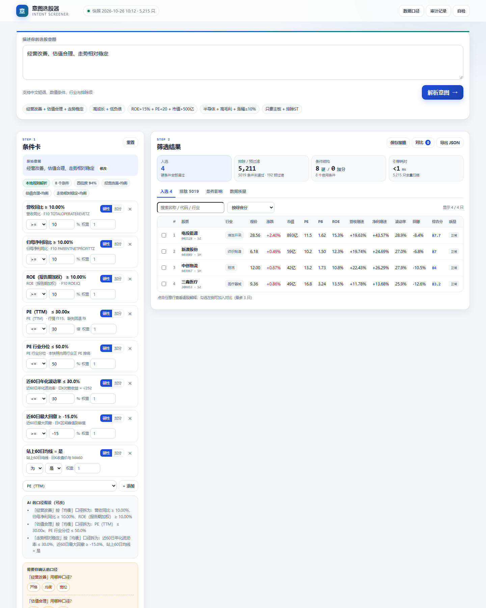
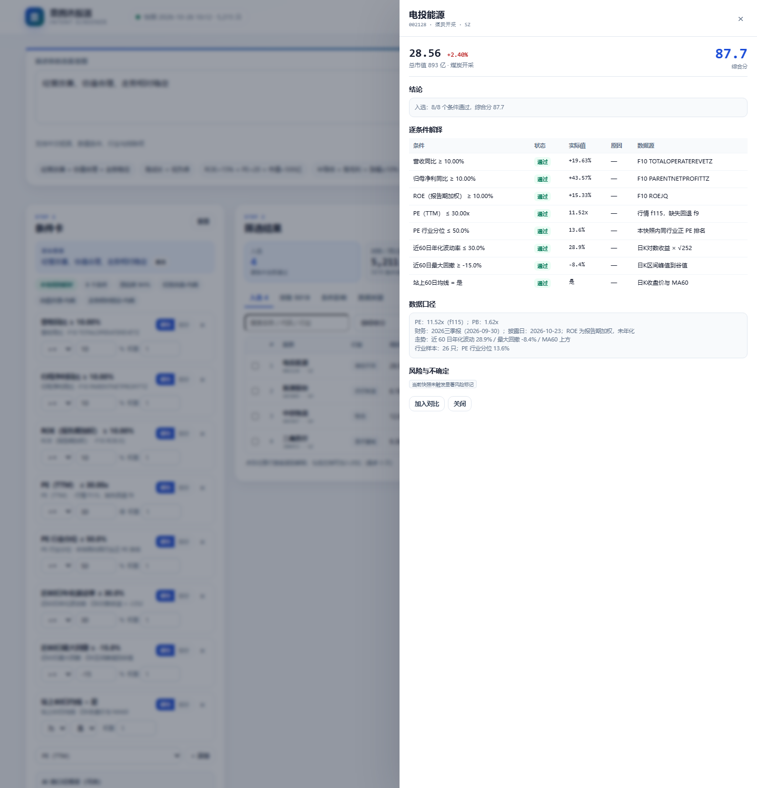

# 意图选股器 · Intent Screener

> 同花顺 AI 产品经理面试题 1：自然语言智能选股与策略解释器
>
> 一句话：把“经营改善、估值合理、走势相对稳定”这类模糊语言，拆成**可检查、可修改、可执行**的条件，再用真实 A 股快照逐只解释**为什么入选、为什么排除、条件变化会带来什么影响**。





## 快速开始

需要 Node.js 18+（本机验证版本 24.21.0），无第三方依赖。

```bash
cd 1
node server/server.js
# 打开 http://127.0.0.1:8080
```

Windows 也可以直接双击 `start.bat`。

也可以用任意静态服务器打开根目录（页面只依赖 `data/snapshot.json` 与 `assets/`）：

```bash
python -m http.server 8080
```

演示链接可以直接带查询参数，方便面试时一键进入：

```
http://127.0.0.1:8080/?q=经营改善、估值合理、走势相对稳定
http://127.0.0.1:8080/?q=高成长、低负债、排除ST
http://127.0.0.1:8080/?q=经营改善、估值合理、走势相对稳定&detail=002128
http://127.0.0.1:8080/?q=经营改善、估值合理、走势相对稳定&tab=impact
```

## 已实现的主链路

1. **自然语言 → 条件卡**：中文短语、数值条件、行业、排除项；模糊词展开为明确代理口径，并展示“AI 的假设”。
2. **可检查 / 可修改**：每个条件可改运算符、阈值、硬性/加分、权重、删除；可手动添加因子。
3. **冲突与口径检查**：同一因子区间互斥、低 PE + 高增长张力、低波动 + 高涨幅张力、硬条件过多、0 结果提醒。
4. **确定性筛选**：硬条件过滤 + 软条件加权排序；全量 5,215 只扫描。
5. **逐股解释**：每个条件的实际值、通过/未通过/数据不足、原因、数据源、财务报告期、行业分位。
6. **排除解释**：未通过条件 + 实际值 + 原因；可一键“改为加分项”看影响。
7. **条件敏感性**：拖动单个阈值，实时显示入选数量变化、新进/移出股票；松手应用到条件卡。
8. **继续使用**：勾选最多 3 只对比（含跨行业/报告期不可比提示）；策略保存/加载（localStorage）；导出 JSON；审计记录。
9. **数据质量页**：覆盖率、缺失率、负 PE、ST、增速异常、数据源与字段口径。
10. **自检**：页面内运行 10 项解析/引擎/合规检查；命令行 `npm test` 同一套逻辑。

## 数据快照

| 项目 | 值 |
|---|---|
| 快照文件 | `data/snapshot.json`（4.42 MB） |
| 交易日期 | 2026-10-26 |
| 生成时间 | 2026-10-26 10:12（**盘中快照**，页面顶部标注时点） |
| 股票池 | 5,215 只沪深 A 股（行情原始 5,563 只，剔除 348 只无价格/退市代码） |
| 财务覆盖 | 2026 中报 4,213 只 + 2026 三季报 1,002 只 |
| K 线覆盖 | 5,215 / 5,215（100%） |
| 行业 | 128 个，未分类 0 |
| 负 PE | 1,185 只，全部置空并标记，不当作“便宜” |
| ST/*ST/退市风险 | 192 只，默认预过滤 |

数据源：东方财富公开接口（行情 `push2`、F10 财务、日 K `push2his`）。字段级来源、公式、时点与缺失处理见 [数据说明](docs/数据说明.md) 和页面「数据口径」。

**关于扶摇 / iFinD**：题目优先建议扶摇/iFinD。本次构建时扶摇/iFinD 文档可访问，但需要 API Key，未拿到可用凭据；为保证主链路可运行，使用公开接口完成真实数据快照，并把数据获取隔离在 `scripts/fetch_snapshot.py` 的三个 `fetch_*` 函数中。替换为扶摇/iFinD 时，保持 `stocks` 字段契约即可，前端与引擎无需改动。这是本版本明确的取舍，不伪装成已接入。

刷新快照：

```bash
python scripts/fetch_snapshot.py                 # 全量（约 2–3 分钟）
python scripts/fetch_snapshot.py --limit 30      # 联调
python scripts/fetch_snapshot.py --skip-kline    # 跳过日K
```

> 2026-10-26 18:xx 再次全量刷新时遇到东方财富批量 K 线限流，为避免用缺失数据覆盖完整快照，保留了 10:12 的完整版本。页面明确标注“盘中快照”，没有把旧数据伪装成收盘数据。

## AI 的角色与边界

| 角色 | 做 | 不做 |
|---|---|---|
| AI / 解析器 | 听懂意图、提出条件、说明口径、生成可读解释 | 不计算因子、不排序、不补缺失值、不生成没有数据支撑的结论、不输出买卖建议 |
| 确定性引擎 | 条件求值、硬/软过滤、综合分、敏感性、冲突检查 | 不猜意图、不编造数据 |
| 数据层 | 提供字段、来源、时点、缺失标记 | 不做推荐 |
| 用户 | 确认/修改口径、决定是否采用 | 不被替代做最终判断 |

- 默认零依赖**本地规则解析器**，离线可用；不把“AI”作为单点故障。
- 可选 LLM：配置 `LLM_API_KEY` 后，`server/server.js` 的 `/api/parse` 调用 OpenAI-compatible Chat Completions；前端用 `normalizeLLMResult` 做因子白名单、运算符、类型、区间二次校验，失败自动回退本地解析器。
- 解释文案由确定性模板生成，数字只来自快照字段；LLM 不参与解释中的数字生成。

可选 LLM 配置：

```bash
# Windows PowerShell
$env:LLM_BASE_URL="https://api.openai.com/v1"
$env:LLM_API_KEY="sk-..."
$env:LLM_MODEL="gpt-4o-mini"
node server/server.js
```

没有 Key 时 `/api/parse` 返回 501，前端自动使用本地解析器；这是预期行为，不是故障。

## 测试与校验

```bash
npm test
# 10/10 通过：解析、数值映射、只有排除项、负 PE、财务缺失、冲突、软条件、敏感性、数据完整性、合规

python scripts/validate_snapshot.py --offline
# 20/20 通过：数量/唯一性/字段/数值范围/负 PE/极端增速/财务与K线覆盖/关键股票/报告期
```

- 测试说明与手动验收清单：[docs/测试说明.md](docs/测试说明.md)
- 数据校验报告：[docs/数据校验报告.md](docs/数据校验报告.md)
- AI 使用与验证记录：[docs/AI使用与验证记录.md](docs/AI使用与验证记录.md)
- 产品说明 / PRD：[docs/产品说明.md](docs/产品说明.md)
- 面试讲解与 90 秒演示脚本：[docs/面试讲解.md](docs/面试讲解.md)

## 目录

```
1/
├─ index.html                  # 单页应用
├─ assets/
│  ├─ css/styles.css
│  └─ js/
│     ├─ app.js                # 状态、渲染、交互、导出/保存/审计
│     ├─ parser.js             # 本地中文意图解析 + LLM 结果归一化
│     ├─ engine.js             # 因子注册表、条件求值、筛选、评分、敏感性
│     └─ selftest.js           # 页面内自检 / 命令行共用
├─ data/snapshot.json          # 5,215 只真实 A 股快照
├─ scripts/
│  ├─ fetch_snapshot.py        # 可复现数据构建
│  └─ validate_snapshot.py     # 数据校验 + 报告生成
├─ server/server.js            # 零依赖静态服务 + 可选 LLM 解析代理
├─ tests/run_tests.js          # 命令行测试
├─ docs/                       # 产品、数据、测试、AI 记录、面试讲解、截图
├─ package.json
└─ README.md
```

## 已知边界 / 未做事项

- 行情是 **2026-10-26 10:12 盘中快照**，不是收盘/实时；页面顶部与数据页都标注了时点。
- 未接实时行情推送、公告原文、研报、回测、定时监控；保存策略只保存条件，监控/回测留作下一步。
- 未接股息率、上市日期、北交所/港股/美股；相关请求会进入 `unparsed`/`ambiguities`，不会静默编造条件。
- 财务为公开 F10 接口，未做审计级复核；ROE 为报告期加权、未年化，中报/三季报/年报不可直接横比。
- 行业分位在行业有效样本 < 8 时为空；银行业负债率、金融业毛利率等不可与制造业直接比较。
- 负 PE 一律按缺失处理；增速 |同比| > 300% 标记 `GROWTH_OUTLIER`，不静默当作持续增长。
- 可选 LLM 路径仅用 `LLM_MOCK=1` 做了接口与回退测试，未使用真实模型 Key 做实网调用；本地解析器是默认路径。
- 本产品仅用于信息筛选与研究，**不构成投资建议，不预测涨跌，不承诺收益**。

## 提交 / 部署

- **本地演示**：`node server/server.js`，默认 `http://127.0.0.1:8080`。
- **静态部署**：把本目录全部内容推到 GitHub Pages / Vercel / Netlify 的静态站点即可；不需要构建步骤。`data/snapshot.json` 必须一起部署。
- **Node 部署**：支持 `PORT` 环境变量；只有需要 LLM 解析时才需要 `LLM_*` 环境变量。
- 提交前检查清单：[docs/提交清单.md](docs/提交清单.md)。

## 合规

本产品不输出确定性涨跌预测、收益承诺或买卖建议；事实、推断、缺失和不确定信息分开呈现；核心结论可回到字段、来源和时点。数据仅用于面试演示，不包含 API Key、用户隐私或受限数据。
