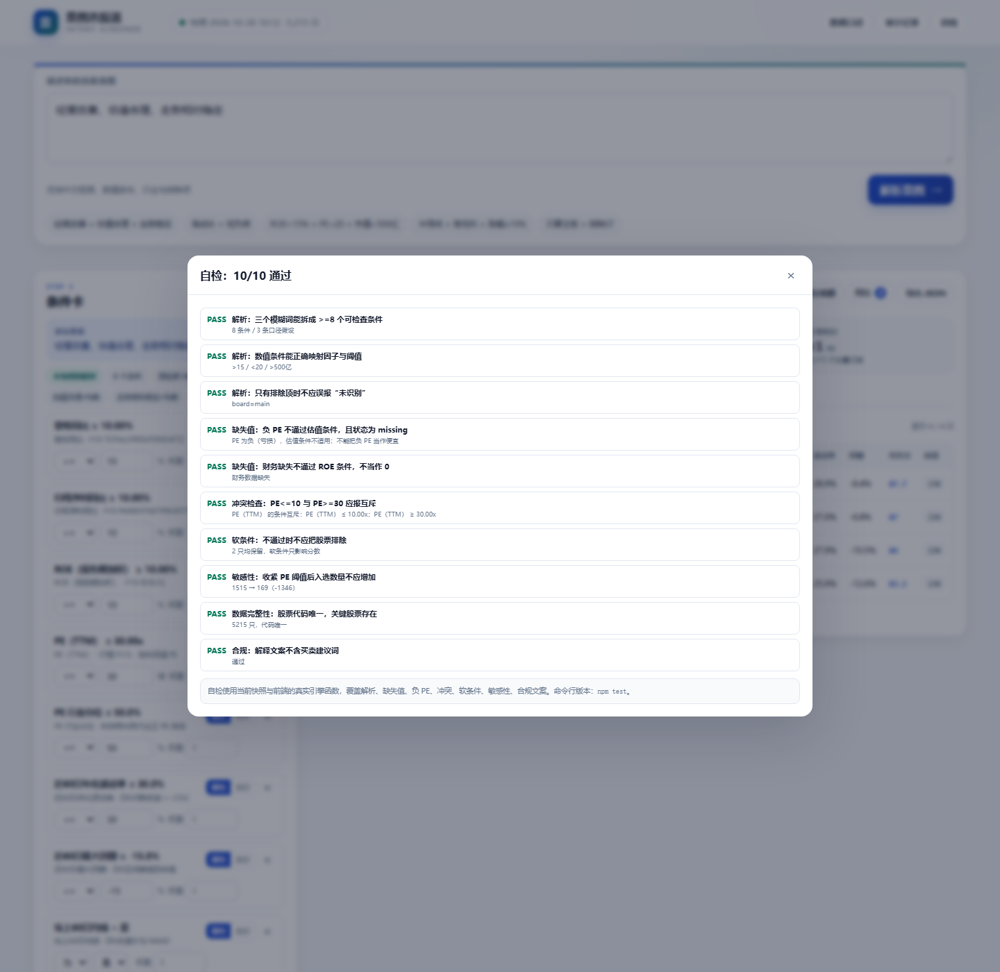

# 测试说明

## 1. 测试范围

| 层级 | 覆盖 | 不覆盖 |
|---|---|---|
| 解析 | 模糊词展开、数值/单位/运算符、行业、排除项、未知词、歧义 | 真实 LLM 提供商、方言/错别字、超长输入 |
| 引擎 | 缺失、负 PE、冲突、硬/软条件、分位评分、敏感性 | 回测、组合优化、实时流式数据 |
| 数据 | 数量/唯一性/字段/范围/覆盖率/关键股票/报告期 | 审计级财务复核、第三方数据对账（未接扶摇/iFinD） |
| 界面 | 首页、结果、排除、详情、条件影响、数据质量、对比、保存、自检 | 移动端真机、Safari、无障碍全量审计 |
| 接口 | health、parse 无 Key/ mock、静态资源、编码路径穿越 | 真实 LLM 超时/限流、并发压测 |
| 合规 | 解释文案禁用词、全站免责声明 | 法律意见 |

## 2. 自动化测试

### 2.1 引擎 / 解析器

```bash
npm test
```

当前结果：**10/10 通过**。



| # | 用例 | 预期 | 当前结果 |
|---|---|---|---|
| 1 | “经营改善、估值合理、走势相对稳定” | ≥8 个条件、3 个预设 | PASS（8 条件 / 3 假设） |
| 2 | “ROE大于15%，PE低于20，市值超过500亿” | 因子/阈值正确 | PASS（>15 / <20 / >500亿） |
| 3 | “不要ST，排除停牌，只要主板” | 不产生条件、不误报 unparsed、board=main | PASS |
| 4 | 负 PE + `pe_ttm<=30` | 返回 missing，原因提示负 PE | PASS |
| 5 | 财务缺失 + `roe>=10` | 返回 missing，不当作 0 | PASS |
| 6 | `PE<=10` 与 `PE>=30` | 报区间互斥 | PASS |
| 7 | 软条件不通过 | 不排除，仅影响分数 | PASS（2 只均保留） |
| 8 | 收紧 PE 阈值 | 入选数量不增加 | PASS（1515 → 169） |
| 9 | 5,215 只快照 | 代码唯一、关键股票存在 | PASS |
| 10 | 解释文案 | 不含买入/卖出/推荐等禁用词 | PASS |

### 2.2 数据校验

```bash
python scripts/validate_snapshot.py --offline
```

当前结果：**20/20 通过**，报告：[数据校验报告](数据校验报告.md)。

覆盖：

- 股票数量与 meta 一致、代码唯一、交易日期/来源/字段口径声明完整。
- 必填字段存在、数值无 NaN/Infinity、关键字段在可解释范围。
- 负 PE 全部置空并标记；极端增速全部标记 `GROWTH_OUTLIER`。
- 财务覆盖率 100%、K 线覆盖率 100%、行业分类覆盖率 100%。
- 财务报告期不晚于快照日。
- 600519 / 300750 / 600036 关键字段可解释。

### 2.3 接口冒烟

| 请求 | 结果 |
|---|---|
| `GET /api/health` | 200，返回快照 meta 与 `llm.configured` |
| `POST /api/parse`（无 Key） | 501，明确返回 `LLM_NOT_CONFIGURED` |
| `POST /api/parse`（`LLM_MOCK=1`） | 200，返回 5 个条件与 options |
| `GET /..%2F..%2FWindows%2Fwin.ini` | 403 `FORBIDDEN` |
| `GET /data/snapshot.json` | 200，4.42 MB |

## 3. 手动验收清单

按顺序做一遍，全部通过即可提交：

1. **首页**：打开 `http://127.0.0.1:8080/`，顶部显示“快照 2026-10-26 10:12 · 5,215 只”，示例按钮可点。
2. **解析**：点“经营改善 + 估值合理 + 走势稳定”，出现 8 张条件卡、3 条口径假设、3 个澄清选项；结果 4 只。
3. **修改**：把 PE 阈值从 30 改成 20，点“运行筛选”，结果数量应减少或不变；条件卡标签同步更新。
4. **硬/软**：把“近60日最大回撤”切到“加分”，结果数量应增加或不变；软条件不通过不会出现在“排除”页。
5. **排除解释**：切到“排除”，任选一只，能看到未通过条件、实际值、原因；点“改为加分项”后该股票可能进入入选。
6. **逐股详情**：点任意入选股票，详情包含结论、逐条件状态、实际值、原因、数据源、财务报告期、行业分位、风险标记。
7. **条件影响**：切到“条件影响”，拖动 PE 滑杆，显示“+N/-N 只”、新进/移出股票；松手后条件卡更新。
8. **对比**：勾选 2–3 只，点“对比”；跨行业时出现“不可直接横比”提示，报告期不同时出现“报告期不同”提示。
9. **保存/加载**：点“保存策略”，输入名称；刷新页面后点“保存策略”能看到并加载；加载后结果恢复。
10. **导出**：点“导出 JSON”，文件包含 query/conditions/options/stats/matched/excluded/disclaimer。
11. **数据质量**：切到“数据质量”，显示覆盖率、缺失率、PE 为空数量、ST 数量、数据源、字段口径、已知边界。
12. **自检**：点右上角“自检”，10/10 PASS；失败项会显示原因。
13. **静态模式**：用 `python -m http.server` 打开；`/api/health` 404 不影响使用，解析仍走本地规则。
14. **无 Key LLM 回退**：用 `node server/server.js` 启动，不配 `LLM_API_KEY`；页面仍可用，解析标签显示“本地规则解析”。
15. **Mock LLM**：`LLM_MOCK=1` 启动，页面解析标签应显示“LLM 解析”；这是接口联调，不代表真实模型质量。
16. **合规**：页面底部/数据说明/导出 JSON 都有“不构成投资建议，不预测涨跌”；解释文案无“买入/卖出/推荐”。

## 4. 数据/接口异常场景

| 场景 | 当前行为 | 验证 |
|---|---|---|
| 负 PE（亏损） | 置空 + `NEGATIVE_PE`，估值条件 missing，不当作便宜 | 自动化 #4；快照 1,185 只 |
| 财务缺失 | 条件 missing，原因“财务数据缺失”，不当作 0 | 自动化 #5 |
| 财务过期 | `STALE_FIN`，详情提示；本快照无过期（全部 >= 2026-06-30） | 数据校验 |
| 增速异常 | `GROWTH_OUTLIER`，详情提示看基数 | 数据校验；591 只 |
| K 线不足 | 走势条件 missing；`NEW_LISTING_OR_SHORT_HISTORY` | 快照 26 只 |
| 行业样本不足 | 行业分位置空，条件 missing；`INDUSTRY_SMALL` | 快照 55 只 |
| 停牌/无成交 | 默认预过滤；可在运行选项关闭 | 快照/筛选 |
| API 失败/无 Key | LLM 501 → 本地解析回退；静态页不依赖 API | 接口冒烟 |
| 快照文件缺失 | 首页提示“数据加载失败”，禁用解析 | 手动可复现 |
| 刷新限流 | 保留旧完整快照，不写入缺失版本；页面标注时点 | 2026-10-26 18:xx 实际发生 |

## 5. 合规边界测试

- 解释文案模板与导出 JSON 均含免责声明。
- 结果只使用“入选 / 排除 / 观察”，没有“买入/卖出/目标价/必涨/保证收益”。
- 不输出收益预测；敏感性只展示“条件变化的入选数量”，不展示收益。
- 不使用真实用户隐私；示例为公开行情数据。
- 负 PE/缺失/过期/异常不被静默“正常化”。

## 6. 未覆盖 / 已知缺口

- 未用真实 LLM Key 做实网调用；只用 mock 验证了结构、校验与回退。
- 未做真实用户可用性测试；成功指标均为待验证。
- 未做移动端真机/Safari 全量验收；CSS 有响应式断点，但未逐机型测试。
- 未做并发压测；当前 5,215 只全量扫描在本机 <1s。
- 未做回测、定时监控、公告原文/研报证据链；这些是下一步，不在本版本冒充已实现。
